# novel-writer · Python API 文档

> 面向把 novel-writer 当作 Python 库使用的高级用户。
> 本文覆盖所有公开 API、类型系统、典型调用模式。
>
> CLI 用户请看 [USER_MANUAL.md](USER_MANUAL.md)；代码维护者请看 [DEVELOPER_GUIDE.md](DEVELOPER_GUIDE.md)。

---

## 目录

1. [快速开始](#1-快速开始)
2. [模块索引](#2-模块索引)
3. [核心 API](#3-核心-api)
4. [生成 API](#4-生成-api)
5. [全自动 API](#5-全自动-api)
6. [观测与控制](#6-观测与控制)
7. [类型系统](#7-类型系统)
8. [典型 Recipes](#8-典型-recipes)
9. [API 稳定性](#9-api-稳定性)

---

## 1. 快速开始

### 1.1 安装

```bash
pip install novel-writer
```

或从源码：

```bash
git clone https://github.com/growdu/ai-novel
cd ai-novel
pip install -e .
```

### 1.2 写一章正文（5 行代码）

```python
from novel.config import GlobalConfig
from novel.llm import LLMClient, Message
from novel.prompts import build_chapter_messages, ChapterContext

cfg = GlobalConfig()
client = LLMClient(cfg)

ctx = ChapterContext(
    title="我的小说",
    outline="第一章 开端：主角出场...",
    characters="陈小军，17 岁...",
    style="冷峻",
    chapter_plan="场景 1：清晨...",
    prev_chapter_tail="",
    target_words=3000,
)

msgs = build_chapter_messages(ctx)
result = client.chat(msgs, temperature=0.95)
print(result.content)
```

### 1.3 完整长篇项目

```python
from pathlib import Path
from novel.config import GlobalConfig
from novel.storage import init_project, load_project, save_chapter
from novel.llm import LLMClient
from novel.generator import write_chapter_extended, ChapterRequest
from novel.prompts import build_chapter_messages, ChapterContext, get_genre_block

# 1. 加载 .env + 创建项目
cfg = GlobalConfig()
client = LLMClient(cfg)
proj = init_project(
    Path("my_novel"),
    title="冬夜的灰",
    theme="1995 年东北小镇的命案",
    meta={"genre": "悬疑", "target_words": 60000},
)

# 2. 构造章节上下文
ctx = ChapterContext(
    title=proj.title,
    outline="（先调用 outline LLM 生成）",
    characters="（先调用 characters LLM 生成）",
    style="冷峻",
    chapter_plan="第 1 章 冬夜陈小军发现父亲遗物",
    prev_chapter_tail="",
    target_words=3000,
    genre="悬疑",  # 自动注入题材硬规则
)

# 3. 写第 1 章（自动 detect + 润色）
req = ChapterRequest(chapter_no=1, target_words=3000)
result = write_chapter_extended(
    req, ctx,
    project=proj,
    client=client,
    max_iters=2,           # detect + review + polish 循环次数
    update_after=True,     # 自动更新 state / foreshadow / arc
)
save_chapter(proj, 1, result.content)
```

### 1.4 一键全自动

```python
from novel.auto import run_auto_novel, AutoSpec
from novel.auto_state import QualityPreset

spec = AutoSpec(
    title="凡人仙途",
    theme="凡人觉醒逆袭",
    genre="修仙",
    style="经典爽文",
    target_words=200000,
    quality=QualityPreset.PREMIUM,  # 3 轮 / ±10% / AI<30 / 雷达≥70
    budget_cny=120.0,
)

out = run_auto_novel(spec, Path("xiuxian"))
# → book.md
```

---

## 2. 模块索引

| 模块 | 责任 | 关键导出 |
|------|------|---------|
| `novel.config` | 配置 / .env | `GlobalConfig`, `load_global` |
| `novel.storage` | 文件 I/O / 数据模型 | `Project`, `init_project`, `save_chapter`, `chapter_word_count`, `ProjectNotFoundError` |
| `novel.llm` | HTTP 调用 LLM | `LLMClient`, `LLMResult`, `Message`, `LLMError` |
| `novel.prompts` | 28 个提示词 builder | `ChapterContext`, `build_chapter_messages` + 27 个 builder |
| `novel.generator` | 主流程 | `write_chapter`, `write_chapter_extended`, `ChapterRequest`, `ChapterResult` |
| `novel.auto` | 全自动编排器 | `run_auto_novel`, `AutoSpec` |
| `novel.auto_state` | 状态机 | `AutoState`, `ChapterResult`, `Phase`, `QualityPreset` |
| `novel.quality_gates` | 校验器 | `GateResult`, `check_word_count`, `parse_ai_flavor_score` |
| `novel.budget` | 价格 / 成本 | `BudgetTracker`, `estimate_cost_cny` |
| `novel.token_tracker` | token 包装 | `TokenTracker` |
| `novel.web` | HTTP 仪表盘 | `serve`, `serve_background`, `ControlSignal`, `build_state_payload` |
| `novel.diff_utils` | 版本对比 | `unified_diff`, `stats_diff` |
| `novel` | 顶级导出 | `__version__` |

---

## 3. 核心 API

### 3.1 `novel.config`

```python
@dataclass
class GlobalConfig:
    """运行时全局配置（从 .env 自动加载）。"""
    base_url: str            # OpenAI 协议端点
    api_key: str             # API key
    model: str               # 模型名（如 "minimax-Text-01"）
    temperature: float       # 默认 0.9
    top_p: float             # 默认 0.95
    max_tokens: int          # 单次最大输出 token
    target_chapter_words: int  # 单章目标字数（3000）
    dry_run: bool            # DRY_RUN 模式
    request_timeout: int     # HTTP 超时（秒）

    def masked(self) -> dict:
        """返回脱敏的 config（key 显示前 4 + *** + 后 3）。"""


def load_global() -> GlobalConfig:
    """从当前目录 .env 加载配置。
    如果 .env 不存在，回退到环境变量或默认值。
    """
```

**示例**：

```python
from novel.config import GlobalConfig, load_global

cfg = load_global()
print(cfg.model)                # "minimax-Text-01"
print(cfg.masked()["api_key"])  # "abcd... ***"
```

### 3.2 `novel.storage`

```python
@dataclass
class Project:
    """小说项目数据模型。"""
    root: Path
    title: str
    meta: dict

    # 14 个 path property
    novel_dir: Path         # .novel/
    outline_path: Path      # 大纲
    chapters_dir: Path      # chapters/
    history_dir: Path       # history/
    project_yaml: Path      # project.yaml
    # ... state.md / rolling_summary.md / foreshadowing.md / etc.


@dataclass
class ProjectNotFoundError(FileNotFoundError):
    """未找到 .novel 项目目录。message 携带解决路径。"""


def init_project(root, title, theme="", meta=None) -> Project:
    """初始化一个新项目目录（含 .novel/、chapters/、history/、arcs/、samples/、reports/）。
    已存在会抛 FileExistsError。
    """

def load_project(root=None) -> Project:
    """从 cwd 或指定路径加载项目。未找到抛 ProjectNotFoundError。"""

def save_chapter(project, chapter_no: int, content: str, backup=True) -> Path:
    """保存章节到 chapters/<四位数>.md。
    backup=True 时旧版本自动备份到 history/chapter_<N>_v<M>.md。
    """

def load_chapter(project, chapter_no) -> str | None:
    """读章节内容。不存在返回 None。"""

def load_titles(project) -> dict[str, str]:
    """读 .novel/titles.json → {"0001": "第一章 标题", ...}"""

def save_titles(project, titles: dict) -> None:
    """写 titles.json。"""

def chapter_word_count(text: str) -> int:
    """粗略字数：中文按字数 + 英文按词数。"""
```

**示例**：

```python
from pathlib import Path
from novel.storage import init_project, save_chapter, load_chapter, chapter_word_count

proj = init_project(Path("demo"), title="测试", theme="主题")
save_chapter(proj, 1, "第一章正文...")
print(chapter_word_count(load_chapter(proj, 1)))  # ~10

# 加载已有项目
proj = load_project(Path("demo"))
print(proj.title, proj.meta)
```

### 3.3 `novel.llm`

```python
@dataclass
class Message:
    role: str           # "user" / "assistant" / "system"
    content: str

    def to_dict(self) -> dict:
        return {"role": self.role, "content": self.content}


@dataclass
class LLMResult:
    content: str
    model: str = ""
    prompt_tokens: int = 0
    completion_tokens: int = 0
    total_tokens: int = 0
    elapsed_ms: int = 0
    raw: dict = field(default_factory=dict)


class LLMError(RuntimeError):
    """LLM 调用失败（4xx 或重试耗尽）。"""


class LLMClient:
    """OpenAI Chat Completions 协议客户端 + think 标签剥离 + 自动续写。"""
    
    def __init__(self, cfg: GlobalConfig | None = None):
        """cfg 默认为 GlobalConfig()（从 .env 加载）。"""
    
    def chat(self, messages, temperature=None, top_p=None, max_tokens=None,
             stop=None, retry=3) -> LLMResult:
        """单次调用。失败自动 3 次指数退避（1s/2s/4s）。
        4xx 立即抛 LLMError，5xx/网络异常重试。
        自动剥离 think 标签。
        """
    
    def chat_with_continuation(self, messages, target_words=1000,
                                 max_total_tokens=30000,
                                 temperature=None, verbose=False, **kwargs) -> LLMResult:
        """当 finish_reason='length' 时自动续写，最多 4 次。
        min_chars = max(200, target_words * 0.6)。
        """
    
    def chat_json(self, messages, **kwargs) -> dict:
        """调用 LLM 并要求返回 JSON。
        内部走 chat + think 剥离 + JSON 解析（含 codeblock）。
        """
    
    def stream_chat(self, messages, **kwargs) -> Iterator[str]:
        """流式输出（delta content）。"""
```

**示例**：

```python
from novel.config import GlobalConfig
from novel.llm import LLMClient, Message

cfg = GlobalConfig()
client = LLMClient(cfg)

# 单次调用
res = client.chat([Message("user", "你好")], temperature=0.7)
print(res.content, res.total_tokens)

# 流式
for chunk in client.stream_chat([Message("user", "写首诗")]):
    print(chunk, end="", flush=True)

# DRY_RUN 模式（不调 API）
cfg.dry_run = True
client = LLMClient(cfg)
res = client.chat([Message("user", "x")])
print(res.content)  # "[DRY_RUN 模式：...]"
```

---

## 4. 生成 API

### 4.1 `novel.prompts`

```python
@dataclass
class ChapterContext:
    """章节上下文。所有字段都注入到消息中（除非为空）。"""
    title: str
    outline: str
    characters: str
    style: str
    chapter_plan: str
    prev_chapter_tail: str
    target_words: int

    # 可选
    feedback: str = ""                 # 上一轮审稿反馈
    extra: str = ""                   # 作者额外要求
    state: str = ""                   # 最近 3 章压缩
    foreshadow: str = ""              # 伏笔簿
    world: str = ""                   # 世界观
    timeline: str = ""                # 时间线
    volumes: str = ""                 # 分卷
    chapter_index_in_volume: int = 0
    total_chapters_in_volume: int = 0
    style_samples: str = ""           # 风格样本
    rolling_summary: str = ""         # 全书滚动
    arc: str = ""                     # 人物弧线
    genre: str = ""                   # 题材（注入硬规则）


# 28 个 build 函数
def build_chapter_messages(ctx: ChapterContext) -> list[Message]
def build_outline_messages(title, theme, genre, target_words, characters, extra="") -> list[Message]
def build_character_messages(outline_text, existing="", extra="") -> list[Message]
def build_world_messages(theme, genre) -> list[Message]
def build_volume_messages(outline, characters) -> list[Message]
def build_state_messages(chapter_no, state_blob, recent_chapters, plan) -> list[Message]
def build_foreshadow_messages(chapter_no, outline, existing, recent_chapters) -> list[Message]
def build_arc_messages(chapter_no, outline, characters, existing, recent_chapters) -> list[Message]
def build_timeline_messages(outline, characters, recent_chapters) -> list[Message]
def build_rolling_summary_messages(outline, characters, prev_summary, recent) -> list[Message]
def build_consistency_messages(outline, characters, world, recent) -> list[Message]
def build_chapter_title_messages(content, plan, existing) -> list[Message]
def build_chapter_plan_messages(chapter_no, outline, coarse_plan, state, characters, feedback="") -> list[Message]
def build_detect_messages(content) -> list[Message]
def build_polish_messages(content, plan, prev_tail, detect_report, extra) -> list[Message]
def build_review_messages(content, plan, prev_tail) -> list[Message]
def build_style_radar_messages(content, samples_blob) -> list[Message]
def build_volume_report_messages(volume_no, outline, characters, recent) -> list[Message]
def build_expand_scene_messages(after_text, before_tail, full_content, instruction) -> list[Message]
def build_continue_chapter_messages(after_tail, content, state, plan, instruction) -> list[Message]
def build_chat_assistant_messages(chapter_no, content, prev_tail, instruction) -> list[Message]
def build_skeleton_messages(source_info) -> list[Message]
def build_adapt_messages(source_info, skeleton_text, direction, genre, style) -> list[Message]
def build_fanfic_messages(source_info, ending_state, character, era, target_words) -> list[Message]


# 题材 / 文风预设
def list_genres() -> list[str]              # 严肃向 10 个
def list_styles() -> list[str]              # 11 个
def list_webnovel_genres() -> list[str]     # 8 个
def list_webnovel_styles() -> list[str]     # 9 个

def get_genre_block(genre: str) -> str       # 返回 markdown 块
def get_style_block(style: str) -> str
def get_webnovel_genre_block(genre: str) -> str
def get_webnovel_style_block(style: str) -> str
```

**示例**：

```python
from novel.prompts import (
    ChapterContext, build_chapter_messages,
    list_genres, get_genre_block, get_style_block,
)

print(list_genres())
# ['玄幻', '仙侠', '科幻', '悬疑', '言情', '历史', '武侠', '都市', '校园', '现实']

ctx = ChapterContext(
    title="我的小说", outline="", characters="",
    style="", chapter_plan="第 1 章 开端", prev_chapter_tail="", target_words=3000,
    genre="悬疑",  # 自动注入悬疑硬规则
)
msgs = build_chapter_messages(ctx)
print(msgs[0].content[:500])  # system message 包含 de_ai_flavour + 题材硬规则 + 文风 + chapter.md
```

### 4.2 `novel.generator`

```python
@dataclass
class ChapterRequest:
    chapter_no: int
    target_words: int = 3000


@dataclass
class ChapterResult:
    chapter_no: int
    content: str
    detect_report: str = ""
    review_report: str = ""
    iterations: int = 1
    word_count: int = 0
    history: list = None  # [("v1", text), ("v2_polish", text), ...]


def write_chapter(req, ctx, client=None, max_iters=2,
                  do_detect=True, do_polish=True, verbose=True) -> ChapterResult:
    """单次写章节。
    流程：generate → 自动重试（think 截断）→ detect → review → polish（多轮）。
    max_iters=2 表示 1 轮生成 + 1 轮 polish。
    """


def write_chapter_extended(req, ctx, project=None, client=None,
                           max_iters=2, update_after=True,
                           verbose=True, do_polish=True) -> ChapterResult:
    """长篇版 write_chapter。
    额外自动调用：
    - update_state (last 3)
    - update_foreshadow (last 2)
    - update_arc (last 3)
    - update_rolling_summary (每 5 章)
    - generate_chapter_title
    """


def parse_chapter_plan(outline_text: str, chapter_no: int) -> str:
    """从粗大纲解析第 N 章规划。"""


def extract_skeleton(source_info: str, client=None) -> str:
    """提取源小说的纯骨架（用于 adapt）。"""


def adapt_novel(source_info, direction, target_genre, target_style,
               client=None, skeleton_text="") -> str:
    """基于骨架改编。direction: 换名/换壳/后传/反派视角/性别转换。"""


def write_fanfic(source_info, ending_state, character, era,
                target_words, client=None) -> str:
    """写后传/番外/同人。"""


def chat_assistant(project, chapter_no, instruction, client=None) -> str | None:
    """自然语言修改某章。"""


def continue_chapter(project, chapter_no, instruction,
                    client=None, target_words=1200) -> str | None:
    """在第 N 章末尾接写。"""


def expand_scene(project, chapter_no, after_text, instruction,
                client=None, target_words=800) -> str | None:
    """在指定位置接场景。"""


def generate_chapter_plan(project, chapter_no, client=None, feedback="") -> str:
    """细化第 N 章大纲（200-400 字）。"""


def batch_generate_chapter_plans(project, start=1, end=0, client=None,
                                  feedback="", verbose=True) -> dict[int, str | None]:
    """批量细化章纲。end=0 按 outline 自动识别总章数。"""


# 元数据更新（写章节后自动调）
def update_state(project, client=None, lookback=3) -> str: ...
def update_foreshadow(project, client=None, lookback=2) -> str: ...
def update_arc(project, client=None, lookback=3) -> str: ...
def update_timeline(project, client=None, lookback=10) -> str: ...
def update_rolling_summary(project, client=None) -> str: ...
def check_consistency(project, client=None, lookback=10) -> str: ...
def generate_chapter_title(project, chapter_no, client=None, force=False) -> str | None: ...
def style_radar(project, chapter_no, client=None) -> str | None: ...

# 实用工具
def find_stuck_chapters(project, threshold=100) -> list[tuple[int, int, str]]:
    """找异常章节（0 字节/think 残片/过短）。返回 [(chapter_no, word_count, content), ...]."""

def export_combined(project, fmt="md", output_path=None) -> Path | None:
    """合并所有章节为 book.md（默认 .novel/..book.md）。"""

def generate_world(project, theme, genre, client=None) -> str: ...
def generate_volumes(project, client=None) -> str: ...
def generate_characters(req, client=None) -> LLMResult: ...
def generate_outline(req, client=None) -> LLMResult: ...
```

**示例**：

```python
from pathlib import Path
from novel.config import GlobalConfig
from novel.llm import LLMClient
from novel.storage import init_project, save_chapter
from novel.prompts import ChapterContext, build_chapter_messages
from novel.generator import write_chapter_extended, ChapterRequest, batch_generate_chapter_plans

cfg = GlobalConfig()
client = LLMClient(cfg)
proj = init_project(Path("demo"), title="测试", theme="...")

# 写第 1 章
ctx = ChapterContext(
    title="测试", outline="...", characters="...", style="冷峻",
    chapter_plan="第 1 章 开端", prev_chapter_tail="",
    target_words=3000, genre="悬疑",
)
req = ChapterRequest(chapter_no=1, target_words=3000)
result = write_chapter_extended(req, ctx, project=proj, client=client)
save_chapter(proj, 1, result.content)

# 批量细化章纲
results = batch_generate_chapter_plans(proj, start=1, end=10, client=client)
# {1: "场景规划...", 2: "场景规划...", ...}

# 找异常章节
stuck = find_stuck_chapters(proj, threshold=200)
for n, wc, text in stuck:
    print(f"第 {n} 章 wc={wc} 异常")

# 导出
out = export_combined(proj, fmt="md")
print(f"Exported: {out}")
```

### 4.3 `novel.diff_utils`

```python
def unified_diff(old_text, new_text, fromfile="old", tofile="new", n=3) -> str:
    """返回 unified diff 文本。"""

def stats_diff(old_text, new_text) -> dict:
    """返回 {added, removed, same, similarity}。
    similarity = same / (added + removed + same)。
    """
```

---

## 5. 全自动 API

### 5.1 `novel.auto`

```python
@dataclass
class AutoSpec:
    title: str
    theme: str = ""
    genre: str = "现实 / 严肃文学"
    style: str = ""
    target_words: int = 200000
    target_chapters: int = 0          # 0 = 自动 = target_words // 3000
    quality: QualityPreset = QualityPreset.PREMIUM
    budget_cny: float = 0.0           # 0 = 不限
    parallel: bool = False            # TODO
    samples_dir: str | None = None

    @property
    def per_chapter_words(self) -> int:
        """每章目标字数（target_words // target_chapters，最小 2000）。"""


def run_auto_novel(
    spec: AutoSpec,
    project_dir: Path,
    cfg: GlobalConfig | None = None,
    state: AutoState | None = None,
    budget_cny: float = 0.0,
    plans_only: bool = False,
    skip_plans: bool = False,
) -> Path:
    """一键全自动写小说主入口。

    5 阶段：PLANNING → WRITING → POLISHING → CONSISTENCY → EXPORTING。

    参数：
    - state：传 None 会从 .novel/auto_state.json 自动加载（用于续跑）
    - plans_only：只跑规划（生成章纲后停止）
    - skip_plans：跳过规划（用现有 outline / chapter_plans）

    返回：导出文件路径（book.md）。
    """
```

**示例**：

```python
from pathlib import Path
from novel.auto import run_auto_novel, AutoSpec
from novel.auto_state import QualityPreset

# 1. 先 init 项目（webnovel-pack / init 都行）
spec = AutoSpec(
    title="凡人仙途",
    theme="凡人觉醒逆袭",
    genre="修仙",
    style="经典爽文",
    target_words=200000,
    quality=QualityPreset.PREMIUM,
    budget_cny=120.0,
)
out = run_auto_novel(spec, Path("xiuxian"))
print(f"Book: {out}")

# 2. 续跑（auto 检测 .novel/auto_state.json）
out = run_auto_novel(spec, Path("xiuxian"))
```

### 5.2 `novel.auto_state`

```python
class Phase(str, Enum):
    PLANNING = "planning"
    WRITING = "writing"
    POLISHING = "polishing"
    CONSISTENCY = "consistency"
    EXPORTING = "exporting"
    DONE = "done"
    FAILED = "failed"

    @property
    def is_done(self) -> bool: ...


class QualityPreset(str, Enum):
    DRAFT = "draft"           # 1 轮 / ±30%
    STANDARD = "standard"     # 2 轮 / ±20%
    PREMIUM = "premium"       # 3 轮 / ±10%

    @property
    def iters(self) -> int: ...
    @property
    def word_tolerance(self) -> float: ...
    @property
    def ai_flavor_threshold(self) -> int | None: ...
    @property
    def radar_threshold(self) -> int | None: ...
    @property
    def max_retries(self) -> int: ...


@dataclass
class ChapterResult:
    chapter_no: int
    status: str = "pending"   # pending / generated / polished / failed
    word_count: int = 0
    iterations: int = 0
    retries: int = 0
    ai_flavor: int | None = None
    radar: int | None = None
    elapsed_ms: int = 0
    prompt_tokens: int = 0
    completion_tokens: int = 0
    total_tokens: int = 0
    estimated_cost_cny: float = 0.0
    error: str = ""


@dataclass
class AutoState:
    """持久化的全自动状态。"""
    spec: dict
    phase: Phase = Phase.PLANNING
    started_at: float
    updated_at: float
    chapters_total: int
    chapters_done: list[int]
    chapters_failed: list[int]
    chapter_results: dict[int, ChapterResult]
    cumulative_tokens: int
    cumulative_prompt_tokens: int
    cumulative_completion_tokens: int
    cumulative_cost_cny: float
    budget_cny: float
    last_error: str = ""
    planning_files: list[str]
    polished: bool
    consistency_checked: bool
    exported_path: str

    # 序列化
    def to_dict(self) -> dict: ...
    @classmethod
    def from_dict(d: dict) -> AutoState: ...

    # 持久化（原子写 .novel/auto_state.json）
    def save(self, project_dir: Path) -> Path: ...
    @classmethod
    def load(project_dir: Path) -> AutoState | None: ...
    @classmethod
    def clear(project_dir: Path) -> None: ...

    # 查询
    @property
    def progress_ratio(self) -> float: ...
    @property
    def total_words(self) -> int: ...
    def is_chapter_done(n: int) -> bool: ...
    def mark_chapter_done(result: ChapterResult) -> None: ...
    def estimate_remaining_chapters() -> int: ...
```

**示例**：

```python
from pathlib import Path
from novel.auto_state import AutoState, Phase, QualityPreset

# 读取状态
state = AutoState.load(Path("xiuxian"))
print(f"阶段: {state.phase.value}")
print(f"已完成: {len(state.chapters_done)}/{state.chapters_total}")
print(f"累计 token: {state.cumulative_tokens:,}")
print(f"估算成本: ¥{state.cumulative_cost_cny:.3f}")

# 检查第 5 章状态
if state.is_chapter_done(5):
    print("第 5 章已完成")

# 强制清除（慎用）
AutoState.clear(Path("xiuxian"))
```

### 5.3 `novel.quality_gates`

```python
@dataclass
class GateResult:
    name: str
    passed: bool
    score: float | None = None
    detail: str = ""
    payload: dict = ""


def check_word_count(content: str, target: int, tolerance: float) -> GateResult:
    """字数 ± tolerance%。"""

def check_ai_flavor(project, chapter_no, client, threshold: int | None) -> GateResult:
    """调 LLM 检测 AI 味并保存 .novel/reports/detect_NNNN.md。"""

def check_radar(project, chapter_no, client, threshold: int | None) -> GateResult:
    """调 LLM 跑雷达并保存报告。无 samples 时跳过。"""

def check_consistency(project, client, lookback=10) -> GateResult:
    """跨章一致性检查。"""

def parse_ai_flavor_score(ai_report_text: str) -> int | None:
    """从 'AI 味指数：N' 提取数字。"""

def parse_radar_score(radar_text: str) -> int | None:
    """从 '总相似度：N' 提取数字。"""

def run_all_gates(project, chapter_no, client, spec, include_consistency=False) -> list[GateResult]:
    """跑所有适用门控，返回列表。"""
```

### 5.4 `novel.budget`

```python
# 价格表（11 个模型）
MODEL_PRICES_CNY_PER_1M: dict[str, tuple[float, float]]


def price_for_model(model: str) -> tuple[float, float]:
    """返回 (input_cny_per_1m, output_cny_per_1m)。"""

def estimate_cost_cny(prompt_tokens: int, completion_tokens: int, model: str = "") -> float:
    """估算一次调用的成本（CNY）。"""


@dataclass
class BudgetTracker:
    model: str = ""
    prompt_tokens: int = 0
    completion_tokens: int = 0
    cost_cny: float = 0.0
    budget_cny: float = 0.0
    auto_downgrade_threshold: float = 0.30
    history: list[dict] = field(default_factory=list)

    def add(self, prompt_tokens: int, completion_tokens: int) -> float:
        """累加，返回本次成本。"""

    @property
    def total_tokens(self) -> int: ...
    @property
    def remaining_cny(self) -> float: ...
    @property
    def ratio_remaining(self) -> float: ...

    def exceeded(self) -> bool: ...
    def should_downgrade(self) -> bool: ...
    def suggest_quality(self, current: str) -> str: ...  # "premium" / "standard" / "draft"
    def summary(self) -> str: ...
```

### 5.5 `novel.token_tracker`

```python
@dataclass
class TokenTracker:
    """包装 LLMClient 累加 token。可作为 LLMClient 的替代使用。"""
    
    client: LLMClient
    prompt_tokens: int = 0
    completion_tokens: int = 0
    call_count: int = 0
    model: str = ""
    history: list[dict]

    def chat(self, messages, **kwargs) -> LLMResult: ...
    def chat_with_continuation(self, messages, **kwargs) -> LLMResult: ...
    def chat_json(self, messages, **kwargs) -> dict: ...
    def stream_chat(self, messages, **kwargs) -> Iterator[str]: ...
    
    def record(self, prompt: int, completion: int, label: str = "") -> float: ...
    def reset_counters(self) -> None: ...
    def to_budget_tracker(self, budget_cny: float = 0.0) -> BudgetTracker: ...
```

**示例**：

```python
from novel.config import GlobalConfig
from novel.llm import LLMClient
from novel.token_tracker import TokenTracker

cfg = GlobalConfig()
raw = LLMClient(cfg)
tracker = TokenTracker(raw, model=cfg.model)

# 像 LLMClient 一样用
res = tracker.chat([Message("user", "你好")])
res = tracker.chat_with_continuation(msgs)

print(token.prompt_tokens, token.completion_tokens, token.total_tokens)
print(f"成本: ¥{token.estimated_cost_cny:.3f}")
```

---

## 6. 观测与控制

### 6.1 `novel.web`

```python
class ControlSignal:
    """控制信号写到 .novel/auto_control.json。"""
    RUN = "run"
    PAUSE = "pause"
    STOP = "stop"
    DOWNGRADE = "downgrade"

    @classmethod
    def write(project_dir, signal: str) -> Path: ...
    @classmethod
    def read(project_dir) -> str: ...  # 默认 "run"
    @classmethod
    def clear(project_dir) -> None: ...


def serve(project_dir, port=8765, open_browser=False) -> ThreadingHTTPServer:
    """启动 HTTP 服务器（阻塞）。"""

def serve_background(project_dir, port=8765, open_browser=False) -> ThreadingHTTPServer:
    """后台线程启动 HTTP 服务器（不阻塞）。"""

def make_handler(project_dir) -> type[BaseHTTPRequestHandler]:
    """工厂：创建 HTTP handler。"""

def build_state_payload(project_dir) -> dict:
    """构造仪表盘用的 JSON payload（包含 state + 元数据）。"""
```

**HTTP 端点**：

| 路径 | 方法 | 响应 |
|------|------|------|
| `/` | GET | 内嵌 HTML 仪表盘 |
| `/api/state` | GET | state JSON（每 2 秒轮询） |
| `/api/control` | POST | `{signal: "pause"}` 写控制信号 |
| `/health` | GET | `{ok: true}` |

**示例**：

```python
from pathlib import Path
from novel.web import serve_background, ControlSignal

# 后台启动
server = serve_background(Path("my_novel"), port=8765, open_browser=True)
# 跑 novel auto ...
# server.server_close()
```

### 6.2 集成测试模式（不调 API）

```python
import os
os.environ["DRY_RUN"] = "true"
os.environ["OPENAI_API_KEY"] = "test-key"

# 现在 LLMClient.chat 返回占位结果
```

---

## 7. 类型系统

### 7.1 核心数据类

```mermaid
graph TB
    Project[Project<br/>root: Path<br/>title: str<br/>meta: dict]
    ChapterContext[ChapterContext<br/>14 字段]
    ChapterRequest[ChapterRequest<br/>chapter_no: int<br/>target_words: int]
    ChapterResult[ChapterResult<br/>content: str<br/>iterations: int<br/>history: list]
    AutoSpec[AutoSpec<br/>title: str<br/>quality: QualityPreset]
    AutoState[AutoState<br/>phase: Phase<br/>chapters_done: list<br/>chapter_results: dict]
    BudgetTracker[BudgetTracker<br/>cost_cny: float<br/>budget_cny: float]
    TokenTracker[TokenTracker<br/>prompt_tokens: int<br/>completion_tokens: int]
    LLMResult[LLMResult<br/>content: str<br/>tokens 计数]
    Message[Message<br/>role: str<br/>content: str]
    GateResult[GateResult<br/>passed: bool<br/>score: float]
    ControlSignal[ControlSignal<br/>RUN/PAUSE/STOP/DOWNGRADE]
```



### 7.2 流转关系

```mermaid
graph LR
    A[用户输入] --> B[AutoSpec]
    B --> C[run_auto_novel]
    C --> D[AutoState (持久化)]
    D --> E[_readers/chapters/*.md]
    C --> F[TokenTracker]
    F --> G[BudgetTracker]
    C --> H[Phase.PLANNING → WRITING → ...]
    H --> I[GateResult]
    H --> E
    I --> D
    E --> J[book.md]
```

### 7.3 Type Cheatsheet

| 类型 | 别名 | 模块 |
|------|------|------|
| `Project` | 项目数据模型 | `novel.storage` |
| `LLMResult` | LLM 调用结果 | `novel.llm` |
| `Message` | 提示词消息 | `novel.llm` |
| `ChapterContext` | 章节上下文 | `novel.prompts` |
| `ChapterRequest` | 章节写入请求 | `novel.generator` |
| `ChapterResult` | 章节写入结果 | `novel.generator` |
| `AutoSpec` | 全自动输入规格 | `novel.auto` |
| `AutoState` | 全自动状态机 | `novel.auto_state` |
| `Phase` | 阶段枚举 | `novel.auto_state` |
| `QualityPreset` | 质量档枚举 | `novel.auto_state` |
| `BudgetTracker` | 成本追踪 | `novel.budget` |
| `TokenTracker` | token 累加 | `novel.token_tracker` |
| `GateResult` | 校验结果 | `novel.quality_gates` |

---

## 8. 典型 Recipes

### 8.1 Recipe：批量写 N 章并自动检测

```python
from pathlib import Path
from novel.config import GlobalConfig
from novel.llm import LLMClient
from novel.storage import init_project, save_chapter, load_chapter
from novel.prompts import ChapterContext, build_chapter_messages
from novel.generator import write_chapter_extended, ChapterRequest

cfg = GlobalConfig()
client = LLMClient(cfg)
proj = init_project(Path("demo"), title="大部头", theme="...")

for n in range(1, 11):
    prev = load_chapter(proj, n - 1) or ""
    ctx = ChapterContext(
        title=proj.title, outline="...", characters="...",
        style="冷峻",
        chapter_plan=f"第 {n} 章规划",
        prev_chapter_tail=prev[-500:],
        target_words=3000,
        genre="悬疑",
    )
    req = ChapterRequest(chapter_no=n, target_words=3000)
    result = write_chapter_extended(req, ctx, project=proj, client=client)
    save_chapter(proj, n, result.content)
```

### 8.2 Recipe：用 mock LLM 测试章节生成

```python
import unittest
from unittest.mock import MagicMock
from novel.llm import LLMResult, Message
from novel.storage import init_project
from novel.prompts import ChapterContext
from novel.generator import write_chapter_extended, ChapterRequest

class TestMyFlow(unittest.TestCase):
    def test_chapter_generated(self):
        proj = init_project(...)  # tmp dir

        # mock client
        client = MagicMock()
        client.chat_with_continuation.return_value = LLMResult(
            content="第一章正文..." * 100,  # ~600 字
            total_tokens=100,
        )
        client.chat.return_value = LLMResult(content="content, total_tokens=10")

        ctx = ChapterContext(...)
        result = write_chapter_extended(
            ChapterRequest(1, 3000), ctx,
            project=proj, client=client,
        )
        self.assertIn("第一章", result.content)
```

### 8.3 Recipe：DRY_RUN 跑完整流程（不调 API）

```python
import os
os.environ["DRY_RUN"] = "true"
os.environ["OPENAI_API_KEY"] = "test"

from novel.auto import run_auto_novel, AutoSpec
from novel.auto_state import QualityPreset
from pathlib import Path

spec = AutoSpec(
    title="测试",
    theme="主题",
    target_words=9000,
    target_chapters=3,
    quality=QualityPreset.DRAFT,
)
out = run_auto_novel(spec, Path("/tmp/demo"))
print(out)  # book.md path
```

### 8.4 Recipe：自定义 LLM 客户端（代理）

```python
from novel.llm import LLMClient, LLMResult, Message

class CachedLLM(LLMClient):
    """缓存相同消息的响应，避免重复 API 调用。"""

    def __init__(self, cfg, cache: dict = None):
        super().__init__(cfg)
        self.cache = cache or {}

    def chat(self, messages, **kwargs):
        key = tuple(m.content for m in messages)
        if key in self.cache:
            return self.cache[key]
        result = super().chat(messages, **kwargs)
        self.cache[key] = result
        return result

# 用法
cached = CachedLLM(cfg)
res = cached.chat(msgs)  # 真调 API
res = cached.chat(msgs)  # 缓存命中
```

### 8.5 Recipe：估算一本书的总成本

```python
from novel.budget import estimate_cost_cny
from novel.token_tracker import TokenTracker
from novel.llm import LLMClient
from novel.config import GlobalConfig

# 经验值：每章约 4K 输入 token + 1K 输出 token
PER_CHAPTER_PROMPT = 4000
PER_CHAPTER_COMPLETION = 1000

# 100 万字 / 3000 字每章 = ~333 章
total_chapters = 333
total_prompt = PER_CHAPTER_PROMPT * total_chapters
total_completion = PER_CHAPTER_COMPLETION * total_chapters

cfg = GlobalConfig()
cost = estimate_cost_cny(total_prompt, total_completion, cfg.model)
print(f"估算成本: ¥{cost:.2f} ({cfg.model})")
# minimax-Text-01: ¥1.67
# gpt-4o:        ¥28.68
```

### 8.6 Recipe：监听 auto 状态变化

```python
import time
from pathlib import Path
from novel.auto_state import AutoState, Phase

def watch(project_dir, interval=2):
    """每 2 秒打印状态。Ctrl-C 退出。"""
    while True:
        state = AutoState.load(project_dir)
        if state is None:
            print("未启动 novel auto")
            break
        print(f"[{state.phase.value}] {len(state.chapters_done)}/{state.chapters_total}"
              f" | token {state.cumulative_tokens:,}"
              f" | ¥{state.cumulative_cost_cny:.3f}")
        if state.phase == Phase.DONE:
            break
        time.sleep(interval)

watch(Path("my_novel"))
```

### 8.7 Recipe：把 novel-writer 集成到自己的 app

```python
# 你的 Flask / FastAPI / Django 端点
from flask import Flask, request, jsonify
from novel.config import GlobalConfig
from novel.llm import LLMClient
from novel.storage import load_project
from novel.generator import write_chapter_extended, ChapterRequest
from novel.prompts import ChapterContext

app = Flask(__name__)
cfg = GlobalConfig()
client = LLMClient(cfg)

@app.route("/api/chapter/<int:n>", methods=["POST"])
def write_chapter_api(n):
    body = request.json
    proj = load_project()  # cwd 必须是项目根
    prev = None
    if n > 1:
        from novel.storage import load_chapter
        prev = load_chapter(proj, n - 1) or ""
    ctx = ChapterContext(
        title=proj.title,
        outline=body.get("outline", ""),
        characters=body.get("characters", ""),
        style=body.get("style", ""),
        chapter_plan=body.get("plan", ""),
        prev_chapter_tail=(prev or "")[-500:],
        target_words=body.get("target_words", 3000),
    )
    result = write_chapter_extended(
        ChapterRequest(n, ctx["target_words"]), ctx,
        project=proj, client=client,
    )
    from novel.storage import save_chapter
    save_chapter(proj, n, result.content)
    return jsonify({
        "content": result.content,
        "word_count": result.word_count,
        "iterations": result.iterations,
    })
```

### 8.8 Recipe：替换为本地模型

```python
# 本地模型用 vLLM / Ollama 启动 OpenAI 兼容端点
# 然后：
from novel.config import GlobalConfig

cfg = GlobalConfig()
cfg.base_url = "http://localhost:11434/v1"  # Ollama
cfg.model = "llama3"
cfg.api_key = "ollama"  # 大多本地不需要真 key

# 直接调用
from novel.llm import LLMClient, Message
client = LLMClient(cfg)
res = client.chat([Message("user", "你好")])
print(res.content)
```

### 8.9 Recipe：用 samples 验证状态完整

```python
# 验证 .novel/auto_state.json 的 round-trip
import json
from pathlib import Path
from novel.auto_state import AutoState

state = AutoState.load(Path("demo"))
d = state.to_dict()
state2 = AutoState.from_dict(d)
assert state2.phase == state.phase
assert state2.chapters_total == state.chapters_total
```

### 8.10 Recipe：导出某 5 章范围

```python
from pathlib import Path
from novel.storage import load_titles, load_chapter, save_titles

proj_path = Path("demo")

out = proj_path / "excerpt.md"
with open(out, "w", encoding="utf-8") as f:
    f.write(f"# {proj_path.name} 节选（第 11-15 章）\n\n")
    titles = load_titles(proj_path)
    for n in range(11, 16):
        title = titles.get(f"{n:04d}", "")
        text = load_chapter(proj_path, n) or ""
        f.write(f"## 第 {n} 章 {title}\n\n{text}\n\n---\n\n")
print(f"Exported: {out}")
```

---

## 9. API 稳定性

### 9.1 版本号

- 遵循 [SemVer](https://semver.org/)
- 当前：`0.11.0`（v0.x 期间 API 可能变化）
- 1.0 后：保证向下兼容

### 9.2 公开 vs 内部

| 公开 API（保证兼容）| 内部（可能改）|
|---|---|
| `novel.config.GlobalConfig` | `novel.config._env_*` |
| `novel.storage.{Project, save_chapter, ...}` | `novel.storage._read_yaml` |
| `novel.llm.{LLMClient, LLMResult, Message, LLMError}` | `novel.llm._THINK_TAG_RE` |
| `novel.prompts.{ChapterContext, build_*, list_*, get_*}` | `novel.prompts._load` |
| `novel.generator.{write_chapter, write_chapter_extended, ...}` | `novel.generator._strip_meta` |
| `novel.auto.{run_auto_novel, AutoSpec}` | `novel.auto._planning_phase` 等内部 |
| `novel.auto_state.{AutoState, Phase, QualityPreset, ChapterResult}` | `novel.auto_state._DEFAULT*` |
| `novel.web.{serve, serve_background, ControlSignal}` | `novel.web.make_handler` |

**判断标准**：在 `novel/__init__.py` 显式 re-export 的 → 公开。

### 9.3 升级指南

#### v0.10 → v0.11

- `novel.auto.run_auto_novel` 新增 `plans_only` / `skip_plans` 参数
- 新增模块：`novel.web`、`novel.auto_state`、`novel.quality_gates`、`novel.budget`、`novel.token_tracker`
- `storage.ProjectNotFoundError` 现在继承 `FileNotFoundError`（以前直接 raise `FileNotFoundError`）
- 升级：pip install --upgrade novel-writer

#### v0.9 → v0.10

- `prompts.py` 增加 `get_genre_block` / `get_style_block` / `list_genres` 等
- 题材 / 文风自动注入 system message

### 9.4 弃用警告

代码里以 `@deprecated` 装饰器标记。当前没有弃用项。

### 9.5 报告问题

- GitHub Issues：https://github.com/growdu/ai-novel/issues
- Bug 报告模板见 `.github/ISSUE_TEMPLATE/bug_report.md`
- 提交前请跑 `pytest tests/` 确保全过

---

## 附录 A：常见错误码

| 异常 | 原因 | 解决 |
|------|------|------|
| `ProjectNotFoundError` | cwd 没 .novel | `novel init <name>` 或 `cd` 进项目 |
| `FileExistsError` in `init_project` | .novel 已存在 | 删 .novel 或用现有项目 |
| `LLMError("api 401")` | API key 错 | `novel setup --force` |
| `LLMError("chat failed after retries")` | 网络/超时 | `REQUEST_TIMEOUT=300` |
| `ChapterResult.content == ""` | thinking 截断 | `novel retry-stuck --iters 2` |
| `QualityPreset` not in valid values | 输入错 | 用 `draft` / `standard` / `premium` |
| `Phase.PLANNING` 跳不出去 | outline 没生成 | 检查 `.novel/outline.md` |

## 附录 B：相关文档

- [USER_MANUAL.md](USER_MANUAL.md) · CLI 使用
- [DEVELOPER_GUIDE.md](DEVELOPER_GUIDE.md) · 代码维护
- [DESIGN.md](DESIGN.md) · 架构设计
- [BEST_PRACTICES.md](BEST_PRACTICES.md) · 最佳实践
- [REQUIREMENTS.md](REQUIREMENTS.md) · 需求规格