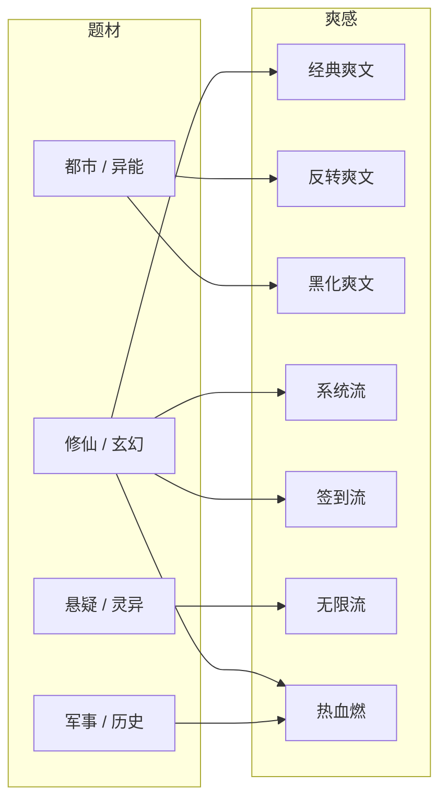
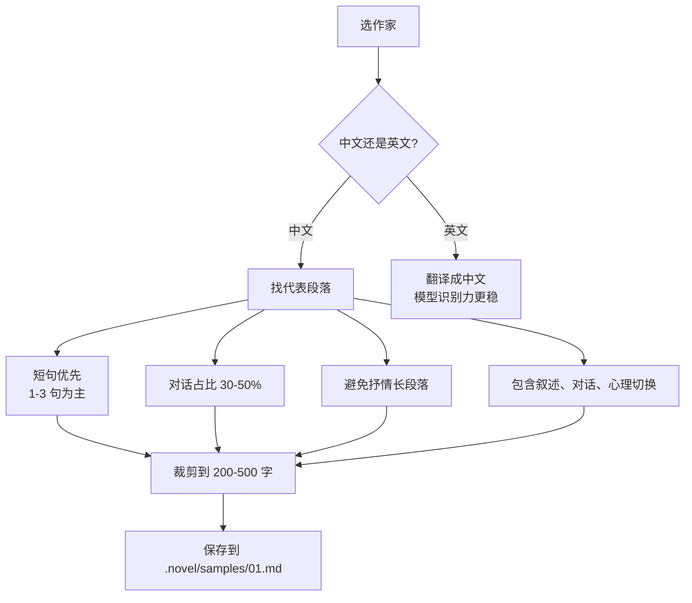
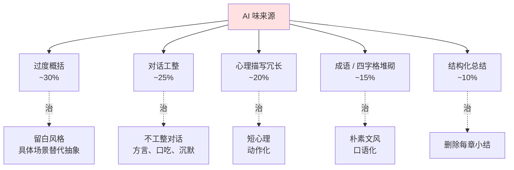
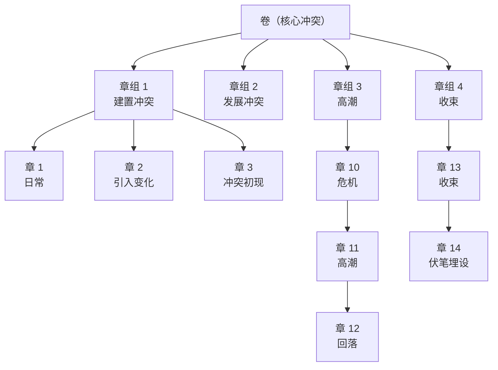
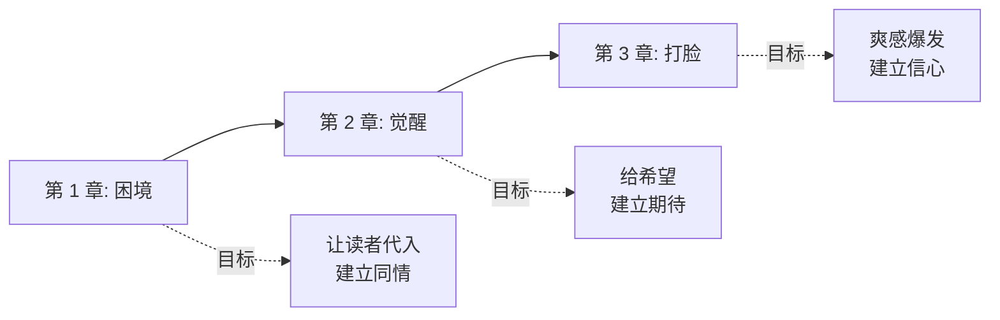
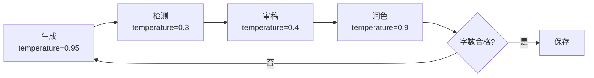
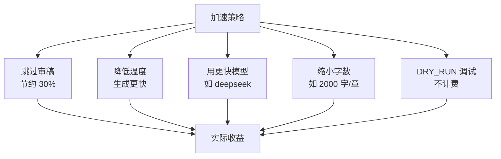
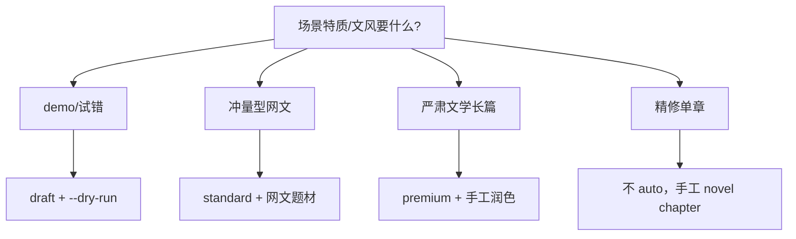

# 最佳实践（Best Practices）

novel-writer v0.11 的实战经验汇总：从作者视角讲怎么用工具写出更好的小说。

---

## 目录

1. [题材 × 文风搭配](#1-题材--文风搭配)
2. [samples 风格样本管理](#2-samples-风格样本管理)
3. [降 AI 味技巧](#3-降-ai-味技巧)
4. [长篇节奏控制](#4-长篇节奏控制)
5. [人设一致性](#5-人设一致性)
6. [多轮审稿策略](#6-多轮审稿策略)
7. [成本与速度平衡](#7-成本与速度平衡)
8. [常见场景配方](#8-常见场景配方)
9. [避坑清单](#9-避坑清单)

---

## 1. 题材 × 文风搭配

### 1.1 严肃向推荐组合

| 题材 | 推荐文风 | 作家参考 | 适合字数 |
|------|---------|---------|---------|
| 悬疑 | 冷峻 | 双雪涛、班宇 | 60-100K |
| 悬疑 | 紧张 | 阿加莎·克里斯蒂纳 | 80-120K |
| 现实 | 诗意 | 汪曾祺、沈从文 | 30-60K |
| 现实 | 朴素 | 余华、萧红 | 50-80K |
| 现实 | 黑色幽默 | 王小波 | 40-60K |
| 历史 | 朴素 | 陈忠实、莫言 | 100-200K |
| 言情 | 诗意 | 张爱玲、王安忆 | 40-60K |
| 言情 | 伤感 | 亦舒 | 30-50K |
| 武侠 | 朴素 | 金庸、古龙 | 100-200K |
| 校园 | 轻松 | 八月长安、九夜茴 | 30-50K |
| 校园 | 诗意 | 岩井俊二 | 40-60K |
| 都市 | 黑色幽默 | 王朔、刘震云 | 50-80K |
| 都市 | 朴素 | 六六 | 60-100K |
| 科幻 | 朴素 | 刘慈欣、阿西莫夫 | 80-150K |
| 军事 | 紧张 | 都梁 | 100-200K |
| 玄幻 | 华丽 | 猫腻 | 200-500K |

### 1.2 网文推荐组合



| 题材 | 黄金文风 | 关键节奏 |
|------|---------|---------|
| 修仙 | 经典爽文 + 系统流 | 升级 + 打脸 + 地图跃迁 |
| 都市 | 反转爽文 | 装逼打脸 + 身份翻转 |
| 悬疑 | 黑化爽文 | 反派智商在线 |
| 军事 | 热血燃 | 战场升级 + 民族气节 |

---

## 2. samples 风格样本管理

### 2.1 选样的标准



### 2.2 推荐样本结构

每个样本文件应包含：

1. **环境描写**（100 字内）：一两句铺垫氛围
2. **对话 / 动作**（200 字）：人物互动
3. **心理 / 内独白**（100 字）：内心变化

```markdown
<!-- samples/01.md 示例（双雪涛风格）-->

雪是从中午开始下的。先是稀稀拉拉几片，像谁撕了作业本扔下来。
后来就密了，风把雪斜着吹，贴在窗子上化掉，再冻成冰。

"妈，我饿了。"
母亲没回头，还在搓苞米面。手冻得通红，手指头裂开的口子渗着血。
"等会儿，"她说。

<!-- samples/02.md 示例（汪曾祺风格）-->

他的菊花开的时候，全院的人都来看。
不是来看花，是来看他。
他已经九十一了，每天还是自己浇花、自己搬凳子、自己端茶。
有人问他长寿的秘诀，他说是吃饭。
"吃饭？"那人笑了。
"嗯，"他说，"每顿都吃八分饱。"

<!-- samples/03.md 示例（金庸风格）-->

郭靖一怔，待要辩驳，黄蓉已抢在前面：
"靖哥哥，别理他！"
黄蓉这一声叫得又脆又急，欧阳锋竟微微一愣。
他冷冷一笑："黄家丫头，倒有几分胆色。"
说着，一掌拍出。
```

### 2.3 样本的负面影响（避坑）

❌ **不要放**：
- AI 味重的段落（作者风格 vs AI 风格）
- 翻译腔重的英文段落
- 段落太短（< 100 字）
- 段落太长（> 2000 字）

✅ **应该放**：
- 真实发表过的作家作品片段
- 你最欣赏的 3-5 个代表段落
- 风格统一（不要混搭 5 个作家）

---

## 3. 降 AI 味技巧

### 3.1 AI 味的来源（按权重）



### 3.2 具体技巧

#### A. 删抽象，加具体

❌ AI：
> 他感到一种说不清的情绪涌上心头。

✅ 作家：
> 他把烟头摁灭在窗台上，又点了一根。

#### B. 删工整对话，加口吃

❌ AI：
> "你怎么能这样对我？"她质问。
> "我没有别的选择，"他回答，"我也是身不由己。"

✅ 作家：
> "你……"她张了张嘴。
> 他没说话，把脸别过去。
> "问你话呢。"
> 他还是不说话。

#### C. 用沉默代替心理

❌ AI：
> 她的内心充满了矛盾和挣扎。一方面她理解他的难处，另一方面她又感到深深的失望和被背叛的痛苦。

✅ 作家：
> 她没说话。
> 她把茶杯端起来，又放下。
> 放下的动作比端起时重了一点。

#### D. 用动作代替成语

❌ AI：
> 他怒不可遏，暴跳如雷。

✅ 作家：
> 他的脸涨得通红，拳头攥得咯咯响。

#### E. 章节末尾不总结

❌ AI（章节末尾）：
> 这一夜，注定是一个不平凡的夜晚。她不知道，命运的齿轮已经开始转动。

✅ 作家（章节末尾）：
> 她关了灯，躺下来。
> 窗外的风刮得勤了一点点。
> 她没听见。

---

## 4. 长篇节奏控制

### 4.1 卷-章-节 三层节奏



### 4.2 黄金三章（网文专项）



具体配方（以修仙文为例）：

| 章 | 主角处境 | 关键事件 | 字数 |
|----|---------|---------|------|
| 1 | 凡人，受人欺压 | 家族试炼失败，被退婚 | 3000 |
| 2 | 绝境，偶得玉佩 | 玉佩鉴定为上古残宝 | 3000 |
| 3 | 第一次装逼 | 退婚当日打脸未婚妻家族 | 2000 |

### 4.3 长篇节奏检查表

每写 10 章后问自己：

- [ ] 主线有没有往前走？（不要原地打转）
- [ ] 主角有没有变化？（人物弧线）
- [ ] 有没有新角色出场？多少？（< 30% 篇幅新人物）
- [ ] 有没有回收之前的伏笔？
- [ ] 这一卷的核心冲突推进了几步？
- [ ] 字数密度是否稳定？（不要某章 5000 字、某章 1500 字）

---

## 5. 人设一致性

### 5.1 人物档案模板

```markdown
<!-- 写进 characters.md -->

### 陈小军
**年龄**：17 岁
**籍贯**：沈阳
**家庭**：父亲早逝，母亲摆摊卖早点
**性格**：
  - 外冷内热
  - 话少，但一开口就扎人
  - 关键时候不动声色
**说话习惯**：
- 短句，从不超过十个字
- 沈阳口音，"咋整"、"嘎哈"
- 紧张时会重复对方最后一个字
**动作特征**：
- 双手插兜
- 思考时揉后脑勺
- 紧张时把打火机翻来翻去
**核心动机**：找到真相，报杀父之仇
**人物弧线**：
- 起点（第 1 章）：冷漠，只为自己活
- 中段（第 20 章）：开始信任朋友
- 终章（第 60 章）：愿意为他人牺牲
```

### 5.2 防止人名漂移

```bash
# 写完一章后立刻检查
novel check

# 或自定义检查
grep "陈小军\|霍小军\|程小军" .novel/chapters/*.md
```

`novel check` 会自动报告：
- 人物名字在不同章节的不同写法
- 时间前后矛盾
- 地点变更不连贯
- 物品出现 / 消失异常

### 5.3 防止性格漂移

每章 prompt 自动包含 `arcs/_overview.md`，记录每个主角当前性格。

#### L1：起点 → L2：中段 → L3：当前 → L4：下一卷预计

如果发现模型让主角性格突变：
```bash
# 用 chat 改回
novel chat 5 '陈小军在第 3 章对小红笑了又握手，不符合他的人设。<br/>他的设定是"外冷内热但不会主动示人"，改回他只点头、把脸别过去。'
```

---

## 6. 多轮审稿策略

### 6.1 默认迭代的工作流



### 6.2 何时关闭审稿？

| 场景 | 建议 |
|------|------|
| 写大纲 / 人物志 | 关闭（不需要**逐字稿**） |
| 第一遍快速出 | 关闭 |
| 关键章节精修 | 默认开 |
| 校对 / 修改 | 默认开 |

```bash
# 关闭审稿
novel chapter 5 --no-polish --iters 1
```

### 6.3 自定义审稿重点

```bash
# 通过 --extra 给审稿加方向
novel polish 5 --extra "本章节是高潮，需要加强小红和陈小军的对手戏<br/>心理描写要克制，不能直接说'她感到心动'"

# 多次审稿：先粗后细
novel polish 5 --extra "重点解决人物名字漂移"
novel polish 5 --extra "重点解决对话过于工整"
novel polish 5 --extra "重点解决心理描写过长"
```

---

## 7. 成本与速度平衡

### 7.1 成本估算

| 模型 | 价格（每千字） | 20 万字小成本 |
|------|--------------|--------------|
| minimax-Text-01 | ¥0.01-0.03 | ¥3-6 |
| minimax-M3 | ¥0.05-0.10 | ¥10-20 |
| gpt-4o | $0.05 | $10 |
| DeepSeek | ¥0.001 | ¥0.2 |

### 7.2 加速技巧



### 7.2.1 预算控制（novel auto --budget）

`novel auto` 会**实时显示**累计 token 和估算成本：

```bash
novel auto my_novel --budget 5.00 --words 200000
```

剩余 < 30% 时自动降级到 draft；剩余 < 60% 时降级到 standard；超出则用最便宜的 draft 跑完。

| 模型 | 价格（¥/1M input + output）| 20 万字成本估算 |
|---|---|---|
| minimax-Text-01 | 1.0 + 1.0 | ~¥2-3 |
| minimax-M3 | 1.0 + 1.0 | ~¥3-5 |
| deepseek-chat | 1.0 + 2.0 | ~¥3-5 |
| gpt-4o | 18.0 + 72.0 | ~¥30-50 |
| claude-3-sonnet | 21.6 + 108.0 | ~¥40-70 |

### 7.3 实战配方

#### 配 A：质量型（推荐）
- 模型：`minimax-M3`
- temperature: 0.95（生成）/ 0.3（检测）
- 字数：3000
- 审稿：默认开
- 速度：~2 分钟/章
- 成本：~¥15/20 万字

#### 配 B：速度型（赶稿用）
- 模型：`deepseek-chat`
- temperature: 0.9
- 字数：2500
- 审稿：单轮
- 速度：~30 秒/章
- 成本：~¥0.5/20 万字

#### 配 C：成本型（写废稿）
- 模型：`qwen-turbo`
- temperature: 0.85
- 字数：2000
- 审稿：关闭
- 速度：~20 秒/章
- 成本：~¥0.2/20 万字

---

## 8. 常见场景配方

### 场景 1：致敬双雪涛的东北短篇

```bash
# 准备
mkdir -p /tmp/novels/jiushi/samples
# 找 2-3 段双雪涛文字（200-500 字 / 段）放到 samples/

# 创建项目
novel init jiushi \
  --title "盘锦往事" \
  --theme "1995 年东北小镇命案，三个少年的二十年" \
  --genre 悬疑 --style 冷峻 --words 80000

cd jiushi

# 写规划
novel outline
novel characters
# 编辑 characters.md，确保每个主角的说话习惯、动作特征都写清楚

# 写
novel chapter 1 --extra "开篇要有雪，第一章以主角的下班路上开始"
```

### 场景 2：致敬汪曾祺的江南短篇

```bash
novel init jiangan \
  --title "受戒新编" \
  --theme "江南水乡的小和尚和邻家女孩" \
  --genre 现实 --style 诗意 --words 40000

cd jiangan

# 在 samples/ 里放汪曾祺《受戒》的片段
# 短句、留白、淡墨

novel outline --extra "汪曾祺风格，场景先于心理，对话要淡"
```

### 场景 3：写修仙网文

```bash
novel webnovel-pack fanren \
  --title "凡人修仙传之玉佩觉醒" \
  --theme "凡人韩立的逆袭修仙路" \
  --genre 修仙 --style 经典爽文 \
  --idea "金手指：残破玉佩，藏有上古残魂 + 升级指南"

cd fanren

# 网文黄金三章
novel chapter 1 --extra "开篇困境：主角被退婚当众羞辱"
novel chapter 2 --extra "觉醒：金手指出现，鉴定为上古残宝"
novel chapter 3 --extra "打脸：退婚当日让对方丢尽颜面"

# 后续（v0.12 推荐用 novel write 一行写完）
novel write demo --title "..." --genre 修仙 --style 经典爽文 --words 50000
```

### 场景 4：改编高热度小说

```bash
# 准备源小说信息
cat > source.txt << 'EOF'
《白夜行》东野圭吾
1973-2001 年，东京。
1973 年: 桐原亮司与西本文代之子在废弃大楼命案
西本文代之女雪穗借机接近桐原亮司
两人走上共生：雪穗活在光明面，亮司活在阴影面
22 年: 两人持续通过血腥损害（获得）地位
雪穗成为一流设计师，亮司成为黑客
最后亮司为保护雪穗用剪刀自杀
雪穗"不认识"亮司
EOF

# 改编为校园 + 冷峻
novel adapt --source source.txt \
  --direction 换名+换壳 \
  --genre 校园 --style 冷峻 \
  --title 夜行

# 用改编方案写
cat .novel/adapt.md  # 检查方案
novel outline --extra "基于改编方案：22 年跨度，校园到校园"
```

---

## 9. 避坑清单

### 9.1 提示词层

| 错误 | 替代 |
|------|------|
| 让模型 "模仿某作家风格" | 用具体段落（避免笼统） |
| 用温度 1.5 | 用 0.9-0.95（再高就乱） |
| 让模型直接写"小说" | 让模型写"本章正文"，避免元说明 |

### 9.2 工作流层

| 错误 | 替代 |
|------|------|
| 一上来就写 100 章 | 先用 3 章试风格 |
| 跳过大纲直接写章节 | 大纲是模型的"路线图" |
| 跳过人物志 | 人物要写到 5+ 维度 |
| 改了一章风格就推大改 | 先测 3 章 |

### 9.3 数据层

| 错误 | 替代 |
|------|------|
| 让 samples/ 放过多文件 | 控制在 1-3 段 |
| 让模型名字完全自由 | 在 characters.md 统一 |
| 不写人物档案 | 写 5+ 维度档案 |
| 用一个目录写多本书 | 一本一目录 |

### 9.4 工具层

| 错误 | 替代 |
|------|------|
| 直接删除 chapter 文件 | 用 `novel rollback --to` |
| 手动改 .novel/chapters/*.md | 用 `novel chat N '指令'` |
| 跳过 doctor | 定期 `novel doctor` |
| 跳过审计 | 写完一卷后 `novel audit` |

### 9.5 性能层

| 错误 | 替代 |
|------|------|
| 一次写 50 章 | 每次 sprint 10 章 |
| chapter 字数 5000+ | 减到 2500-3000 |
| 模型频繁切换 | 一种用到底 |

---

## 10. 进阶技巧

### 10.1 多本书串联（共享人物）

通过 git submodule 共享 `.novel/characters.md`：

```
series/
├── .gitmodules         # submodule 配置
├── 灵瓶/
│   └── .novel/
│       └── characters.md   # 软链接 → ../../../shared/characters.md
└── 夜行/
    └── .novel/
        └── characters.md   # 软链接 → ../../../shared/characters.md
```

### 10.2 接力续写（多作者合作）

```bash
# 作者 A 写完 1-10 章，提交
git commit -am "完成 1-10 章"

# 作者 B 拉代码后
cd my_novel
git pull
novel chapter 11  # 自动加载前文，无需交接

# 作者 B 写完 11-15 章，提交
git commit -am "完成 11-15 章"
```

### 10.3 风格 A/B 测试

写同一段情节，用不同文风：

```bash
# 同一大纲 + 不同文风
novel chat 5 --style "冷峻" --no-save > v1.txt
novel chat 5 --style "诗意" --no-save > v2.txt
novel chat 5 --style "黑色幽默" --no-save > v3.txt

# 对比
diff v1.txt v2.txt
diff v1.txt v3.txt
```

### 10.4 写作日历

```bash
# 用 progress 命令跟踪
novel progress
# ┏━━━━━━━━━━━━━━━━━━┳━━━━━━━━━┓
# ┃ 指标             ┃ 值      ┃
# ┡━━━━━━━━━━━━━━━━━━╇━━━━━━━━━┩
# │ 目标总字数       │ 200K    │
# │ 已写章节         │ 35/70   │
# │ 已写字数         │ 102K    │
# │ 字数进度         │ 51.0%   │
# │ 当前卷           │ 第 2 卷 │
# │ 卷内进度         │ 12-25: 64%│
# │ 平均每章耗时     │ 2.3 分钟│
# │ 预计剩余         │ 80 分钟 │
# └──────────────────────────────┘
```

---

## 11. 全自动 vs 手工：什么时候用哪个

`novel auto` 提供 `draft / standard / premium` 三档质量档，覆盖大多数长篇场景。选哪个的关键是：质量优先还是速度优先？



| 场景 | 推荐 | 原因 |
|------|------|------|
| 100K 字网文冲量 | `novel auto --quality standard` | 量大，标准档足够 |
| 50K 字严肃文学 | `novel auto --quality premium` + 后期手工润色 | 质量门需要 radar ≥ 70 |
| 5K 字短篇 / 单章 | 手工 `novel chapter N --iters 3` | 全自动开销大于收益 |
| 写 demo / 试错大纲 | `novel auto --dry-run` | 不调 API，验流程 |
| 跑一半换文风 | `novel auto --fresh --style 新文风` | 重头跑覆盖成本高 |
| 50K 字已写 10K | `novel auto --resume` | 自动跳过已写章节 |
| 跨项目批量管理 | 手工 init + auto 各项目 | 每个项目独立跑 |

### 11. 何时别用 auto

| 场景 | 为什么 |
|------|------|
| 需要现场探索人设 | auto 会一次性生成人物志，之后想改需要重跑 |
| 章节需要反复推敲 | auto 只会按字数/雷达门控重写，不保证"中段突转" |
| 已写 50K 想加入新伏笔 | auto 难以理解中期追加伏笔，建议手工改大纲 |
| API key 试用期 | auto 会用大量 token，手工写 1-3 章可以控制 |

### 11.2 全自动常见决策点

1. **预算紧张**：`--budget 0.50`；超额后自动降级到 draft
2. **想要快但质量还行**：`--quality standard` + `--chapters 20`
3. **精修档卡住怎么办**：检查 `.novel/reports/detect_NNNN.md` 看哪章 AI 味高；用 `novel chat N '指令'` 手动改
4. **状态文件损坏**：用 `cat .novel/auto_state.json` 检查；删掉 `auto_state.json` 后 `--fresh` 重头

---

## 附录 A：常见错误快速排查

| 错误现象 | 原因 | 解决 |
|---------|------|------|
| 章节字数 0 | think 标签吃满 max_tokens | `novel retry-stuck` |
| 人名漂移 | 长篇遗忘 | 用 `novel check`，写作时看 `arcs/_overview.md` |
| 风格突然变 | 文风预设没注入 | 检查 `.novel/style.md` 是否有内容 |
| API 调用超时 | prompt 过长 / 网络 | 减少 `TARGET_CHAPTER_WORDS` 或换网络 |
| 模型拒绝 | 安全审核 | 改写主题或章节大纲 |

## 附录 B：相关文档

- [REQUIREMENTS.md](REQUIREMENTS.md) - 需求规格
- [DESIGN.md](DESIGN.md) - 设计文档
- [USER_MANUAL.md](USER_MANUAL.md) - 用户手册
- [PROGRESS.md](../PROGRESS.md) - 演进日志
- [CHANGELOG.md](../CHANGELOG.md) - 版本日志
- [CONTRIBUTING.md](../CONTRIBUTING.md) - 贡献指南