# 设计文档（Design）

novel-writer v0.11 的架构设计说明，含架构图、数据流图、关键决策。

---

## 1. 总体架构

### 1.1 分层视图

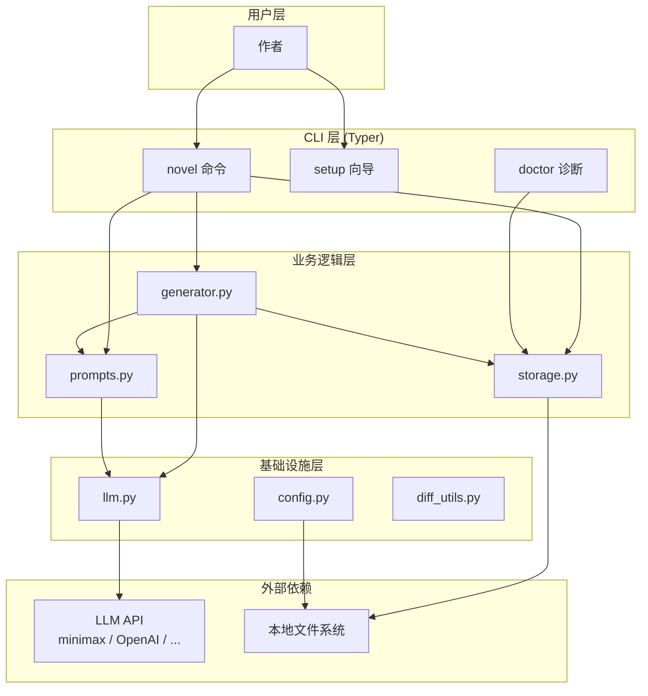

### 1.2 模块依赖矩阵

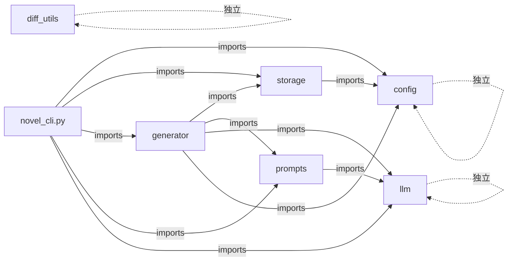

**关键约束**：依赖单向、不形成环。`config` 和 `llm` 是叶子模块。

---

## 2. 数据模型

### 2.1 项目结构

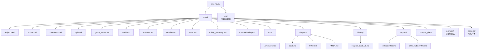

### 2.2 元数据流（每章写完）

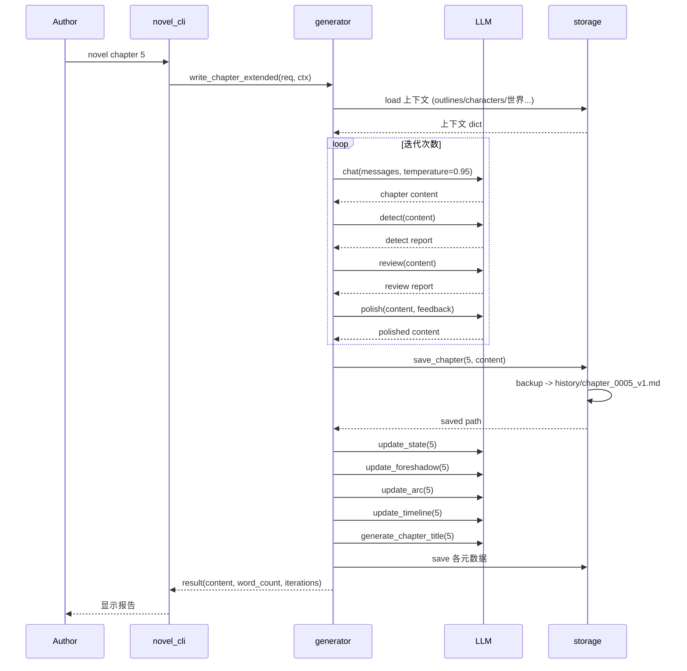

---

## 3. 长篇一致性机制

### 3.1 五种"长期记忆"

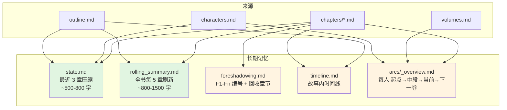

### 3.2 记忆的传递

每章 prompt 注入的"上下文"由七部分组成：

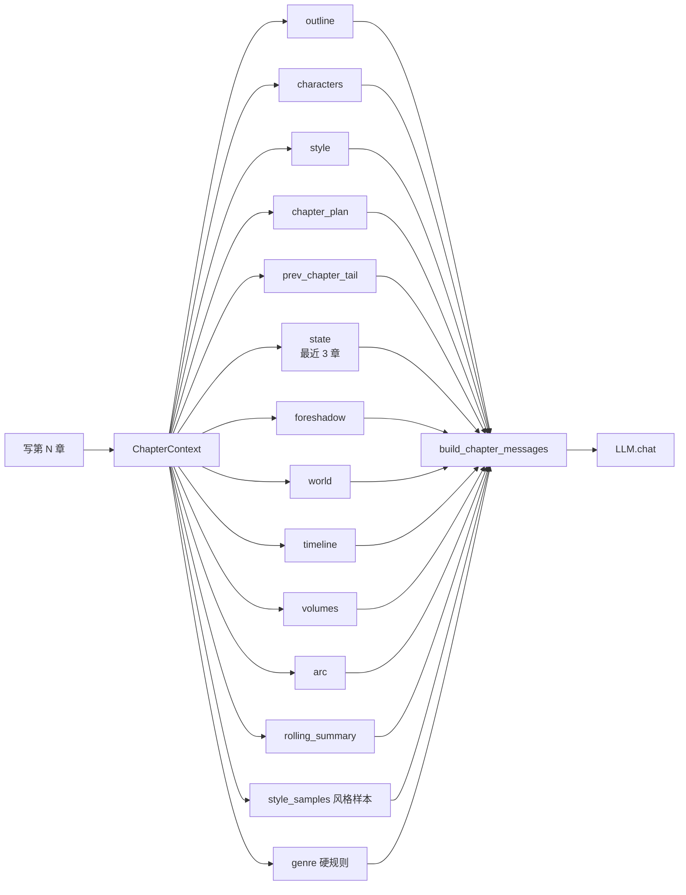

---

## 4. LLM 适配层

### 4.1 think 标签剥离（三层兜底）

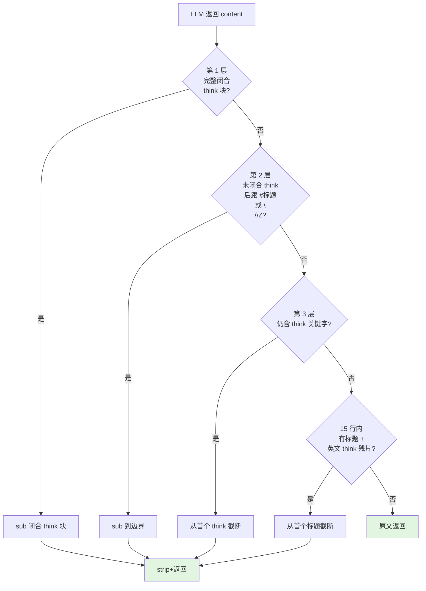

**为什么需要 4 层？**
- 第 1 层：处理标准的 `<think>...</think>`
- 第 2 层：处理被 max_tokens 截断的 think 块（带 `\n\n##` 边界）
- 第 3 层：兜底任何残余 `<think>` 关键字
- 第 4 层：处理英文 think 残片（"OK so let me..."）

### 4.2 chat_with_continuation 自动续写

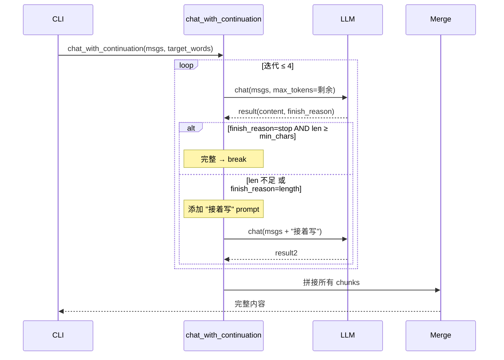

**关键参数**：
- `min_chars = max(200, target_words * 0.6)`：动态阈值（替代固定 800）
- `max_total_tokens=30000`：4 次迭代的上限
- 每次 `max_tokens = min(剩余预算, 16000)`

---

## 5. 提示词系统

### 5.1 三层提示词

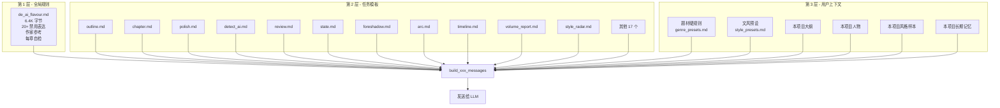

### 5.2 题材 / 文风匹配流程

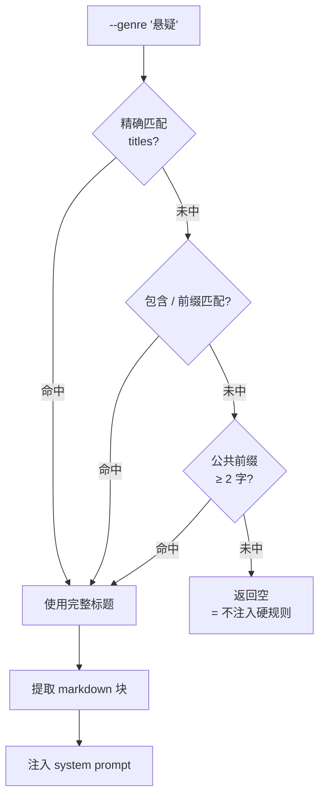

---

## 6. 命令路由

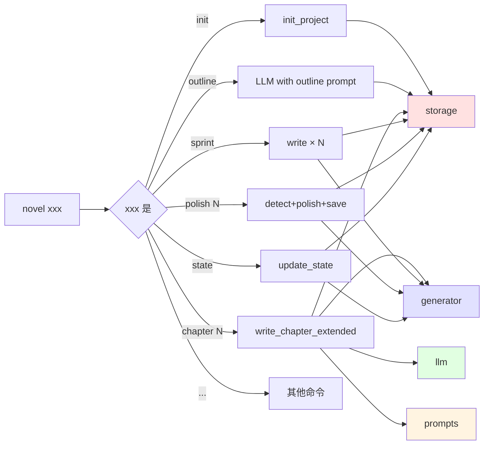

---

## 7. 改编工作流

### 7.1 adapt 命令的两步流程

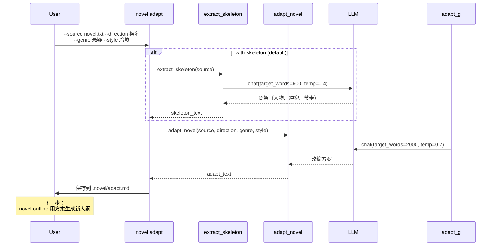

### 7.3 webnovel-pack 一键流程

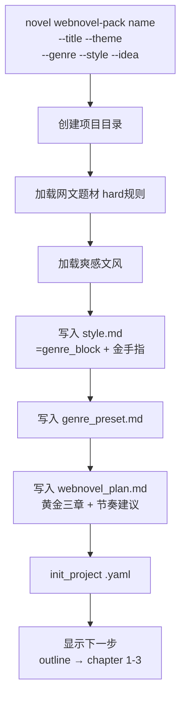

---

## 8. 状态管理

### 8.1 自动维护触发

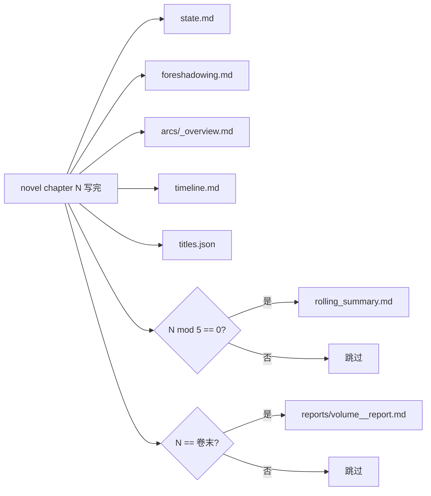

### 8.2 伏笔簿（F1-Fn 编号）

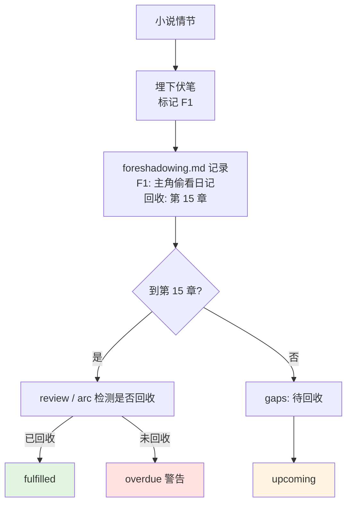

---

## 9. 异常处理

### 9.1 API 失败重试

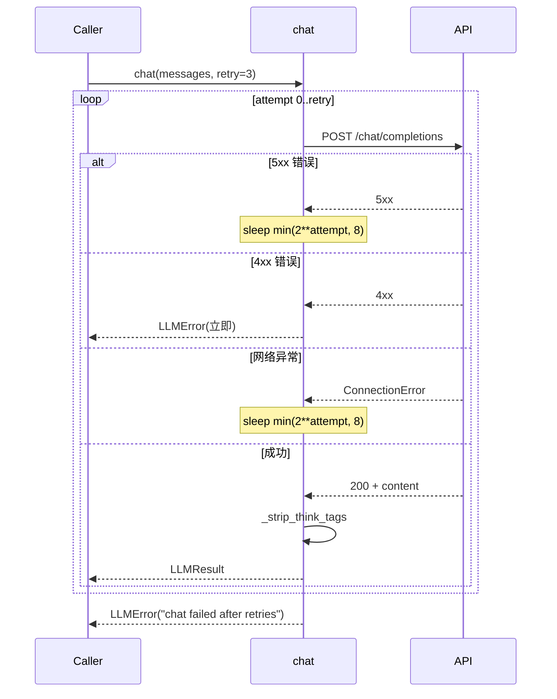

### 9.2 章节残片兜底

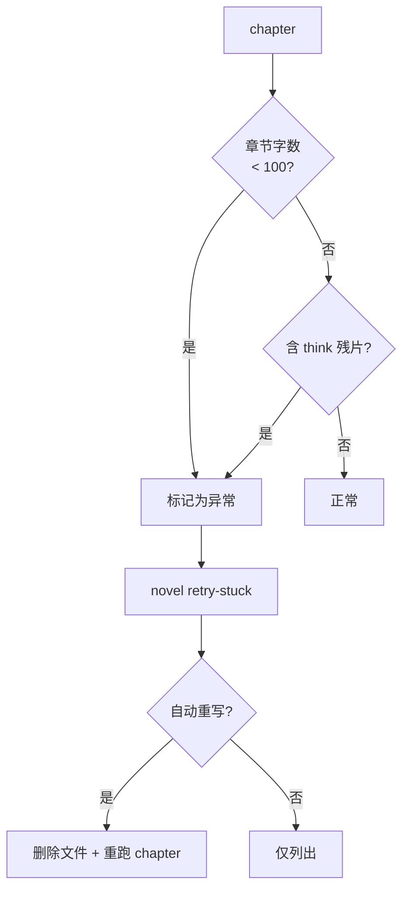

---

## 10. 关键设计决策

### 10.1 提示词即产品

| 决策 | 原因 |
|------|------|
| 提示词外置到 `prompts/*.md` | 作者可改、可版本化、可对比 |
| `@lru_cache` 加载 | 避免重复读盘 |
| 不用 f-string 模板 | 减少 LLM 端的不确定性 |

### 10.2 减法优于加法

| 决策 | 原因 |
|------|------|
| `de_ai_flavour.md` 列出 20+ 禁用表达 | 比"教怎么写"更有效 |
| 6 维度雷达量化 | 把"AI 味"从主观变成可测量 |
| 多轮审稿迭代 | 让模型能自我修正 |

### 10.3 长篇需要长期记忆

| 决策 | 原因 |
|------|------|
| state（最近 3 章）+ rolling（每 5 章）| 双层记忆，平衡细节与全局 |
| foreshadow 编号 F1-Fn | 模型可主动埋设和回收 |
| arc（人物弧线）| 长期人物变化 |
| 自动维护而非手动 | 作者不写元数据 |

### 10.4 兼容任意 OpenAI 协议

| 决策 | 原因 |
|------|------|
| 不绑定特定供应商 | minimax / OpenAI / DeepSeek / 通义 都可用 |
| DRY_RUN 模式 | 调试提示词不需要 API |
| 项目级 `.env` | 覆盖全局配置 |

---

## 11. 性能与可扩展性

### 11.1 性能瓶颈与对策

| 瓶颈 | 对策 |
|---|---|
| 单章 LLM 调用 ~30 秒 | 多章并发（TODO） |
| 长 prompt 20K tokens | 拆分摘要、自动剪枝 |
| max_tokens 截断 | chat_with_continuation 续写 |
| think 残片 | 三层兜底 |

### 11.2 可扩展点

| 扩展 | 实现 |
|---|---|
| 新增题材 | `prompts/genre_presets.md` 加 `# 标题` 段落 |
| 新增文风 | `prompts/style_presets.md` 加 `# 标题` 段落 |
| 新增提示词 | `prompts/<name>.md` + `prompts.py` 加 `lru_cache` |
| 新增命令 | `novel_cli.py` 加 `@app.command()` |
| 新增 LLM | 修改 `OPENAI_BASE_URL` 即可 |
| 新增风格雷达维度 | `style_radar.md` 加评估项 |

---

## 12. 安全与隐私

| 风险 | 对策 |
|---|---|
| API key 明文 | `.env` 在 `.gitignore` |
| API key 打印 | `masked()` 隐藏前 4 + 后 3 |
| 提示词泄露 | prompts/ 是公开 markdown |
| 数据丢失 | `save_chapter` 自动备份 |
| 误删章节 | `novel rollback --to vN` |

---

## 附录 A：相关文档

- [REQUIREMENTS.md](REQUIREMENTS.md) - 需求规格
- [USER_MANUAL.md](USER_MANUAL.md) - 用户手册
- [BEST_PRACTICES.md](BEST_PRACTICES.md) - 最佳实践
- [PROGRESS.md](../PROGRESS.md) - 演进日志
- [CHANGELOG.md](../CHANGELOG.md) - 版本日志
- [CONTRIBUTING.md](../CONTRIBUTING.md) - 贡献指南