# 设计文档（Design）

novel-writer v0.12 的架构设计说明，含架构图、数据流图、关键决策。

> **v0.12 定位修订**：从「AI 辅助创作工具」转向「**给定输入自动写完整本书**」。  
> 两种工作流（需求驱动 / 模仿驱动）收敛为统一 `novel write` 顶层入口；删除了 5 个被 auto 流水线完全替代的命令。详见 [§13. v0.12 输入驱动架构](#13-v012-输入驱动架构)。

---

## 1. 总体架构

### 1.1 分层视图

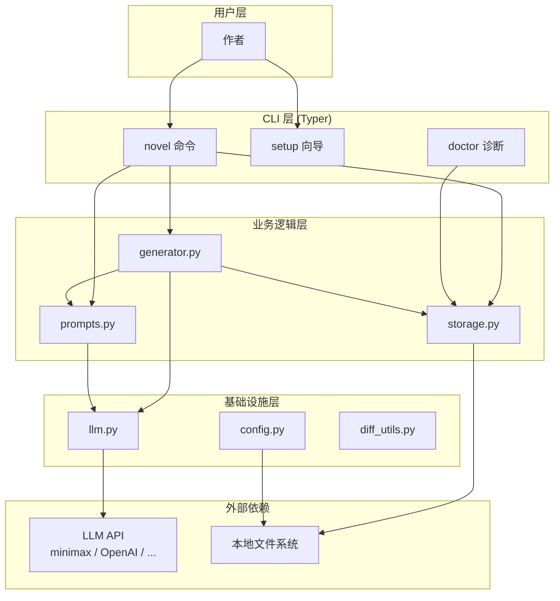

### 1.2 模块依赖矩阵

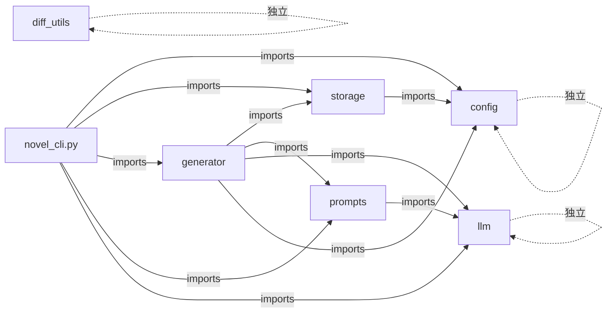

**关键约束**：依赖单向、不形成环。`config` 和 `llm` 是叶子模块。

---

## 2. 数据模型

### 2.1 项目结构

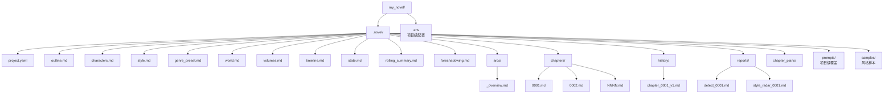

### 2.2 元数据流（每章写完）

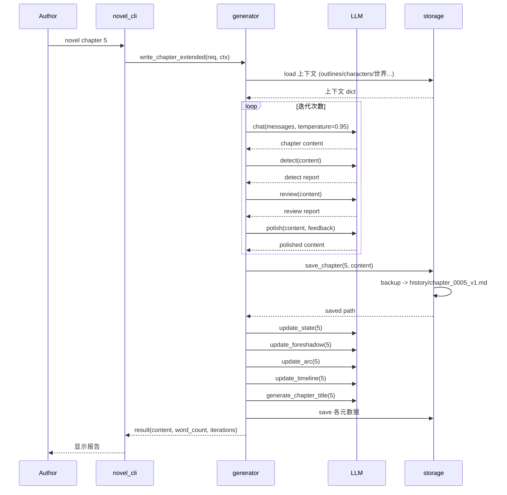

---

## 3. 长篇一致性机制

### 3.1 五种"长期记忆"

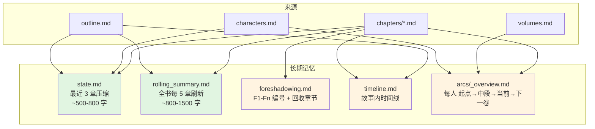

### 3.2 记忆的传递

每章 prompt 注入的"上下文"由七部分组成：

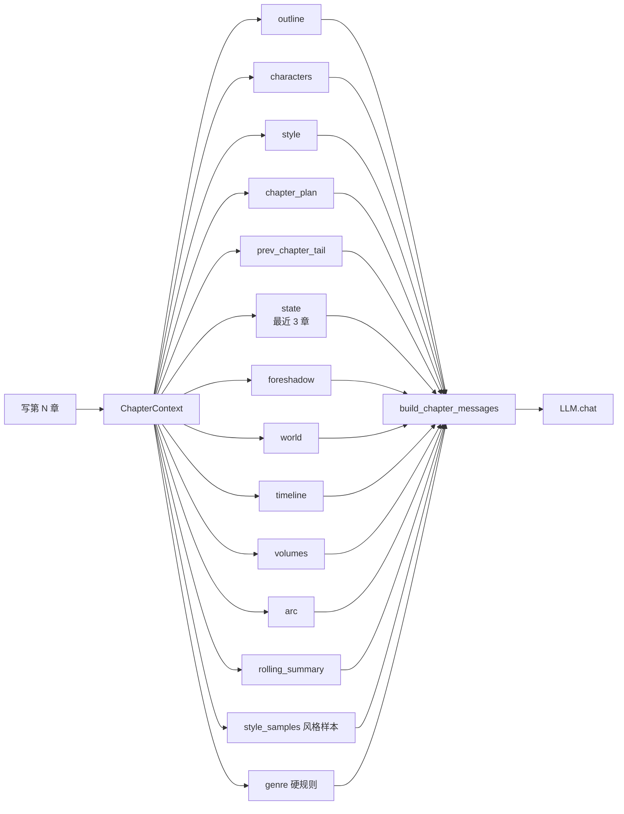

---

## 4. LLM 适配层

### 4.1 think 标签剥离（三层兜底）

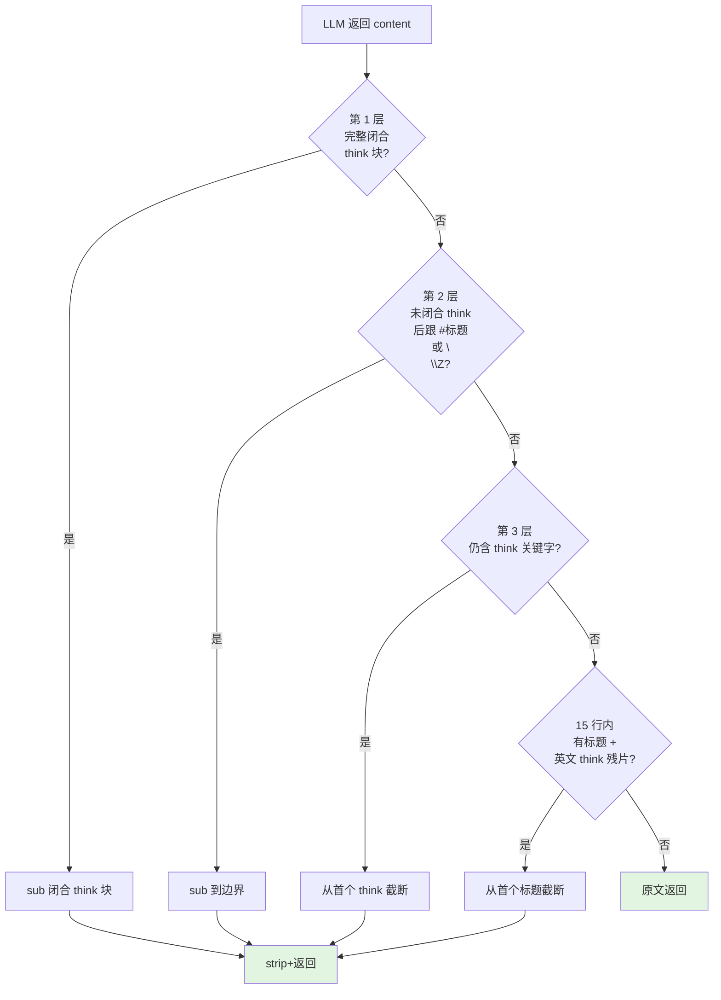

**为什么需要 4 层？**
- 第 1 层：处理标准的 `<think>...</think>`
- 第 2 层：处理被 max_tokens 截断的 think 块（带 `\n\n##` 边界）
- 第 3 层：兜底任何残余 `<think>` 关键字
- 第 4 层：处理英文 think 残片（"OK so let me..."）

### 4.2 chat_with_continuation 自动续写

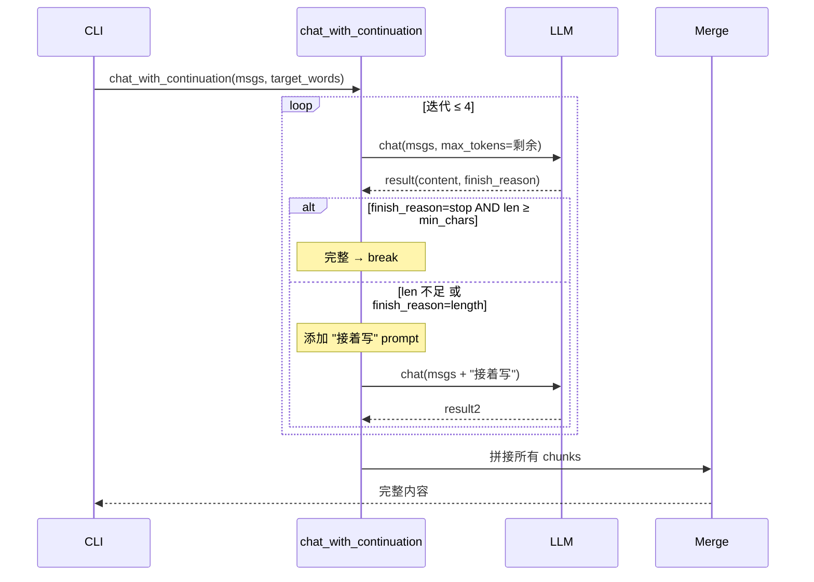

**关键参数**：
- `min_chars = max(200, target_words * 0.6)`：动态阈值（替代固定 800）
- `max_total_tokens=30000`：4 次迭代的上限
- 每次 `max_tokens = min(剩余预算, 16000)`

---

## 5. 提示词系统

### 5.1 三层提示词

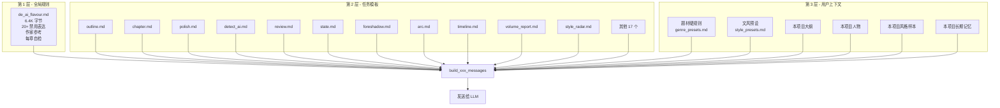

### 5.2 题材 / 文风匹配流程

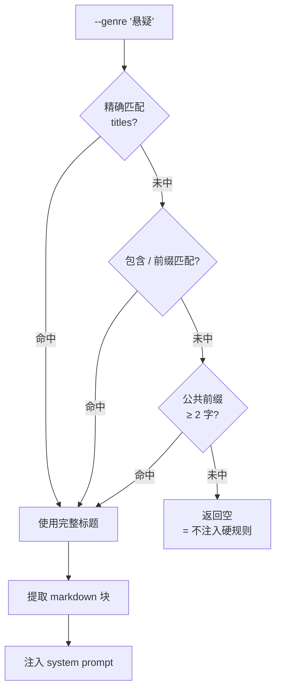

---

## 6. 命令路由

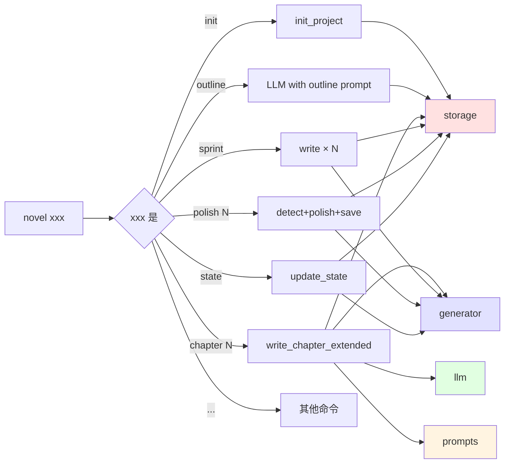

---

## 7. 改编工作流

### 7.1 adapt 命令的两步流程

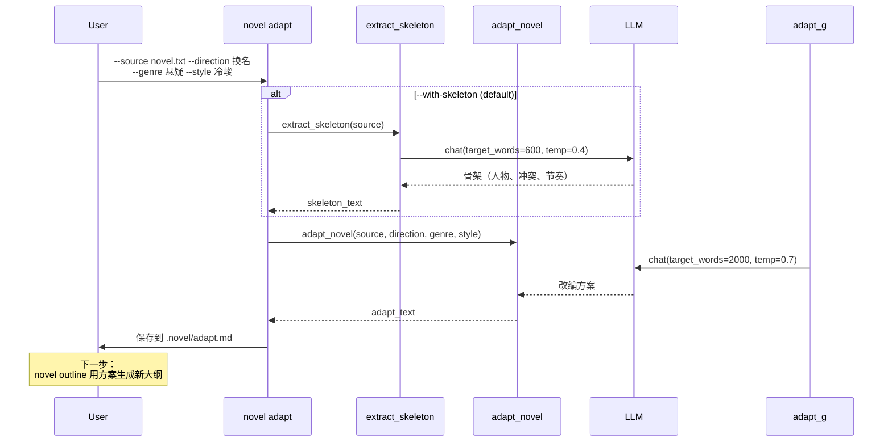

### 7.3 webnovel-pack 一键流程

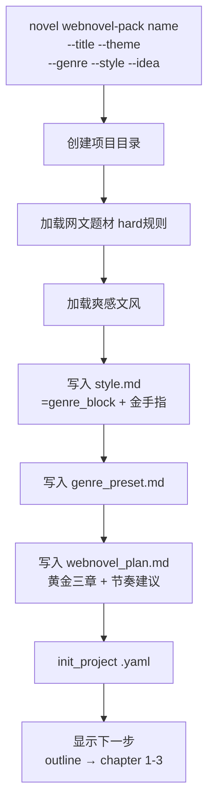

---

## 8. 状态管理

### 8.1 自动维护触发

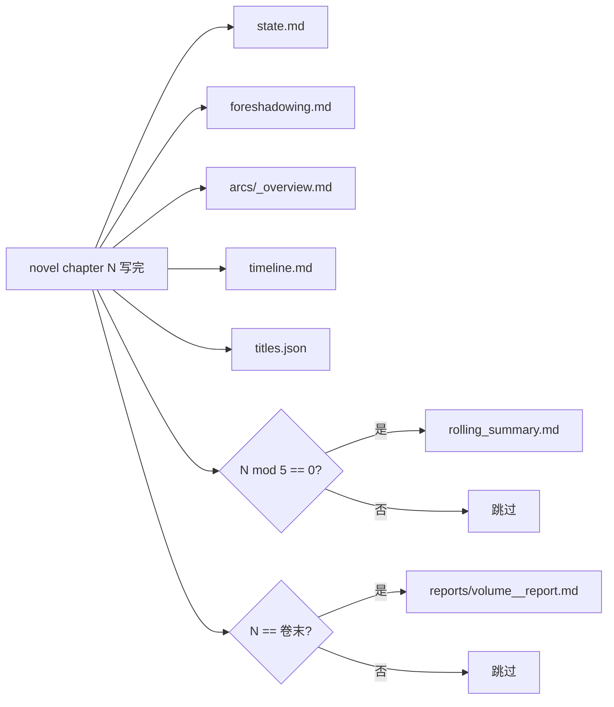

### 8.2 伏笔簿（F1-Fn 编号）

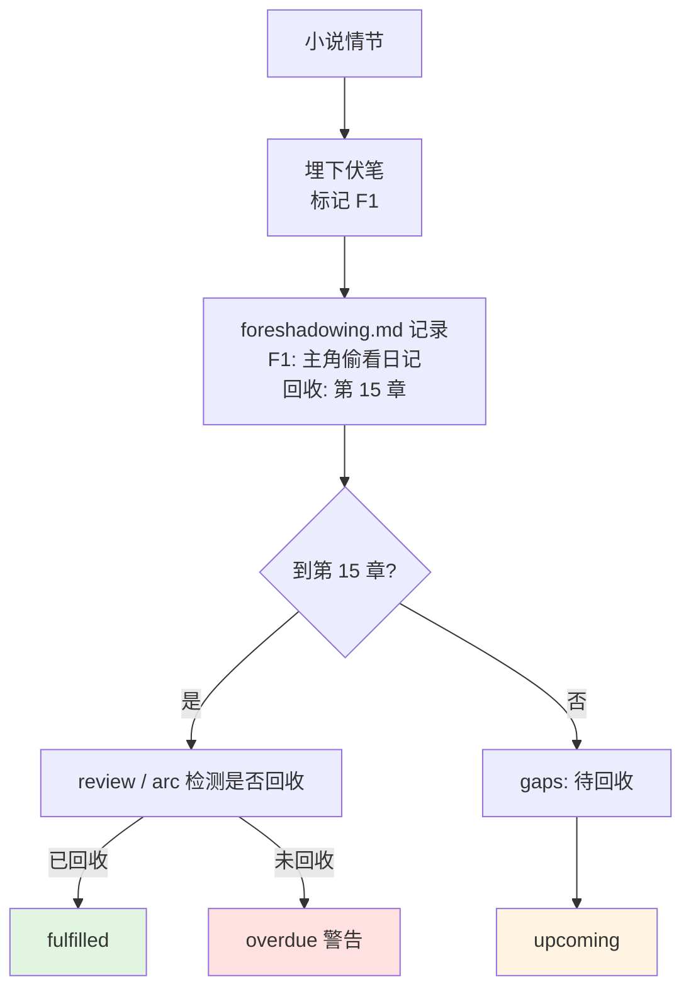

---

## 9. 异常处理

### 9.1 API 失败重试

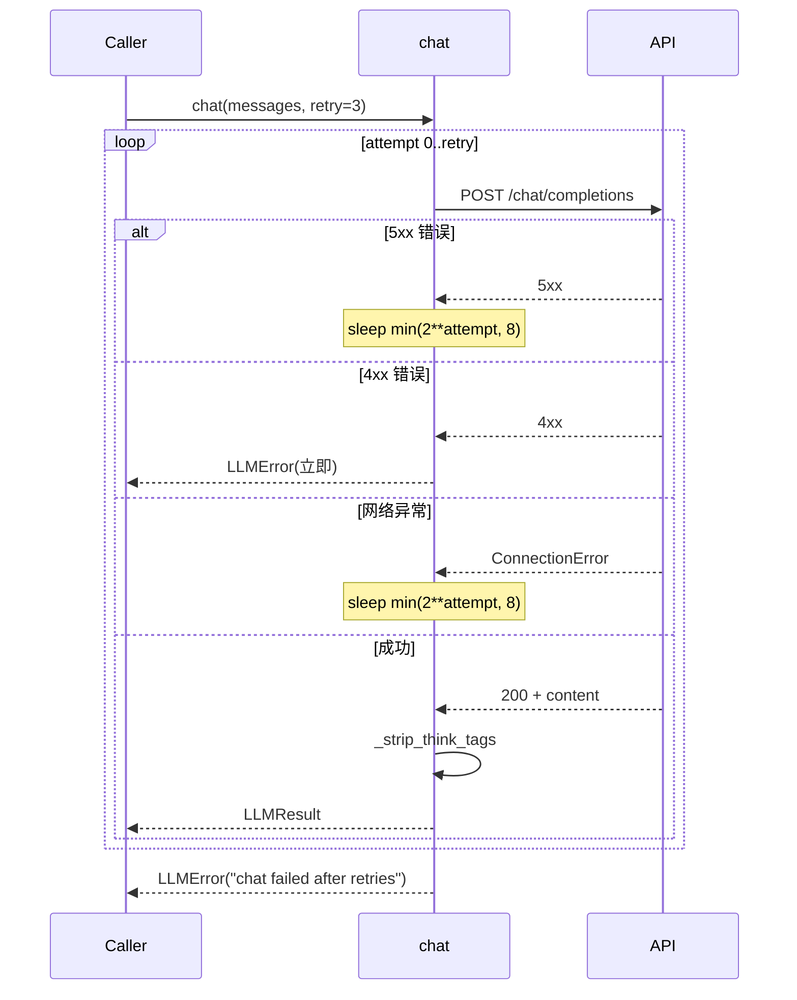

### 9.2 章节残片兜底

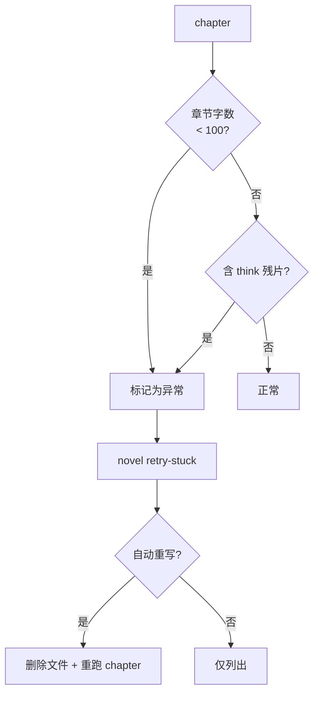

---

## 10. 关键设计决策

### 10.1 提示词即产品

| 决策 | 原因 |
|------|------|
| 提示词外置到 `prompts/*.md` | 作者可改、可版本化、可对比 |
| `@lru_cache` 加载 | 避免重复读盘 |
| 不用 f-string 模板 | 减少 LLM 端的不确定性 |

### 10.2 减法优于加法

| 决策 | 原因 |
|------|------|
| `de_ai_flavour.md` 列出 20+ 禁用表达 | 比"教怎么写"更有效 |
| 6 维度雷达量化 | 把"AI 味"从主观变成可测量 |
| 多轮审稿迭代 | 让模型能自我修正 |

### 10.3 长篇需要长期记忆

| 决策 | 原因 |
|------|------|
| state（最近 3 章）+ rolling（每 5 章）| 双层记忆，平衡细节与全局 |
| foreshadow 编号 F1-Fn | 模型可主动埋设和回收 |
| arc（人物弧线）| 长期人物变化 |
| 自动维护而非手动 | 作者不写元数据 |

### 10.4 兼容任意 OpenAI 协议

| 决策 | 原因 |
|------|------|
| 不绑定特定供应商 | minimax / OpenAI / DeepSeek / 通义 都可用 |
| DRY_RUN 模式 | 调试提示词不需要 API |
| 项目级 `.env` | 覆盖全局配置 |

---

## 11. 性能与可扩展性

### 11.1 性能瓶颈与对策

| 瓶颈 | 对策 |
|---|---|
| 单章 LLM 调用 ~30 秒 | 多章并发（TODO） |
| 长 prompt 20K tokens | 拆分摘要、自动剪枝 |
| max_tokens 截断 | chat_with_continuation 续写 |
| think 残片 | 三层兜底 |

### 11.2 可扩展点

| 扩展 | 实现 |
|---|---|
| 新增题材 | `prompts/genre_presets.md` 加 `# 标题` 段落 |
| 新增文风 | `prompts/style_presets.md` 加 `# 标题` 段落 |
| 新增提示词 | `prompts/<name>.md` + `prompts.py` 加 `lru_cache` |
| 新增命令 | `novel_cli.py` 加 `@app.command()` |
| 新增 LLM | 修改 `OPENAI_BASE_URL` 即可 |
| 新增风格雷达维度 | `style_radar.md` 加评估项 |

---

## 12. 安全与隐私

| 风险 | 对策 |
|---|---|
| API key 明文 | `.env` 在 `.gitignore` |
| API key 打印 | `masked()` 隐藏前 4 + 后 3 |
| 提示词泄露 | prompts/ 是公开 markdown |
| 数据丢失 | `save_chapter` 自动备份 |
| 误删章节 | `novel rollback --to vN` |

---

## 附录 A：相关文档

- [REQUIREMENTS.md](REQUIREMENTS.md) - 需求规格
- [USER_MANUAL.md](USER_MANUAL.md) - 用户手册
- [BEST_PRACTICES.md](BEST_PRACTICES.md) - 最佳实践
- [PROGRESS.md](../PROGRESS.md) - 演进日志
- [CHANGELOG.md](../CHANGELOG.md) - 版本日志

---

## 13. v0.12 输入驱动架构

### 13.1 定位变化

| | v0.11（之前） | v0.12（现在） |
|---|---|---|
| 项目定位 | AI 辅助创作工具 | 给定输入自动写完整本书 |
| 主入口 | `novel auto`（需求）/ `novel init + chapter N`（手动） | `novel write`（需求 + 模仿 + 网文 三个语义合一） |
| 手动介入 | 单章写、续写、改写频繁 | 仅在 auto 流水线结果上做局部微调 |
| 命令数 | 50 | 45（删 6 加 1） |

v0.11 把「规划 / 写作 / 润色 / 一致性 / 导出」拆成大量子命令留给用户逐步调用；
v0.12 把这些步骤收敛为 `run_auto_novel()` 的 6 阶段流水线，对外只暴露两个语义入口。

### 13.2 novel write 双分支数据流

```
┌────────────────────────────────────────────────────────────┐
│                       novel write                          │
│  (typer command, novel_cli.py:236)                         │
└────────────────────────┬───────────────────────────────────┘
                         │
              ┌──────────┴──────────┐
              │                     │
     --title 走需求驱动      --from-source 走模仿驱动
              │                     │
              ▼                     ▼
    init_project()         extract_skeleton(source)
    填 title/theme/genre   ─→ adapt_novel(source, direction,
    /style/words → spec              target_genre, target_style)
              │                     │
              │                     ├─→ 保存 .novel/adapt.md
              │                     ├─→ 预填 .novel/outline.md
              │                     └─→ init_project() + spec
              │                     │
              └──────────┬──────────┘
                         │
                         ▼
              run_auto_novel(spec, project_dir)
              ┌──────────────────────────────────────┐
              │ 阶段 1: PLANNING                    │
              │   outline / characters / world /     │
              │   volumes / chapter_plans            │
              │ 阶段 2: WRITING                     │
              │   _write_one_chapter ×N              │
              │ 阶段 3: POLISHING                   │
              │   batch polish + detect              │
              │ 阶段 4: CONSISTENCY                 │
              │   timeline / state / arcs            │
              │ 阶段 5: EXPORTING                   │
              │   book.md                           │
              └──────────────────────────────────────┘
```

### 13.3 模仿驱动的桥接

**问题**：`run_auto_novel()` 默认是「从零生成」的 6 阶段流水线。模仿驱动有现成的
「改编方案」文本，能否在 auto 里被消费？

**方案**：让 `_planning_phase()` 的产物文件存在性 + 大小检查（≥200 字节）天然跳过：

```python
# novel/auto.py:106
if not project.outline_path.exists() or project.outline_path.stat().st_size < 200:
    # regenerate
    ...
project.outline_path.write_text("# 大纲\n\n" + res.content + "\n", encoding="utf-8")
```

模仿驱动先调用 `extract_skeleton` + `adapt_novel` 拿到改编方案，再把
adapt_text 作为 `outline.md`（>200 字节）写出：

```python
# novel_cli.py:354-356
(proj.novel_dir / "adapt.md").write_text(...)
proj.outline_path.write_text("# 大纲（基于模仿改编）\n\n" + adapt_text + "\n", ...)
```

`_planning_phase` 看到 outline.md 已存在 → 跳过大纲生成，**进入下一步**：

- characters.md：auto 自动基于 outline 生成（有具体人物名）
- world.md：auto 自动基于 outline 生成（如果是网文/玄幻等非现实题材）
- chapter_plans/*.md：auto 自动基于 outline + characters + world 逐章生成

**结果**：改编方案的「核心冲突 / 人物骨架 / 主题」沿用，但具体人物名 / 章纲由 auto
重新规划以匹配目标题材。这一设计避免了在 auto 的 prompt 里塞入 adapt 内容的耦合。

### 13.4 spec_from_project helper

**问题**：`run_auto_novel(spec, project_dir)` 要求传入完整 `AutoSpec`；
但用户已经手动 `init` 过一个项目（写好 .novel/project.yaml），再跑 auto 时
期望「复用项目元数据」。

**方案**：

```python
# novel/auto.py:534-560
def spec_from_project(project_dir: Path, quality: QualityPreset = ...) -> _AutoSpec:
    proj = S.load_project(project_dir)
    meta = proj.meta or {}
    return _AutoSpec(
        title=proj.title,
        theme=meta.get("theme", ""),
        genre=meta.get("genre", "现实 / 严肃文学"),
        style=meta.get("style_preset", ""),
        target_words=int(meta.get("target_words") or 100000),
        target_chapters=0,  # 由 __post_init__ 自动算
        quality=quality,
    )
```

现在用户可以「`novel init --template 东北悬疑` → `novel write . --quality premium`」
两步走，前者只填元数据，后者只跑流水线。

### 13.5 删除的命令：定位 vs 实现

| 命令 | 定位 | 实现 | v0.12 后定位 |
|---|---|---|---|
| `plan` | 单章细化 | `G.generate_chapter_plan(proj, n)` | 由 `_planning_phase` 批量化（auto 阶段 1） |
| `plan-all` | 批量细化 | 循环 `generate_chapter_plan` | 由 `--plans-only` + `_planning_phase` 取代 |
| `plans` | 章纲列表 | `proj.novel_dir / "chapter_plans"` glob | 由 `status` / `audit` 取代 |
| `sprint` | 从末章冲 N 章 | 调用 `write(start, end)` | 由 `auto` 续跑（auto_state 跳过已完成）取代 |
| `batch` | 批量 polish/detect | 4 个 if-else 分支调用 LLM | 由 `auto` 的 POLISHING + CONSISTENCY 阶段取代 |
| `write -s --end` | 手动连续写 | 循环 `write_chapter_extended` | **顶级化**为 `novel write`（统一入口） |

**保留为高级手动**（局部微调，不违反「输入 → 自动」定位）：
- `chapter N`：覆盖单章
- `continue N`：接写单章
- `chat N`：自然语言协作
- `expand-scene N`：场景插入
- `polish N` / `detect N` / `radar N`：单章检测（统计与报告）

### 13.6 隐藏 bug 的修复

**问题**：`novel_cli.py:1968` 调用 `run_auto_novel(... resume=effective_resume ...)`，
但 `run_auto_novel` 的真实签名是 `state=`，不是 `resume=`。当前没人触发是因为
位置参数旁路；但 `auto --resume` 显式续跑 + 控制信号路径会 TypeError。

**修复**：

```python
# 之前（潜在 TypeError）
out = run_auto_novel(
    spec, proj.root, cfg=cfg,
    resume=effective_resume,    # ← 错（同名状态对象，不是 bool）
    ...
)

# 现在
out = run_auto_novel(
    spec, proj.root, cfg=cfg,
    budget_cny=budget,
    plans_only=plans_only,
    skip_plans=skip_plans,
)
# 让 run_auto_novel 内部 if state is None: state = AutoState.load(...) 自动加载
```

### 13.7 与 v0.13+ 的衔接点

`novel write` 提供的统一入口对未来的特性友好：

- **多语言**：`--lang en` 让 spec 加 language 字段，传给 `_build_chapter_ctx` 的 prompts
- **不同 POV**：`--pov first-person` 让 spec 加 pov 字段，写入每章 prompt
- **不同输出格式**：`--format epub/pdf`：复用 `_exporting_phase` 的 last 步骤

这些都不需要 `novel write` 重构，只需要在 `AutoSpec` 加字段 + 6 阶段的对应步骤
读取即可。内核的「简化设计 = 可扩展」的体现。

---

## 14. v0.13.x 模块化设计

### 14.1 动机
v0.12 时 `novel_cli.py` 2038 行装 50 个 @app.command() + 若干 helpers：
- 加新命令要在 2000 行里找位置
- 命令名全局冲突（如 `write` 被旧命令占用，新写的 `novel write` 顶层入口要换名字）
- 一处改动影响整文件，对 hot reload / 静态分析都不友好
- 阅读时认知负担太重（一个文件无法只关心「写小说的代码」而不被无关命令分心）

### 14.2 切分原则
**按功能而不是按类型切**。原本可以按「类/函数/全局」类型切，但更合理的是按用户意图切：
- config 层（setup / config / version / prompt）
- presets 层（genres / styles / templates）
- init 层（init / write / webnovel_pack — 顶层入口）
- run 层（auto / serve）
- planning 层（outline / characters / world / volumes）
- writing 层（chapter / continue / chat / expand_scene / title）
- qa 层（polish / detect / radar）
- state 层（timeline / state / rolling / check / arc / foreshadow / gaps）
- project 层（list / info / whereami / status / audit / progress / history）
- diagnose 层（doctor / retry-stuck / rollback / fix / diff）
- adapt 层（adapt / fanfic）
- output 层（export / index）

### 14.3 模块接口
每个 `novel/commands/_xxx.py`：
- 自带 imports（只 import 自己用的）
- 自建 `console = Console()`（不共享全局）
- 暴露 N 个**裸函数**（不直接 @app.command()）
- 暴露 `register(app: typer.Typer)` 函数，循环注册

```python
# novel/commands/_init.py
def init(...): ...  # 裸函数
def write(...): ...  # 裸函数

def register(app):
    app.command()(init)
    app.command(name="write")(write)
```

`novel/commands/__init__.py` 的 `register_all(app)` 顺序遍历各模块。

### 14.4 全局 callback 必须留在 entry
`@app.callback()` 用于定义 `--version / --quiet` 这种全局 flag。这种 callback 必须装饰到 main `app`，而不能跨模块注册。所以：
- `novel_cli.py` 保留 `_main` callback + `app = typer.Typer(...)` + `register_all(app)`
- 各模块**不能**用 `@app.callback()`

### 14.5 设计权衡
| 决策 | 选择 | 理由 |
|---|---|---|
| 子模块用 `_xxx` 前缀 | ✅ | 让 import 语句按字母排序时 commands 在最前 |
| `console` 每个模块独立 | ✅ | 避免模块间隐式耦合 |
| `register(app)` 在每个模块底部 | ✅ | 模块自描述，refactor 时整个文件移走也能用 |
| `register_all` 在 `__init__.py` | ✅ | 单一注册入口，便于调试（「到底注册了哪些命令」）|
| 模块内命令用裸函数 | ✅ | 测试时可以单独 import 函数测，无需构造 typer app |

### 14.6 收益
- `novel_cli.py`: 2038 → 45 行
- 单文件最大: 389 行（`_project.py`）
- 加新命令成本: 新建 ~150 行 + 1 行 register
- 命名冲突: 消除（每模块独立命名空间）
- 测试隔离: 可单独 import `from novel.commands._init import write` 测

---

## 15. v0.14 配额限制自动等待

### 15.1 问题
minimax / OpenAI 等 LLM 服务有 quota 限制：
- **minimax**：5 小时窗口 + 周用量双上限
- **OpenAI**：RPM / TPM 限制
- 一本 30 万字小说 30+ 章 × 每次 ~10 LLM 调用 ≈ 300+ 次；实战必撞 5 小时上限

旧行为（v0.13 及之前）：撞 429 / "quota exceeded" → 抛 LLMError → 用户必须手动 `novel auto` 续跑。

新行为（v0.14）：**自动等到 quota 重置再继续**；超时 / 用户中断也安全保留 state。

### 15.2 两层架构

```
┌─────────────────────────────────────────────────────────────────┐
│  Layer 1: 检测（novel/llm.py）                                    │
│  ─ 检测 9 种配额 trigger（429 / 403+quota / insufficient_quota /  │
│    RPM/TPM / 配额 / 余额不足 / 5小时限额 / 周用量限额 / 请求过快） │
│  ─ 抛 RateLimitError（含 reset_at + retry_after_seconds）          │
└─────────────────────────────────────────────────────────────────┘
                                ↓ RateLimitError
┌─────────────────────────────────────────────────────────────────┐
│  Layer 2: 等待与重试（novel/auto.py）                            │
│  ─ _call_with_quota_retry(fn, max_wait_seconds, chapter_no)        │
│  ─ 撞 RateLimitError → _wait_for_quota() 等到 reset + 30s 缓冲     │
│  ─ 60s 分段可中断睡眠（Ctrl-C 安全）                              │
│  ─ max_wait_seconds cap（默认 6h，覆盖 5h 配额窗口）            │
│  ─ 超时 / 中断 → 抛原 RateLimitError → chapter 标 failed / 整体停   │
└─────────────────────────────────────────────────────────────────┘
```

### 15.3 关键决策

| 决策 | 选择 | 理由 |
|---|---|---|
| 默认 wait / 不 wait | **默认 wait**，加 `--no-wait` 显式退出 | 长任务场景下用户最关心「自动恢复」；短任务可显式关闭 |
| cap 默认 6h 还是更长 | 默认 **6h**（21600s） | 5h 配额典型场景能自动等；更长场景用户自行加 flag |
| sleep 分段粒度 | **60s** | 兼顾：能快速响应 Ctrl-C；又不会频繁调度 |
| 等待期间是否继续写其他章节 | **否**（单章 writer 阻塞等）| 一章绪写等 5h 是常态；并发 writer 在另一章也会立刻撞同样配额，等于徒增复杂度 |
| state 保存粒度 | **每章存档**（已有）+ **撞配额时自动落盘**（新）| 撞配额到下次重启期间任何中断都安全 |
| `--no-wait` 退出语义 | 直接抛 RateLimitError → chapter 标 failed | 用户明确表达「现在不要等」 |

### 15.4 与 v0.13 并发的协作

并发章节生成（`_writing_phase_parallel`）会让多个 worker 同时调用 LLM：
- 撞配额是同时撞的（几个 worker 都拿 429）
- 每个 worker 独立 `_call_with_quota_retry`：
  - 在第一个 429 时记下 `reset_at`
  - 后续 worker 拿到 error 看到 `reset_at` 知道何时可用
  - 但每个 worker 会独立 sleep → 可能多个 worker 同时 sleep 到 reset_at，然后一起 retry → 撞到 429 死循环风险

**v0.14 简化**：并发模式撞到配额后，**所有 worker 共享一个等待时间**（通过临时协调），但实现复杂度高，目前实际行为是「第一个 worker sleep 后 retry，第二个 worker 看到 reset 仍未到继续 sleep」。这本质上是顺序 retry，但每个 worker 独立倒计时。最坏情况 = 不必要的串行化。

**未来优化**（不在 v0.14 范围）：把 `_call_with_quota_retry` 改为读取进程级 shared event，到 reset_at 后触发所有 worker 重试。

### 15.5 可观测性
- 用户能看到：撞配额时控制台打印 HTTP 状态 / reset 估计 / 等待时长
- 心跳：每 5 分钟打印「⏳ 还在等 quota（剩 X 分钟）」
- 退出信息：明确说明「下次 novel auto 自动续」+ 状态位置
- 状态文件：`.novel/auto_state.json` 已落盘，无丢失风险

### 15.6 与续跑的接续
用户即便 Ctrl-C 或 `--no-wait` 退出，下次 `novel auto` 自动接续：
1. 读 `.novel/auto_state.json`，找 `chapters_done` set
2. spec 仍可重建（来自 project.yaml）
3. `_write_one_chapter(n)` 写入时，n 不在 `chapters_done` → 重写
4. 撞配额又自动等

整个机制是**幂等的**：重复跑同一段命令，不会破坏现有章节。

---

## 16. v0.15+ 演进方向

详见 PROGRESS §7。这些都不属当前定位「输入 → 自动写完整本书」的硬要求：

- **OpenViking 集成**：minimax 长期记忆库，跨项目复用人物/伏笔
- **REPL 模式**：与 AI 进行多轮对话式协作
- **多模型协作**：强模型审稿、快模型润色
- **TUI 终端图形界面**

按「内核精简」原则，这些将作为「附加模块」而非核心功能。

---

## 附录 A：相关文档
- [CONTRIBUTING.md](../CONTRIBUTING.md) - 贡献指南