# DEVELOPER_GUIDE · 代码开发文档

> 面向维护 / 二次开发 / 新功能贡献者的代码导览。
> 读完本文档应该能在 30 分钟内找到任何功能的实现位置、调用关系、修改方式。

> **代码版本**：v0.13（2026-XX）  
> **关键变更**：v0.13 加并发章节生成（`_writing_phase_parallel` / `--parallel N`）。v0.12 加 `novel write` 顶层命令 + `auto.spec_from_project` helper。详见 [§9. v0.12 端到端定位实现](#9-v012-端到端定位实现)、[§10. v0.13 并发章节生成实现](#10-v013-并发章节生成实现)。

---

## 目录

1. [项目地图](#1-项目地图)
2. [架构原则](#2-架构原则)
3. [代码风格与约定](#3-代码风格与约定)
4. [核心模块详解](#4-核心模块详解)
5. [数据流图](#5-数据流图)
6. [扩展指南](#6-扩展指南)
7. [测试架构](#7-测试架构)
8. [维护者排查手册](#8-维护者排查手册)
9. [v0.12 端到端定位实现](#9-v012-端到端定位实现)
10. [v0.13 并发章节生成实现](#10-v013-并发章节生成实现)

---

## 1. 项目地图

### 1.1 文件树

```text
ai-novel/
├── novel_cli.py              # CLI thin entry（仅 ~45 行：app + 全局 callback + 入口）
├── novel/                    # 核心库
│   ├── __init__.py           # 导出 __version__ = "0.13.x"
│   ├── commands/             # v0.13.x 模块化后的命令包（50 命令）
│   │   ├── __init__.py       # register_all(app) 聚合
│   │   ├── _config.py        # setup / config / version / prompt
│   │   ├── _presets.py       # genres / styles / webnovel_genres / webnovel_styles / templates
│   │   ├── _init.py          # init / write / webnovel_pack  + _run_auto_via_spec helper
│   │   ├── _run.py           # auto / serve
│   │   ├── _planning.py      # outline / characters / world / volumes
│   │   ├── _writing.py       # chapter / continue / chat / expand_scene / title
│   │   ├── _qa.py            # polish / detect / radar
│   │   ├── _state.py         # timeline / state / rolling / check / arc / foreshadow / volume_report / gaps
│   │   ├── _project.py       # list / info / whereami / status / audit / progress / history
│   │   ├── _diagnose.py      # doctor / retry-stuck / rollback / fix / diff
│   │   ├── _adapt.py         # adapt / fanfic
│   │   └── _output.py        # export / index
│   ├── config.py             # GlobalConfig 配置 / .env 加载
│   ├── llm.py                # LLMClient + think 标签剥离 + chat_with_continuation
│   ├── storage.py            # Project 数据类 + 章节读写 + 版本备份
│   ├── prompts.py            # 28 个提示词构建函数
│   ├── generator.py          # 主流程：写章节、伏笔、人物、世界
│   ├── diff_utils.py         # 章节版本对比
│   ├── templates.py          # 10 推荐模板 + apply_template
│   ├── auto.py               # 一键全自动编排器（含 v0.13 并发）
│   ├── auto_state.py         # AutoState 状态机 + 持久化
│   ├── quality_gates.py      # 字数 / AI 味 / 雷达 / 一致性 校验
│   ├── budget.py             # 模型价格表 + BudgetTracker
│   ├── token_tracker.py      # LLMClient 包装器：token 累加
│   └── web.py                # Web 仪表盘 HTTP 服务
├── prompts/                  # 28 个独立 markdown 提示词
├── tests/                    # 228 个 pytest 测试
├── docs/                     # 文档（USER_MANUAL / DESIGN / BEST_PRACTICES / 本文件）
├── my_novel/                 # 示例项目（v0.11 7 章 50K 字）
├── examples/                 # 用户示例
├── .github/                  # CI 配置
│   └── workflows/ci.yml      # 3 矩阵 Python 测试 + lint
├── pyproject.toml            # 项目元数据 + ruff + pytest 配置
└── README.md                 # 项目入口
```

> **v0.13.x 模块化说明**：2038 行的 `novel_cli.py` 拆成 11 个 ~80-400 行的命令模块。
> 加新命令不再需要翻 2000 行：直接新增 `novel/commands/_xxx.py` 并在 `__init__.py` 调用它的 `register(app)`。
> 历史背景：v0.11 时 1 个文件 50 命令，命名冲突 + 改一处影响全文；v0.13 后改 1 个文件 ~150 行。

### 1.2 模块依赖图

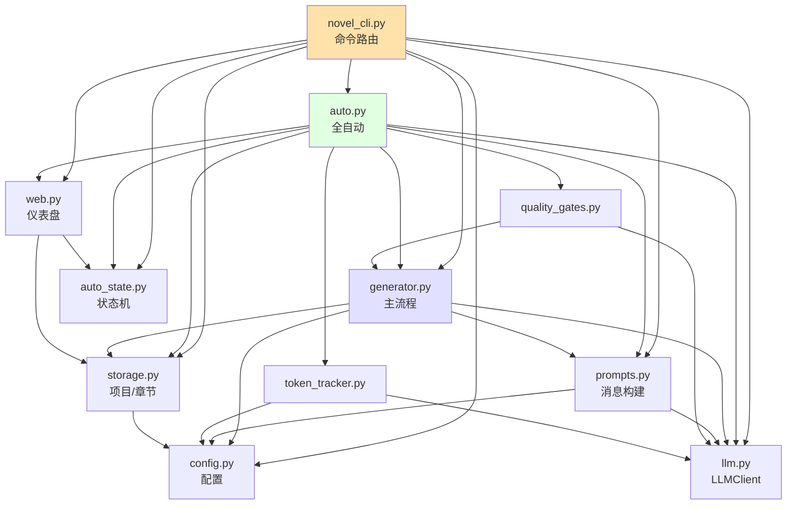

**依赖原则**：依赖单向，禁止循环。`config` 和 `llm` 是叶子节点。

### 1.3 模块大小速览

| 模块 | 行数 | 责任 |
|---|---|---|
| `novel_cli.py` | **45** | thin entry：app + 全局 callback（--version / -V） + 入口 |
| `novel/commands/*.py` | **2340** | 11 个命令模块（_init/_config/_presets/_run/...），50 命令按功能切分（v0.13.x 模块化） |
| `novel/templates.py` | 200 | 10 个推荐模板 + `apply_template()`（过滤 None override） |
| `novel/generator.py` | 660 | 写章节、伏笔、人物、世界 |
| `novel/prompts.py` | 470 | 28 个 builder 函数 |
| `novel/llm.py` | ~340 | LLM HTTP + think 剥离 + 续写 + **RateLimitError 检测（v0.14+）** |
| `novel/auto.py` | ~760 | 全自动编排器（含 `spec_from_project` + 并发 `_writing_phase_parallel` + 配额等待 `_call_with_quota_retry`（v0.14+）） |
| `novel/web.py` | 350 | HTTP 仪表盘 |
| `novel/auto_state.py` | 220 | 状态机 dataclass（含 `wait_on_quota` / `max_wait_seconds` 字段） |
| `novel/storage.py` | 195 | 项目/章节文件 I/O |
| `novel/budget.py` | 140 | 价格表 + 累加 |
| `novel/quality_gates.py` | 200 | 校验器 |
| `novel/token_tracker.py` | 95 | LLMClient 包装 |
| `novel/diff_utils.py` | 35 | difflib 封装 |
| `novel/config.py` | 110 | .env 加载 + env helpers |
| `novel/__init__.py` | 4 | 导出 `__version__ = "0.14.0"` |
| **合计** | **~6300** | |

**v0.13.x 模块化收益**：

| 指标 | v0.12 | v0.13 |
|---|---|---|
| `novel_cli.py` 行数 | 2038 | **45**（thin entry） |
| 命令模块数 | 1 | 11 |
| 单文件最大行数 | 2038 | 389（`_project.py`） |
| 添加新命令成本 | 翻 2000 行找位置 | 新建 ~150 行文件 + 一行 `register_all` |
| 命名冲突检测 | 容易撞 | 每模块独立命名空间 |

### 1.4 提示词目录（28 个）

```text
prompts/
├── de_ai_flavour.md          # 全局去 AI 味规则（核心，所有任务加载）
├── outline.md / chapter.md / character.md
├── detect_ai.md / polish.md / review.md
├── state.md / rolling_summary.md / world.md / timeline.md
├── foreshadow.md / arc.md / volume.md / volume_report.md
├── chapter_title.md / chapter_plan.md
├── consistency.md / style_radar.md
├── samples.md / expand_scene.md / continue_chapter.md
├── adapt.md / fanfic.md / skeleton.md
└── genre_presets.md / style_presets.md / webnovel_genres.md / webnovel_style.md
```

---

## 2. 架构原则

### 2.1 单向依赖（最重要）

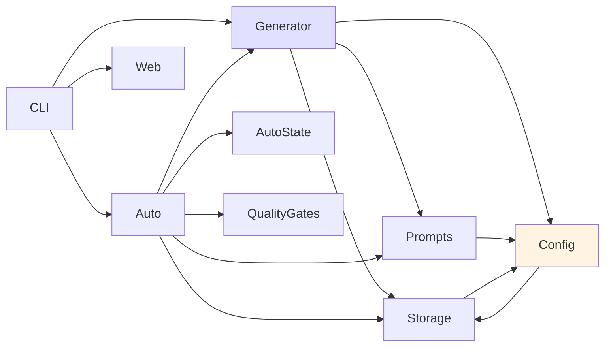

> **核心约束**：`config` 和 `llm` 永远只被引用，不引用任何业务模块。这样 config 重构不会引发连锁修改。

### 2.2 数据 / 控制 / UI 三层分离

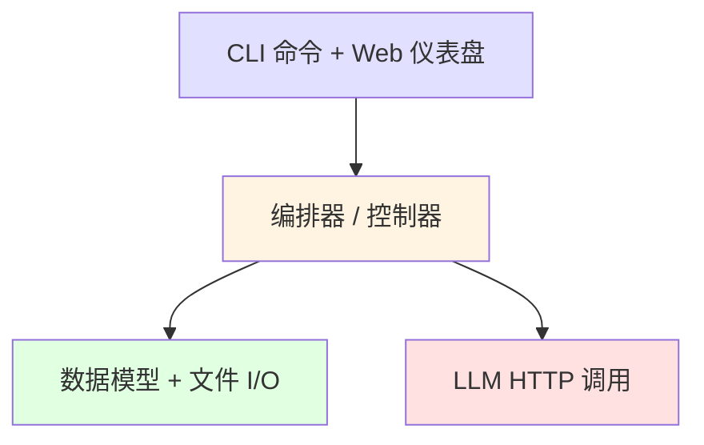

| 层 | 模块 | 责任 |
|---|---|---|
| UI | `novel_cli.py`, `web.py` | 用户交互、参数解析、富文本 |
| 控制 | `auto.py`, `generator.py` | 状态机、阶段流转 |
| 数据 | `storage.py`, `auto_state.py`, `prompts.py` | 文件 I/O、dataclass |
| IO | `llm.py`, `config.py` | 网络、配置 |

### 2.3 提示词外置为 markdown

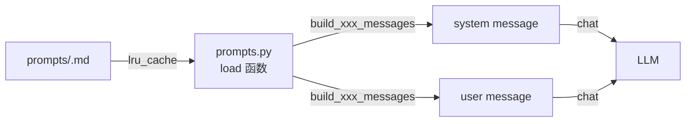

**设计原则**：所有 prompt 模板都是 markdown 文件，业务代码通过 `@lru_cache(maxsize=1)` 加载。用户可改 markdown 但不改 Python。

### 2.4 历史版本自动备份

每次 `save_chapter()` 写盘前：

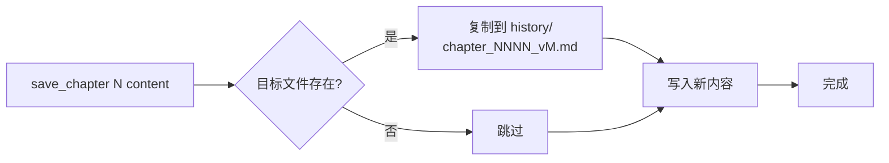

**好处**：用户改 `novel chat N` 时，原始版本永远可回滚（`novel rollback --to v1`）。

### 2.5 自动维护机制（5 种长期记忆）

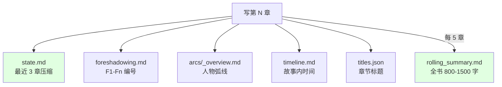

**原则**：每章写完自动调用 5 个 update 函数。无需作者手动维护。

### 2.6 失败兜底原则

> "如果失败，不要崩溃；保留草稿，让用户后续修。"

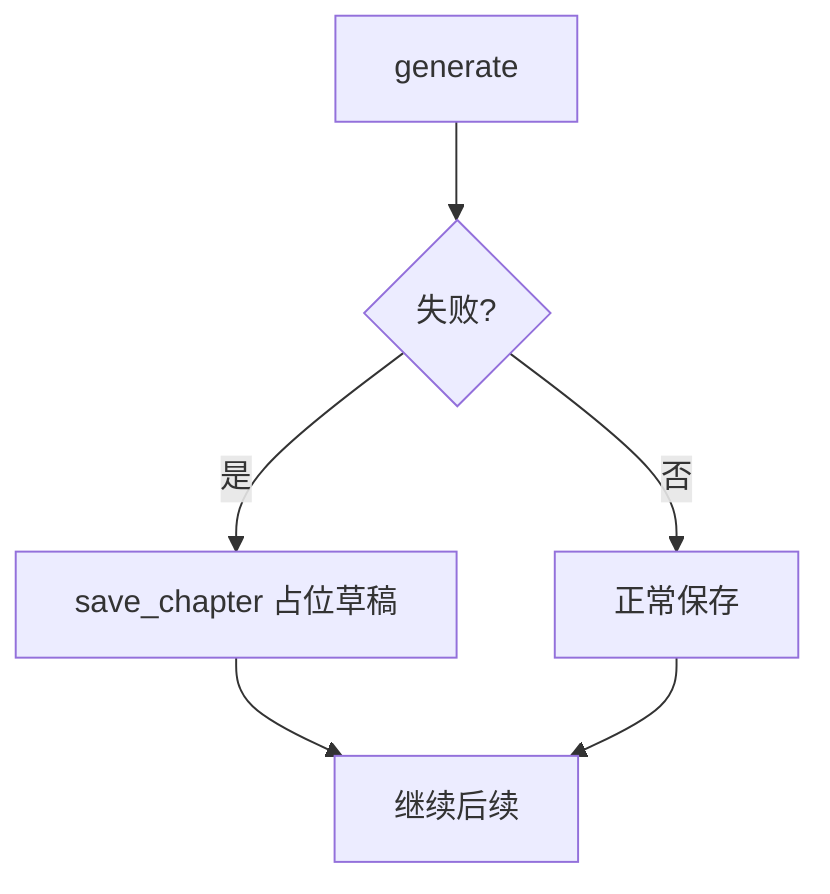

`novel auto` 中如果一章重试 N 次仍不达标：保留最后一次输出到章节文件，标记 `status=failed`，用户后续可 `novel chapter N` 手工重写。

---

## 3. 代码风格与约定

### 3.1 Python 风格

- **Python 3.10+**：用 `from __future__ import annotations` 推迟类型求值
- **类型注解**：所有公共函数必须有类型注解
- **dataclass 优先**：状态/配置用 `@dataclass`，不用 dict
- **pathlib.Path**：不用 `os.path`
- **rich 打印**：所有 CLI 输出用 `console.print()`，不用 `print()`
- **日志**：当前没用 logging（rich console + 千分位显示足够）

### 3.2 命名约定

| 类型 | 命名 | 示例 |
|---|---|---|
| 类 | PascalCase | `AutoState`, `LLMClient`, `Project` |
| 函数 | snake_case | `load_chapter`, `build_chapter_messages` |
| 私有函数 | _前缀 | `_strip_think_tags` |
| dataclass 字段 | snake_case | `chapter_no`, `ai_flavor` |
| 常量 | UPPER_SNAKE | `PROJECT_DIR`, `PROMPTS_DIR` |
| CLI flag | kebab-case | `--skip-plans`, `--word-count` |
| 内部 enum 值 | lowercase | `Phase.WRITING.value == "writing"` |

### 3.3 Lint / 格式

```bash
ruff check novel/ novel_cli.py tests/  # F-class 必须 0 错
ruff format --check novel/ novel_cli.py tests/
pytest tests/ -m "not slow and not network"  # CI 必过
```

**配置位置**：`pyproject.toml [tool.ruff]`、`[tool.pytest.ini_options]`

### 3.4 模块导入约定

```python
# 标准
from __future__ import annotations
import os, sys, time
from pathlib import Path
from dataclasses import dataclass, field
from typing import Optional

# 第三方
import typer
from rich.console import Console
import yaml

# 本项目
from novel import __version__
from novel.config import GlobalConfig
from novel import storage as S  # 别名避免与本地变量冲突
```

### 3.5 错误处理约定

| 场景 | 模式 |
|---|---|
| 用户输入错误 | `raise typer.Exit(1)` + console.print 红字 |
| 数据缺失 | 抛 `ProjectNotFoundError`（继承 FileNotFoundError） |
| LLM 调用失败 | `LLMClient` 内部 3 次指数退避，不重抛 |
| 单章失败 | 编排器捕获 + 标记 failed，不中断整体 |

### 3.6 测试约定

| 场景 | 测试位置 |
|---|---|
| 模块逻辑 | `tests/test_<module>.py` |
| CLI 命令 | `tests/test_cli.py` + `typer.testing.CliRunner` |
| 集成 | DRY_RUN 模式（不调 API） |
| 真实 LLM | `@pytest.mark.slow + @pytest.mark.network` 跳过 |

---

## 4. 核心模块详解

### 4.1 novel/config.py（110 行）

**责任**：读取 `.env` 环境变量，构建 `GlobalConfig` dataclass。

```python
@dataclass
class GlobalConfig:
    base_url: str            # OPENAI_BASE_URL
    api_key: str             # OPENAI_API_KEY
    model: str               # OPENAI_MODEL
    temperature: float       # 0.7-1.0
    top_p: float             # 默认 0.95
    max_tokens: int          # 单次最大输出 token
    target_chapter_words: int  # 单章目标字数
    dry_run: bool            # 是否真调 API
    request_timeout: int     # HTTP 超时（秒）
    
    def masked(self) -> dict:
        """返回脱敏的 config（key 显示前 4 + 后 3）。"""
```

**关键点**：

- `_env(name, default)` 帮手：处理 None 和空字符串
- `_env_float`, `_env_int`, `_env_bool`：类型转换，失败 fallback 到 default
- 不依赖 `python-dotenv` 包，自己解析（避免依赖）


### 4.2 novel/llm.py（~340 行，v0.14）

**责任**：HTTP 调用 LLM + think 标签剥离 + 自动续写 + **配额限制检测（v0.14+）**。

```python
class LLMClient:
    def chat(self, messages, ...) -> LLMResult
    def chat_with_continuation(self, messages, ...) -> LLMResult  # 自动续写
    def chat_json(self, messages, ...) -> dict
    def stream_chat(self, messages, ...) -> Iterator[str]

class RateLimitError(LLMError):  # v0.14+
    """携带 reset_at + retry_after_seconds + raw_status 元数据。"""

def _is_rate_limit_response(status, text, headers) -> bool
def _parse_retry_after(headers) -> int
def _build_rate_limit_error(status, text, headers) -> RateLimitError
```

#### 4.2.1 think 标签剥离（4 层兜底）

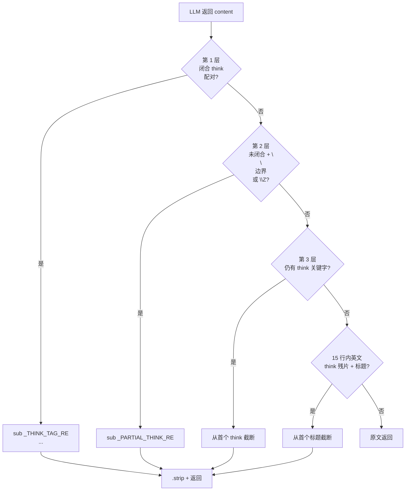

```python
_THINK_TAG_RE = re.compile(r"<think>[\s\S]*?</think>", re.IGNORECASE)
_PARTIAL_THINK_RE = re.compile(r"<think>[\s\S]*?(?=\n\n##|\n\n[^#]|\Z)", re.IGNORECASE)
# 兜底："OK so I should not have" 残片 → 找首个 # 标题
```

**为什么需要 4 层**：

| 层 | 处理场景 | 示例 |
|---|---|---|
| 1 | 完整闭合 | `<think>思考</think>正文` |
| 2 | 截断无闭合 | `<think>思考<br>正文开始##标题` |
| 3 | 任何 think 关键字 | 散落 token 嵌入 |
| 4 | 英文 think 残片 | "OK so I should not have..." 跟着标题 |

#### 4.2.2 chat_with_continuation 自动续写

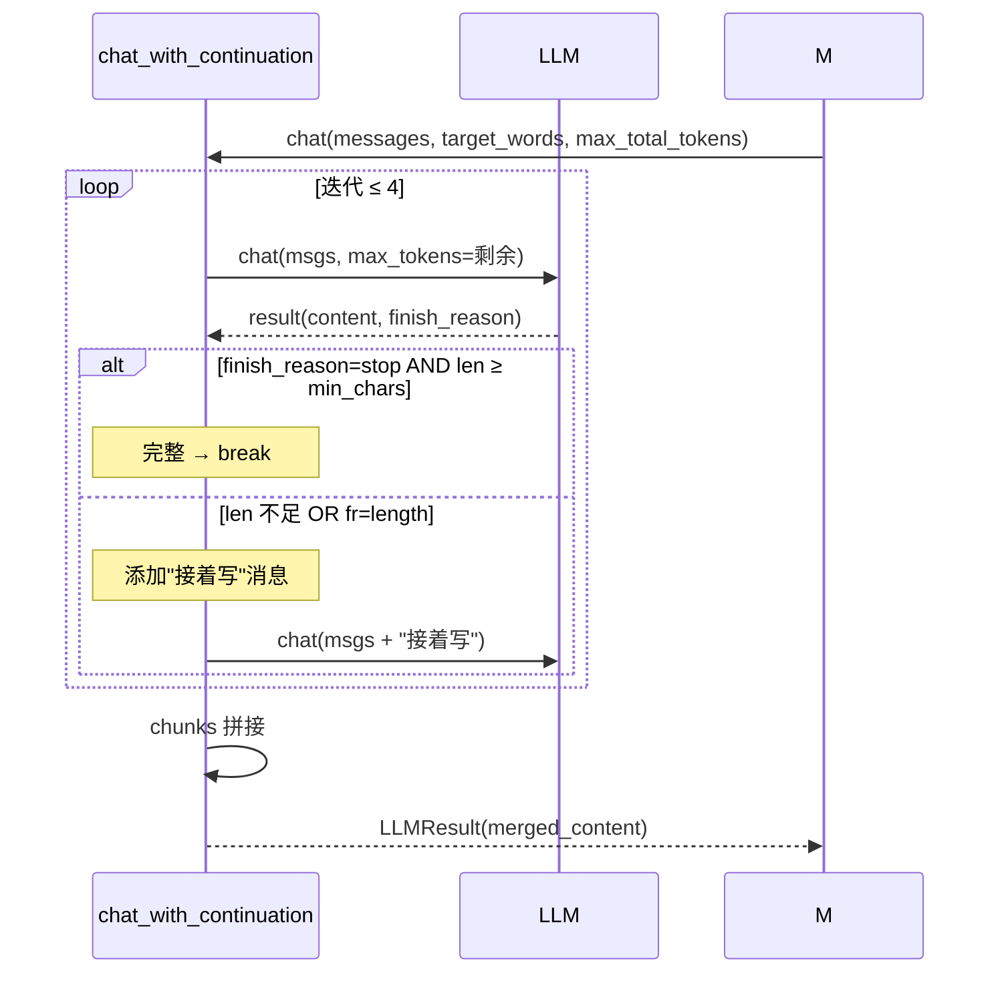

**关键参数**：
- `min_chars = max(200, target_words * 0.6)`：动态替代简单 ~800
- `max_total_tokens=30000`：4 次迭代上限
- 每次 `max_tokens = min(剩余预算, 16000)`

#### 4.2.3 重试机制

```python
def chat(self, messages, retry=3):
    last_err = None
    for attempt in range(retry):
        try:
            resp = requests.post(url, headers=headers, json=payload, timeout=...)
        except requests.RequestException as e:
            last_err = e
            time.sleep(min(2 ** attempt, 8))  # 1/2/4 秒，封顶 8
            continue
        if resp.status_code >= 500:
            # 5xx 也重试
            time.sleep(min(2 ** attempt, 8))
            continue
        if resp.status_code != 200:
            raise LLMError("api 4xx")  # 4xx 直接抛
        return _strip_think_tags(resp.content)
    raise LLMError("chat failed after retries")
```

**重试策略**：5xx + 网络异常 → 重试；4xx / 配额 → 立即抛（v0.14 起 4xx 中配额类抛 RateLimitError）

#### 4.2.5 配额检测（v0.14+）

minimax / OpenAI 等 LLM 服务有 quota 上限；撞到 429 / "quota exceeded" 用户感知不到原因。`novel/llm.py` 在 v0.14 增加：

**触发条件（任一即抛 `RateLimitError`）**：
1. HTTP 状态 = 429
2. HTTP 状态 = 403 + 含 "quota" / "billing" / "余额" 关键词
3. response text 命中 9 种正则：
   - `insufficient_quota`
   - `rate.?limit.?exceeded`
   - `\bRPM\b.*(?:limit|exceeded|reached)`
   - `\bTPM\b.*(?:limit|exceeded|reached)`
   - `配额`（中文）
   - `余额不足`
   - `5\s*小时.{0,8}限额`（minimax 5小时）
   - `周.{0,8}用量.{0,8}限额`（minimax 周）
   - `请求过快`

**`Retry-After` header 处理**：

```python
def _parse_retry_after(headers) -> int:
    val = headers.get("Retry-After")  # 不区分大小写
    if not val:
        return 0
    try:
        return max(0, int(val))  # 仅处理秒数格式（HTTP-date 不支持）
    except (TypeError, ValueError):
        return 0
```

**`RateLimitError` 携带的元数据**：

```python
err = RateLimitError(
    message="rate limit: 429 retry_after=300s body=...",
    reset_at=int(time.time() + 300),     # 服务器给 retry_after → 推算
    retry_after_seconds=300,
    raw_status=429,
    raw_text="...",                     # 上层 debug 用
)
```

**关键 invariant**：检测层**只抛出，不等待**。等待逻辑在 `novel/auto.py`：

```python
# 错误流向
LLMClient.chat() ──── 抛 RateLimitError
       │
       ↓
auto._call_with_quota_retry(fn) ──→ _wait_for_quota() ──→ retry LLMClient.chat()
```

这样分工的好处：
- `llm.py` 保持精简，不引入时间相关依赖
- `auto.py` 统一所有「等待 → 重试」决策
- 单测容易：测 llm.py 只测检测；测 auto.py mock time.sleep

### 4.3 novel/storage.py（195 行）

**责任**：项目文件结构 + 章节读写 + 版本备份。

```python
@dataclass
class Project:
    root: Path
    title: str
    meta: dict

    @property
    def novel_dir(self):        return self.root / ".novel"
    @property
    def outline_path(self):      return self.novel_dir / "outline.md"
    @property
    def chapters_dir(self):      return self.novel_dir / "chapters"
    @property
    def history_dir(self):       return self.novel_dir / "history"
    # ... 共 14 个 path property
```

#### 4.3.1 项目结构

```text
my_novel/.novel/
├── project.yaml              # 元数据
├── outline.md                # 全书大纲
├── characters.md             # 人物志
├── style.md / genre_preset.md
├── world.md / volumes.md
├── timeline.md / state.md / rolling_summary.md
├── foreshadowing.md / arcs/_overview.md
├── chapters/0001.md 0002.md ...    # 章节文件
├── chapter_plans/0001.md ...        # 细化章纲
├── history/chapter_0001_v1.md ...   # 历史版本
├── reports/                       # AI 味检测 / 雷达报告
├── samples/01.md / *.md           # 风格样本
├── prompts/<name>.md              # 项目级提示词覆盖
└── auto_state.json / auto_control.json  # novel auto 状态
```

#### 4.3.2 save_chapter 版本备份

```python
def save_chapter(project, chapter_no, content, backup=True):
    target = project.chapters_dir / f"{chapter_no:04d}.md"
    if target.exists() and backup:
        # 找下一个版本号：现有 v1, v2 → v3
        existing = sorted(history_dir.glob(f"chapter_{chapter_no:04d}_v*.md"))
        nxt = len(existing) + 1
        shutil.copy2(target, history_dir / f"chapter_{chapter_no:04d}_v{nxt}.md")
    target.write_text(content, encoding="utf-8")
```

**好处**：每次覆盖前都备份。`novel rollback --to vN` 可以恢复任意历史版本。

#### 4.3.3 ProjectNotFoundError 友好错误

```python
class ProjectNotFoundError(FileNotFoundError):
    """未找到项目目录。继承 FileNotFoundError 但携带更友好的 message。"""

def load_project(root=None):
    proj_root = find_project_root(base)
    if not proj_root:
        raise ProjectNotFoundError(
            "未找到 .novel 项目目录。\n"
            "  当前目录: " + str(base) + "\n"
            "  解决方法：\n"
            "    - novel init 新建\n"
            "    - cd 进入项目根\n"
            "    - novel init . --here"
        )
```

### 4.4 novel/prompts.py（470 行）

**责任**：28 个 `build_xxx_messages` 函数，每个接收数据返回 `[Message]`。

```python
@lru_cache(maxsize=1)
def _load(name):
    p = PROMPTS_DIR / name
    return p.read_text(encoding="utf-8")

def de_ai_flavour():
    return _load("de_ai_flavour.md")

def build_chapter_messages(ctx: ChapterContext) -> list[Message]:
    sys = de_ai_flavour() + ... + chapter()  # 拼装 system
    user = _NO_THINK_HINT + ctx  # 拼装 user
    return [Message("system", sys), Message("user", user)]
```

#### 4.4.1 ChapterContext dataclass

```python
@dataclass
class ChapterContext:
    title: str                          # 小说标题
    outline: str                        # 大纲
    characters: str                     # 人物志
    style: str                          # 文风
    chapter_plan: str                   # 细化章纲
    prev_chapter_tail: str              # 上一章结尾
    target_words: int                   # 目标字数
    feedback: str = ""                  # 上轮审稿反馈
    extra: str = ""                     # 作者额外要求
    # 长篇专属
    state: str = ""                     # 最近 3 章
    foreshadow: str = ""                # 伏笔簿
    world: str = ""                     # 世界观
    timeline: str = ""                  # 时间线
    volumes: str = ""                   # 分卷
    chapter_index_in_volume: int = 0     # 卷内位置
    total_chapters_in_volume: int = 0
    style_samples: str = ""             # 风格样本
    rolling_summary: str = ""           # 全书滚动
    arc: str = ""                       # 人物弧线
    genre: str = ""                     # 题材（注入硬规则）
```

#### 4.4.2 build_chapter_messages 流程

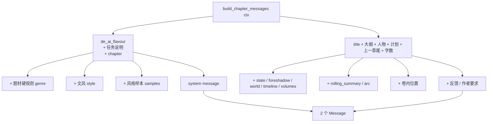

#### 4.4.3 题材 / 文风匹配（4 级）

```mermaid
flowchart TB
    Input[--genre '悬疑'] --> A{精确匹配<br/>titles?}
    A -->|命中| Use[使用完整标题]
    A -->|未中| B{包含?<br/>'悬疑' <br/>in titles?}
    B -->|命中| Use
    B -->|未中| C{反向包含?<br/>titles[i] <br/>in '悬疑'?}
    C -->|命中| Use
    C -->|未中| D{公共前缀 ≥ 2?}
    D -->|命中| Use
    D -->|未中| Empty[返回空<br/>不注入硬规则]
    Use --> Block[提取 markdown 块]
    Block --> Inject[注入 system prompt]
```

```python
def _match_title(query, titles):
    if query in titles: return query
    for t in titles:
        if query in t or t in query: return t
    # 最长公共前缀
    best = ""
    for t in titles:
        i = 0
        while i < len(query) and i < len(t) and query[i] == t[i]:
            i += 1
        if i > len(best): best = t[:i]
    if len(best) >= 2:
        for t in titles:
            if t.startswith(best): return t
    return ""
```

### 4.5 novel/generator.py（660 行）

**责任**：写章节 + 维护元数据 + 各种实用功能。

```python
@dataclass
class ChapterRequest:
    chapter_no: int
    target_words: int = 3000

@dataclass
class ChapterResult:
    chapter_no: int
    content: str
    detect_report: str = ""
    review_report: str = ""
    iterations: int = 1
    word_count: int = 0
    history: list = None
```

#### 4.5.1 write_chapter_extended 流程

```mermaid
sequenceDiagram
    participant C as chapter CLI
    participant WC as write_chapter_extended
    participant LLM
    participant Storage

    auto = chat_with_continuation(msgs, target_words)
    Note over LLM: 第 1 轮：生成
    
    loop 自动重试 ≤ 2
        alt 内容 < 200 字符
            Note over LLM: think 截断，重试
        else 内容 OK
            break
        end
    end
    
    loop max_iters (默认 2)
        Note over WC: 第 2-N 轮：detect + review + polish
        detect_msgs = build_detect_messages(content)
        detect_report = chat(detect_msgs, temp=0.3)
        review_msgs = build_review_messages(content, plan, prev)
        review_report = chat(review_msgs, temp=0.4)
        
        alt 不需要更多迭代
            break
        else
            if i+1 < max_iters:
                polish_msgs = build_polish_messages(content, plan, prev, detect)
                content = chat_with_continuation(polish_msgs, target_words)
            end
        end
    end
    
    Note over WC: 自动维护元数据
    update_state(project)
    update_foreshadow(project)
    update_arc(project)
    
    opt 每 5 章
        update_rolling_summary(project)
    end
    
    Note over WC: 每章标题
    generate_chapter_title(project, chapter_no)
```

**关键函数签名**：
```python
def write_chapter_extended(req, ctx, project=None, client=None,
                          max_iters=2, update_after=True, verbose=True, do_polish=True):
    """长篇版 write_chapter：写完后自动更新 state/foreadow/arc。"""
```

#### 4.5.2 主要函数清单

| 函数 | 用途 |
|---|---|
| `extract_skeleton(source_info, client)` | 提取源小说骨架 |
| `adapt_novel(source_info, direction, genre, style, ...)` | 改编 |
| `write_fanfic(source_info, ending_state, character, era, ...)` | 同人 / 后传 |
| `chat_assistant(project, chapter_no, instruction, client)` | 自然语言改章节 |
| `continue_chapter(project, chapter_no, instruction, ...)` | 末尾接写 |
| `expand_scene(project, chapter_no, after_text, instruction, ...)` | 指定位置接场景 |
| `generate_chapter_plan(project, chapter_no, client, feedback)` | 细化章纲 |
| `batch_generate_chapter_plans(project, start, end, ...)` | 批量细化章纲 |
| `parse_chapter_plan(outline_text, chapter_no)` | 从粗大纲解析本章规划 |
| `extract_name_roster(characters_blob)` | 从人物志提取人名集合 |
| `find_stuck_chapters(project, threshold)` | 找异常章节 |
| `export_combined(project, fmt, output_path)` | 合并为书稿 |
| `style_radar(project, chapter_no, client)` | 6 维度风格雷达 |
| `generate_chapter_title(project, chapter_no, client, force)` | 章节标题 |
| `update_state(project, client, lookback=3)` | 最近 3 章压缩 |
| `update_foreshadow(project, client, lookback=2)` | 伏笔簿 |
| `update_arc(project, client, lookback=3)` | 人物弧线 |
| `update_timeline(project, client, lookback=10)` | 时间线 |
| `update_rolling_summary(project, client)` | 全书滚动 |
| `check_consistency(project, client, lookback=10)` | 一致性检查 |

#### 4.5.3 元数据更新流程

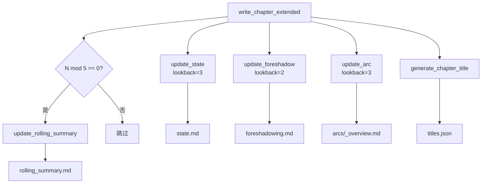

**每个 update 函数**：
1. 读最新 N 章
2. 拼装 prompt（含旧 state + 大纲 + 人物）
3. LLM 生成新 metadata
4. 写回 .md

### 4.6 novel/auto.py（~760 行，v0.14）

**责任**：一键全自动的 5 阶段流程 + **并发章节生成（v0.13+）** + **配额自动等待（v0.14+）**。

#### 4.6.5 配额自动等待（v0.14+）

撞到 `RateLimitError` 时的处理路径：

```
任何 LLM 调用 (write_extended / run_all_gates / _regenerate_chapter)
       │
       ↓  用 _call_with_quota_retry(fn, max_wait, chapter_no) 包
auto._call_with_quota_retry(fn)
       │
       ├── 第一次调 fn() → 成功 ✅
       │
       └── 第一次调 fn() → 抛 RateLimitError
              ↓
              auto._wait_for_quota(err, max_wait, chapter_no)
              ├── 算 wait 秒数 (retry_after + 30s 缓冲, cap max_wait)
              ├── print 友好提示 (HTTP / reset 估计 / 等多久)
              ├── 60s 分段循环 sleep（每段醒一次检查 Ctrl-C / 控制信号）
              └── 返回 True/False（False = 用户中断或 cap 触发）
              │
              ├── True → retry fn() → 回到顶端
              │
              └── False → 重新抛 RateLimitError → 外层 chapter 标 failed
```

**核心函数**：

```python
def _call_with_quota_retry(fn, *, max_wait_seconds=21600, chapter_no=0, on_rate_limit=None):
    """装饰任意 LLM 调用。撞 RateLimitError 自动等 + 重试。"""
    attempt = 0
    while True:
        try:
            return fn()
        except RateLimitError as e:
            attempt += 1
            if max_wait_seconds == 0 or on_rate_limit is _PASS_THROUGH:
                raise  # --no-wait 或 cap 触发
            if on_rate_limit is None:
                keep_going = _wait_for_quota(e, max_wait_seconds, chapter_no)
            else:
                keep_going = on_rate_limit(e, max_wait_seconds, chapter_no, attempt)
            if not keep_going:
                raise


def _wait_for_quota(err, max_wait_seconds, chapter_no) -> bool:
    """撞配额 → 算等待时间 → 60s 一段可中断睡眠。
    
    返回 True = 等完可重试；False = 用户中断或 cap 触发。
    """
    import time as _t
    wait = 0
    if err.retry_after_seconds > 0:
        wait = err.retry_after_seconds + 30
    elif err.reset_at > 0:
        wait = max(0, err.reset_at - int(_t.time())) + 30
    if wait <= 0:
        wait = 60
    wait = min(wait, max_wait_seconds)  # cap 用户上限
    
    # 友好提示
    if err.reset_at > 0:
        reset_str = _t.strftime("%Y-%m-%d %H:%M:%S", _t.localtime(err.reset_at))
    console.print(f"⏳ 撞到 minimax 配额限制 (第 {chapter_no} 章, HTTP {err.raw_status})")
    console.print(f"   配额重置估计：{reset_str}")
    console.print(f"   本次等待：{wait // 60} 分钟（cap {max_wait_seconds // 60} 分钟）")
    console.print(f"   [dim]Ctrl-C 安全退出，state 已保存[/dim]")
    
    # 可中断睡眠
    start = _t.time()
    slept = 0
    while slept < wait:
        chunk = min(60, wait - slept)
        try:
            _check_control_signal(Path.cwd())  # 每段醒一次查控制信号
            time.sleep(chunk)
        except KeyboardInterrupt:
            console.print("[yellow]用户中断 — state 已保存。[/yellow]")
            return False
        slept = int(_t.time() - start)
        if slept % 300 < 60 and slept > 0:
            console.print(f"[dim]  ⏳ 还在等 quota（剩 {(wait - slept) // 60} 分钟）...[/dim]")
    return True


def _quota_kwargs(spec, chapter_no):
    """从 spec 取 (max_wait_seconds, on_rate_limit) 给 _call_with_quota_retry。
    
    wait_on_quota=False → (0, _PASS_THROUGH)  # --no-wait
    wait_on_quota=True  → (spec.max_wait_seconds, None)
    """
    if not getattr(spec, "wait_on_quota", True):
        return 0, _PASS_THROUGH
    return spec.max_wait_seconds, None
```

**AutoSpec 字段**（`novel/auto_state.py`）：

```python
@dataclass
class AutoSpec:
    ...
    wait_on_quota: bool = True         # v0.14+：撞配额是否等到恢复
    max_wait_seconds: int = 21600     # v0.14+：单次最多等 6h
```

**调用点**（`_write_one_chapter` 内 3 个 LLM 调用都包了 wrapper）：
- `G.write_chapter_extended(...)` — 写主章节
- `run_all_gates(...)` — 质量门控
- `_regenerate_chapter(...)` — 失败重试

并发版 `_write_one_chapter_locked` 当前不直接 wrap（继承自 `_write_one_chapter` 的 quota 处理由上层 worker 负责）。

#### 4.6.6 自测真 API 性能（v0.14+ 缺数据，欢迎贡献）

**为什么缺**：DRY_RUN 模式只测编排调度；`_writing_phase_parallel` 的 50-65% 节省预期是按 LLM I/O-bound 性质推算的——真实的 wall-clock 数字必须用真 API 跑一遍才有。

> **项目维护者没买 minimax 真实凭证**（开平 401 unauthorized），也无意让真 API 数据进 commit 历史。  
> 你的真 API 实测数据是补上这一缺口的关键。请按下方步骤跑 + 报告。

##### 步骤 1：准备工作

```bash
# 确认凭据有效（不要把真 key 贴到 chat / commit）
python3 novel_cli.py config --show | grep api_key
# api_key 应是真值（如 sk-xxxx...）而不是 your***ere

# 如果还是占位符：
python3 novel_cli.py setup --force
```

##### 步骤 2：跑基准（3 章 draft 档 + parallel=2 ≈ 3 分钟）

```bash
cd /path/to/ai-novel

# 3 章 × 3000 字 × draft 档（最快）：足够代表典型 baseline，
# 且不消耗过多 5 小时 quota
time python3 novel_cli.py write smoke_v014 \
  --title "凌晨四点的便利店" \
  --theme "一个冬夜，便利店收银员和一个意外闯入的陌生人" \
  --genre 现实 --style 朴素 \
  --words 9000 --chapters 3 \
  --quality draft --parallel 2 --here --force --budget 5
```

预期：~3 分钟完成（draft 档 + parallel=2 是 base case）。

##### 步骤 3：捕获 4 个核心指标

```bash
# 1. state 里的阶段/章数/累加 token/累计成本/起止时间
cat smoke_v014/.novel/auto_state.json | python3 -m json.tool | grep -E '"(phase|chapters_done|chapters_total|cumulative_tokens|cumulative_cost_cny|started_at|updated_at)'

# 2. book.md 字符数（实际产出）
wc -c smoke_v014/book.md

# 3. book.md 行数
wc -l smoke_v014/book.md

# 4. 实际耗时（time 命令输出的 real 字段）
# 在步骤 2 输出末尾
```

##### 步骤 4：填进本节表格

跑完后，把 4 个数字按下面模板填到「社区实测数据」表对应行（PR 加 1 行就行）：

```markdown
| 用户 | 时间 | 模型 | chapters | words | parallel | wall-clock | tokens | cost (CNY) | 备注 |
|---|---|---|---|---|---|---|---|---|---|
| @yourname | 2026-XX-XX | minimax-Text-01 | 3 | 9000 | 2 | 3m12s | 12345 | 0.42 | draft 档；撞配额 0 次 |
```

PR 直接改 DEVELOPER_GUIDE.md 这一段（一行添加）+ 在 PROGRESS.md §5.18 加引用。

##### 步骤 5：可选 — 测试并发上限 / 配额等待

```bash
# 测并发上限
for P in 1 2 4 8; do
  time python3 novel_cli.py write smoke_v014_$P \
    --title "..." --genre 现实 --words 9000 --chapters 3 \
    --quality draft --parallel $P --here --force --budget 2
done

# 测撞 5 小时配额自动等
# 预先消耗完 quota（用 draft 档连续跑到撞），然后：
time python3 novel_cli.py write smoke_v014 \
  --title "..." --words 30000 --chapters 10 \
  --quality draft --parallel 2 --wait-on-quota --here --force
# 看等多久才恢复 + 心跳是否合理
```

##### 期望产出

每个 contributor 累计 5 行数据后，本节表格会给出真实数字而非「预期 50-65%」。  
后续 v0.15+ 性能优化的 baseline 就是这表。

#### 4.6.1 5 阶段状态机

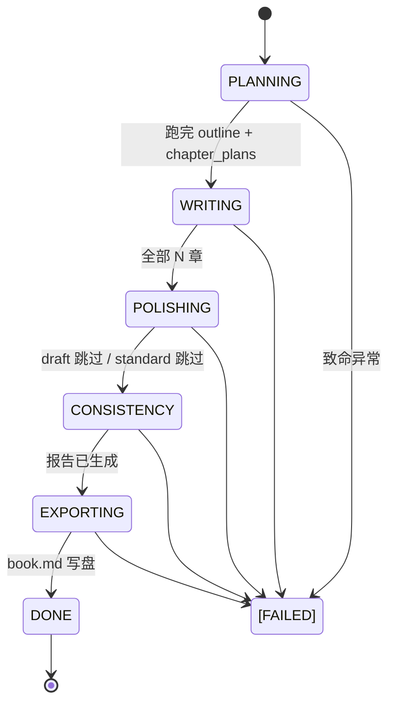

#### 4.6.2 run_auto_novel 主流程

```python
def run_auto_novel(spec, project_dir, cfg=None, state=None,
                  budget_cny=0.0, plans_only=False, skip_plans=False):
    """一键全自动写小说主入口。"""
    cfg = cfg or GlobalConfig()
    raw = LLMClient(cfg)
    client = TokenTracker(raw, model=cfg.model)  # 包一层记录 token
    
    # 加载或新建项目
    if not (project_dir / ".novel").exists():
        init_project(project_dir, spec.title, theme=spec.theme, meta={...})
    
    # 加载或新建 state
    state = AutoState.load(project_dir) or AutoState(spec=spec.__dict__)
    state.save(project_dir)
    
    # 5 阶段（按 state.phase 续跑）
    if state.phase in (PLANNING,) and not skip_plans:
        _planning_phase(spec, project, client, state)
    if state.phase in (PLANNING, WRITING):
        _writing_phase(spec, project, client, state)
    if state.phase in (WRITING, POLISHING) and not plans_only:
        _polishing_phase(spec, project, client, state)
    if state.phase in (POLISHING, CONSISTENCY) and not plans_only:
        _consistency_phase(spec, project, client, state)
    if state.phase in (CONSISTENCY, EXPORTING):
        out = _exporting_phase(spec, project, state)
    
    return out
```

#### 4.6.3 _writing_phase 详细

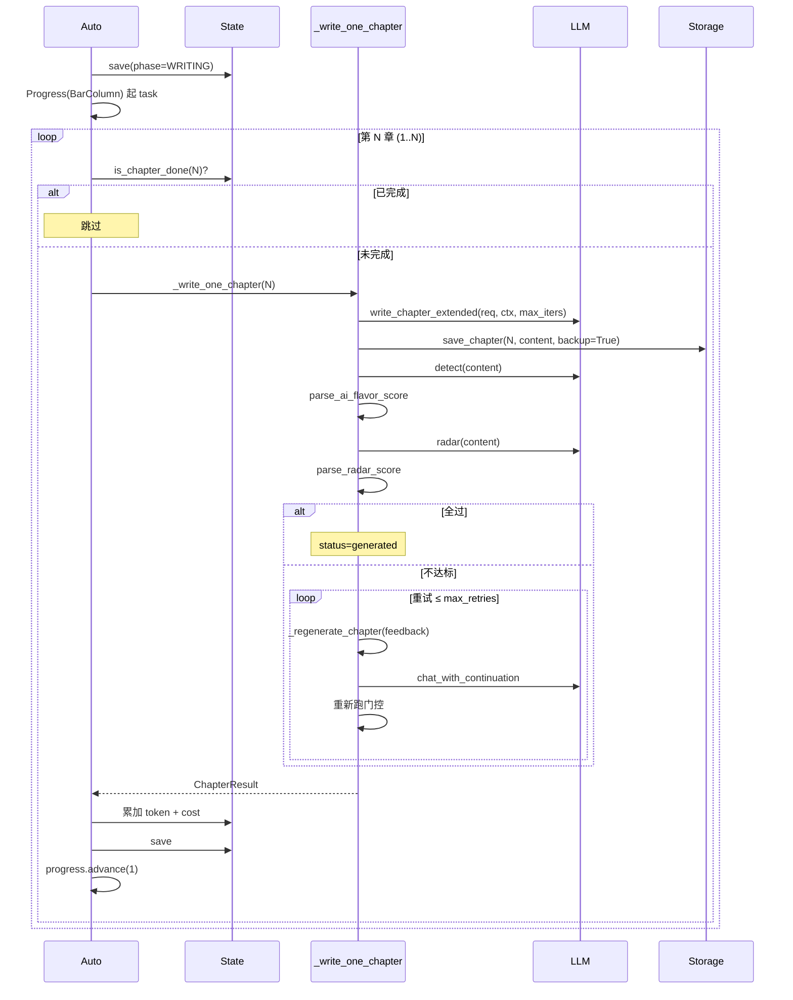

#### 4.6.4 关键模块接口

```python
# 可重复模式：所有阶段都按这个结构
def _phase(spec, project, client, state):
    state.phase = Phase.X
    state.save(project.root)
    console.print("[bold cyan]阶段 X/5：XXX[/bold cyan]")
    # ... 业务 ...
    state.save(project.root)
```

### 4.7 novel/auto_state.py（220 行）

**责任**：AutoState 状态机 + 原子持久化。

```python
class Phase(str, Enum):
    PLANNING = "planning"
    WRITING = "writing"
    POLISHING = "polishing"
    CONSISTENCY = "consistency"
    EXPORTING = "exporting"
    DONE = "done"
    FAILED = "failed"

class QualityPreset(str, Enum):
    DRAFT = "draft"      # 1 轮 / ±30% / 不查 AI 味和雷达
    STANDARD = "standard" # 2 轮 / ±20% / AI < 50 / 雷达 ≥ 60
    PREMIUM = "premium"   # 3 轮 / ±10% / AI < 30 / 雷达 ≥ 70
    
    @property
    def iters(self) -> int: ...
    @property
    def word_tolerance(self) -> float: ...
    @property
    def ai_flavor_threshold(self) -> int | None: ...
    @property
    def radar_threshold(self) -> int | None: ...
    @property
    def max_retries(self) -> int: ...
```

#### 4.7.1 AutoState dataclass

```python
@dataclass
class AutoState:
    spec: dict                    # 序列化的 AutoSpec
    phase: Phase = PLANNING
    started_at: float             # 时间戳
    updated_at: float
    chapters_total: int = 0
    chapters_done: list[int]      # 已成功完成章节号
    chapter_results: dict[int, ChapterResult]  # 每章详情
    cumulative_tokens: int = 0
    cumulative_prompt_tokens: int = 0
    cumulative_completion_tokens: int = 0
    cumulative_cost_cny: float = 0.0
    budget_cny: float = 0.0
    last_error: str = ""
    planning_files: list[str]     # 已生成的 outline/characters/world/volumes 路径
    polished: bool = False
    consistency_checked: bool = False
    exported_path: str = ""
```

#### 4.7.2 原子持久化

```python
def save(self, project_dir: Path) -> Path:
    """写到 .novel/auto_state.json（原子写）。"""
    state_path = project_dir / ".novel" / "auto_state.json"
    state_path.parent.mkdir(parents=True, exist_ok=True)
    self.updated_at = time.time()
    tmp = state_path.with_suffix(".json.tmp")
    tmp.write_text(json.dumps(self.to_dict(), ensure_ascii=False, indent=2), encoding="utf-8")
    os.replace(tmp, state_path)  # 原子操作：tmp → state_path
    return state_path
```

**为什么原子写**：Ctrl-C 中断时，tmp 还在但 state 已完整。

### 4.8 novel/quality_gates.py（200 行）

**责任**：单章 / 多章质量校验。

```python
@dataclass
class GateResult:
    name: str              # 校验器名
    passed: bool
    score: Optional[float]  # 数值分数
    detail: str           # 详细说明
```

#### 4.8.1 4 个校验器

```python
def check_word_count(content, target, tolerance) -> GateResult
    """字数 ± tolerance% 算通过。tolerance=0.1 表示 2700-3300 字。"""

def check_ai_flavor(project, chapter_no, client, threshold) -> GateResult
    """调 LLM 检测 AI 味并保存报告，AI 味 < threshold 通过。"""

def check_radar(project, chapter_no, client, threshold) -> GateResult
    """调 LLM 跑雷达并保存报告，相似度 ≥ threshold 通过。"""

def check_consistency(project, client, lookback=10) -> GateResult
    """跨章一致性检查，冲突数 == 0 算通过。"""
```

#### 4.8.2 字数边界示例

```python
# target=3000, tolerance=0.1
# 范围: 2700 - 3300

# target=2000, tolerance=0.3 (draft)
# 范围: 1400 - 2600

# 超过 1.5x target 视为过多（灌水检测）
```

#### 4.8.3 AI 味 / 雷达正则

```python
_AI_RE = re.compile(r"AI\s*味指数[：:]?\s*(\d+)")
_RADAR_RE = re.compile(r"总相似度[：:]?\s*(\d+)")
```

`detect_ai.md` prompt 明确要求模型写出"AI 味指数：N"行，radar 同理。

### 4.9 novel/budget.py（140 行）

**责任**：模型价格表 + 估算成本 + BudgetTracker。

```python
MODEL_PRICES_CNY_PER_1M: dict[str, tuple[float, float]] = {
    "minimax-": (1.0, 1.0),
    "gpt-4o": (18.0, 72.0),
    # ... 11 个模型
}

def price_for_model(model: str) -> tuple[float, float]:
    """返回 (input_cny_per_1m, output_cny_per_1m)。"""

def estimate_cost_cny(prompt_tokens, completion_tokens, model="") -> float:
    """估算一次 LLM 调用的成本（CNY）。"""

@dataclass
class BudgetTracker:
    model: str = ""
    prompt_tokens: int = 0
    completion_tokens: int = 0
    cost_cny: float = 0.0
    budget_cny: float = 0.0
    
    def add(self, prompt_tokens, completion_tokens) -> float:
        """累加，返回本次成本。"""
    
    @property
    def ratio_remaining(self) -> float:
        """剩余预算占比。"""
    
    def should_downgrade(self) -> bool:
        """剩余 < 30% 时降级。"""
    
    def suggest_quality(self, current_quality: str) -> str:
        """根据剩余预算建议降级后的质量档。"""
```

#### 4.9.1 价格表覆盖

| 模型 | input ¥/1M | output ¥/1M |
|---|---|---|
| minimax-Text-01 / M3 | 1.0 | 1.0 |
| gpt-4o / 4-turbo | 18.0 | 72.0 |
| gpt-4 | 216.0 | 432.0 |
| deepseek-chat | 1.0 | 2.0 |
| qwen / glm | 4.0 | 12.0 |
| claude-3-5-sonnet | 21.6 | 108.0 |
| claude-3-opus | 108.0 | 540.0 |
| 未匹配 | 1.0 | 1.0（保守兜底）|

### 4.10 novel/token_tracker.py（95 行）

**责任**：包装 LLMClient，记录 token 用量。

```python
@dataclass
class TokenTracker:
    client: LLMClient
    prompt_tokens: int = 0
    completion_tokens: int = 0
    call_count: int = 0
    model: str = ""
    history: list[dict] = field(default_factory=list)
    
    def chat(self, messages, **kwargs) -> LLMResult:
        result = self.client.chat(messages, **kwargs)
        self.record(result.prompt_tokens, result.completion_tokens, label="chat")
        return result
    
    def chat_with_continuation(self, messages, **kwargs) -> LLMResult:
        result = self.client.chat_with_continuation(messages, **kwargs)
        self.record(...)
        return result
```

**关键设计**：只代理 `chat` / `chat_with_continuation`，不代理 `chat_json`（chat_json 内部走 chat 已记录）。

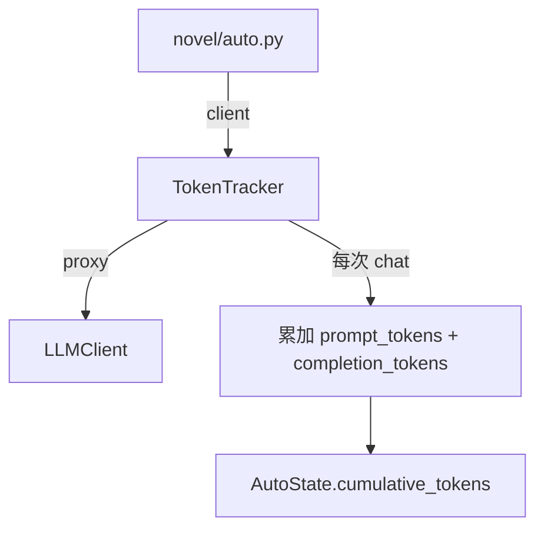

### 4.11 novel/web.py（350 行）

**责任**：内嵌 HTML 的 HTTP 仪表盘 + 控制信号。

```python
class ControlSignal:
    RUN = "run"
    PAUSE = "pause"
    STOP = "stop"
    DOWNGRADE = "downgrade"
    
    @classmethod
    def write(project_dir, signal) -> Path: ...   # 写到 .novel/auto_control.json
    @classmethod
    def read(project_dir) -> str: ...              # 读
    @classmethod
    def clear(project_dir) -> None: ...

def serve_background(project_dir, port, open_browser) -> ThreadingHTTPServer:
    """后台线程跑 HTTP 服务器。"""
```

#### 4.11.1 HTTP 路由

| 路径 | 方法 | 作用 |
|---|---|---|
| `/` | GET | 内嵌单页 HTML |
| `/api/state` | GET | 返回 state payload（前端轮询） |
| `/api/control` | POST | 写入控制信号（暂停/继续/降级/停止） |
| `/health` | GET | 健康检查 |

#### 4.11.2 仪表盘 HTML 特点

- 单文件内嵌（**无外部资源**）
- 4 张卡片（进度 / 字数 / Token / 成本）+ 1 张章节表 + 4 个按钮
- 2 秒自动轮询
- 浅色背景 + 系统 mono 字体

### 4.12 novel/diff_utils.py（35 行）

**责任**：difflib 封装，统一 old/new 比较。

```python
def unified_diff(old_text, new_text, fromfile="old", tofile="new", n=3) -> str:
    """返回 unified diff 文本。"""

def stats_diff(old_text, new_text) -> dict:
    """返回 {added, removed, same, similarity} 字典。"""
```

### 4.13 novel_cli.py（1900 行）

**责任**：47 个 Typer 命令注册。

#### 4.13.1 命令模式

```python
@app.command()
def chapter(no: int = typer.Argument(...), ...):
    """docstring 会被 --help 显示。"""
    proj = S.load_project()
    cfg = load_global()
    # ... 业务逻辑 ...
    console.print(Panel(...))
```

#### 4.13.2 47 命令分类

| 类别 | 命令数 | 关键模式 |
|------|-------|---------|
| 基础（11） | init / setup / config / status / version / doctor / list / info / whereami / templates / serve | 直接调模块 |
| 规划（7） | outline / characters / world / volumes / plan / plan-all / plans | 调 generator.* |
| 写作（10） | chapter / write / sprint / continue / chat / expand-scene / auto / webnovel-pack / adapt / fanfic | 调 generator / auto |
| 润色（4） | polish / detect / radar / batch | 调 generator + 直查 |
| 一致性（10） | state / rolling / foreshadow / arc / timeline / check / volume-report / title / gaps / index | 调 generator |
| 版本（7） | history / diff / rollback / fix / retry-stuck / audit / export / prompt | 调 storage / generator |
| 查询（4） | genres / styles / webnovel-genres / webnovel-styles | 调 prompts.list_* |

#### 4.13.3 全局 callback

```python
@app.callback()
def _main(ctx, version=False, verbose=True):
    """--version / -V 全局标志。"""
    if version:
        console.print(f"[bold]novel-writer[/bold] {__version__}")
        raise typer.Exit()
    ctx.obj = {"verbose": verbose}
```

`--version` 自动拦截：`novel --version` 直接打印版本号并退出。

---

## 5. 数据流图

### 5.1 端到端：novel chapter N 完整路径

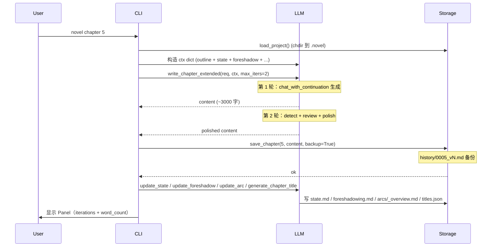

### 5.2 novel auto 完整生命周期

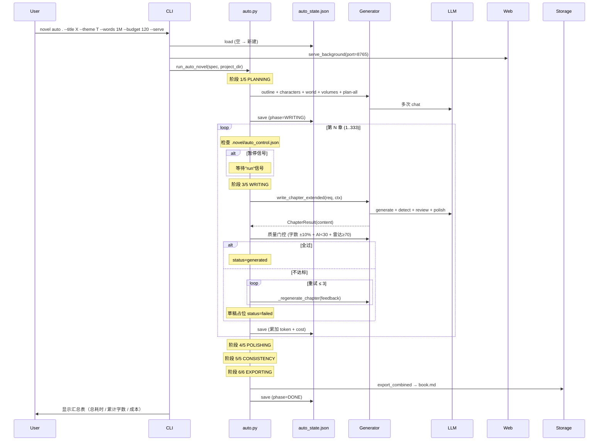

### 5.3 数据流向

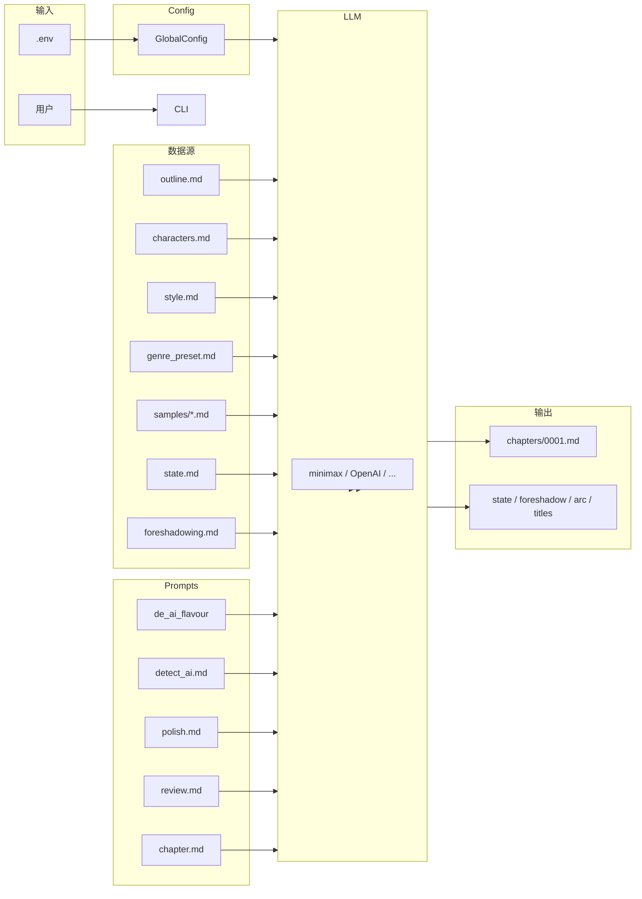

---

## 6. 扩展指南

### 6.1 新增 CLI 命令

```python
# novel_cli.py
@app.command()
def my_new_cmd(name: str = typer.Argument(...), verbose: bool = False):
    """命令的 docstring 会显示在 --help。"""
    proj = _load_project()
    cfg = load_global()
    client = LLMClient(cfg)
    
    try:
        result = G.some_function(proj, client, ...)
    except Exception as e:
        console.print(f"[red]错误：{e}[/red]")
        raise typer.Exit(1)
    
    console.print(Panel(result, title="完成"))
```

**位置**：放在 `templates` 命令前。
**测试**：在 `tests/test_cli.py` 加 `TestMyCmd` 类。

### 6.2 新增提示词

```bash
# 1. 创建 prompts/my_new.md（用 markdown 而非 Python dict）
cat > prompts/my_new.md << 'EOF'
## 任务说明
你的任务是...

## 输出格式
...
EOF
```

```python
# 2. 在 novel/prompts.py 加 lru_cache 加载
@lru_cache(maxsize=1)
def my_new():
    return _load("my_new.md")

# 3. 在 novel/prompts.py 加 builder
def build_my_new_messages(ctx, ...):
    sys = de_ai_flavour() + ... + my_new()
    user = "..."
    return [Message("system", sys), Message("user", user)]
```

```python
# 4. 在 novel_cli.py 加命令（如需要 CLI 入口）
@app.command()
def my_command(x: str):
    """my 新命令。"""
    proj = _load_project()
    msgs = P.build_my_new_messages(...)
    res = LLMClient(load_global()).chat(msgs)
    console.print(res.content)
```

### 6.3 新增题材 / 文风预设

```bash
# 编辑 prompts/genre_presets.md 或 prompts/webnovel_genres.md
cat >> prompts/genre_presets.md << 'EOF'

# 推理
- 硬规则：逻辑严密，每章结尾有反转...
- 作家参考：阿加莎·克里斯蒂纳、东野圭吾
- 容易翻车：直接给出凶手太早
EOF
```

`novel genres` 自动列出（数 `# 标题` 数量）。
`--genre 推理` 自动匹配（4 级匹配算法见 §4.4.3）。

### 6.4 替换 LLM

```python
# 任何 OpenAI Chat Completions 协议
# 修改 .env：
OPENAI_BASE_URL=https://api.openai.com/v1
OPENAI_MODEL=gpt-4o

# 或临时
novel config --base-url https://api.openai.com/v1 --model gpt-4o
```

价格表在 `novel/budget.py` `MODEL_PRICES_CNY_PER_1M`，新增模型：

```python
MODEL_PRICES_CNY_PER_1M["gpt-5"] = (50.0, 150.0)
```

### 6.5 改长篇自动维护策略

每章写完后 `write_chapter_extended` 自动调：

```python
# novel/generator.py 第 586-627 行
if project and update_after:
    update_state(project, client=client, lookback=3)  # ← 改这个函数
    update_foreshadow(project, client=client, lookback=2)
    update_arc(project, client=client, lookback=3)
    if (chapter_no - 1) % 5 == 4:
        update_rolling_summary(project, client=client)
    generate_chapter_title(project, chapter_no, client=client)
```

要新增一种记忆（如"场景设定簿"）：
1. 在 `novel/storage.py` 加 path property
2. 在 `generator.py` 加 `update_scenes(project, client, lookback=N)` 函数
3. 在 `novel/prompts.py` 加 `build_scene_messages` + `scenes.md`
4. 在 `write_chapter_extended` 调 `update_scenes`
5. 在 `ChapterContext` 加 `scenes` 字段
6. 在 `build_chapter_messages` 拼接

### 6.6 增量自定义章节生成器

如果你不想用默认的 write_chapter_extended：

```python
# novel/generator.py 加新函数
def write_chapter_with_examples(req, ctx, project=None, client=None):
    """带 few-shot 示例的章节生成。"""
    msgs = build_chapter_messages_with_examples(ctx, examples=load_my_examples())
    res = LLMClient(load_global()).chat(msgs)
    return res.content
```

然后在 CLI 里加命令调用即可，不影响其他模块。

---

## 7. 测试架构

### 7.1 测试结构

```text
tests/
├── __init__.py             # 让 tests 可作为包导入
├── conftest.py             # 共用 fixture（auto_dry_run_env 等）
├── test_llm.py             # _strip_think_tags / LLMResult / DRY_RUN
├── test_storage.py         # Project / save_chapter / ProjectNotFoundError
├── test_prompts.py         # 题材匹配 / 消息构建 / 缓存
├── test_diff_and_config.py # diff_stats / env helpers / GlobalConfig
├── test_cli.py             # version / setup / init / doctor / list / info / whereami
├── test_auto.py            # DRY_RUN 端到端 + 续跑
├── test_auto_state.py      # AutoState 序列化 / 原子写
├── test_quality_gates.py   # 字数 / AI 味 / 雷达 / 解析
├── test_budget.py         # 价格表 / 累加 / 超预算 / 降级
├── test_web.py             # HTTP 端点 / 控制信号
├── test_status_watch.py    # status --watch 终端模式
└── test_plan_all.py        # plan-all / plans / --plans-only
```

### 7.2 测试约定

| 场景 | 模式 |
|---|---|
| 不调 API | `DRY_RUN=true` + `monkeypatch.setenv` |
| 真实 LLM | `@pytest.mark.slow + @pytest.mark.network`（默认跳过）|
| 临时目录 | `tmp_path` fixture |
| 模拟 LLM 异常 | `monkeypatch.setattr(client, "chat", lambda *a, **k: raise LLMError)` |
| 测试 CLI | `typer.testing.CliRunner()` + `runner.invoke(app, [...])` |

### 7.3 跑测试

```bash
# 全跑（默认排除 slow + network）
pytest tests/

# 只跑快测试
pytest tests/ -m "not slow and not network"

# 跑特定文件
pytest tests/test_llm.py -v

# 跑特定测试
pytest tests/test_llm.py::TestStripThinkTags::test_third_layer

# 带输出
pytest tests/ -s

# 覆盖率
pytest tests/ --cov=novel --cov=novel_cli --cov-report=term-missing
```

### 7.4 CI 配置（.github/workflows/ci.yml）

```yaml
matrix:
  python-version: ["3.10", "3.11", "3.12"]
steps:
  - pip install -e ".[dev]"
  - ruff check novel/ novel_cli.py tests/
  - ruff format --check novel/ novel_cli.py tests/
  - pytest tests/ --tb=short -q
  - bash tests/smoke_test.sh
```

3 矩阵 ×（lint + 单测 + smoke）= 完整 CI 覆盖。

---

## 8. 维护者排查手册

### 8.1 章节生成为什么空白？

```mermaid
flowchart TB
    A[章节空白] --> B{文件存在?}
    B -->|否| C[从未生成]
    B -->|是| D{文件大小?}
    D -->|0| E[LLM 失败或 think 截断]
    D -->|< 100| F[字数异常]
    D -->|> 100| G[正常]

    E --> H[检查 .novel/chapters/]
    E --> I[nano .env 查 API key]
    E --> J[nano .novel/reports/detect_NNNN.md 看 think 残片]
    F --> K[novel retry-stuck --iters 2]
```

### 8.2 跨章一致性为什么漂移？

人物名漂移：

```bash
# 1. 查人名冲突
grep -E "陈小军|霍小军|程小军" .novel/chapters/*.md

# 2. 看 arcs/_overview.md 当前人物设定
cat .novel/arcs/_overview.md

# 3. 强制统一
novel chat 5 '把"陈小军"全部改成"霍小军"'
```

时间漂移：

```bash
# 1. 看 .novel/timeline.md 当前时间线
cat .novel/timeline.md

# 2. 跑一致性检查
novel check
```

### 8.3 novel write / novel auto 中途崩了？

```bash
# 1. 看 state 当前阶段 + 已完成章节
cat .novel/auto_state.json | python3 -m json.tool | head -50

# 2. 续跑（自动检测；底层是 run_auto_novel 加载 .novel/auto_state.json）
cd /path/to/project
novel write . --title "..." --theme "..."  # 推荐入口
# 等价：
novel auto . --title "..." --theme "..."   # 底层入口

# 3. 完全重头（覆盖旧进度）
novel write . ... --fresh

# 注：v0.11 的 --resume 已改为自动检测
#      （修了一个 resume= → state= 的 TypeError 隐患，见 novel_cli.py:1967 提交 332b835）
```

### 8.4 提示词改了不生效？

```python
# 检查 lru_cache 缓存
from novel.prompts import de_ai_flavour
print(de_ai_flavour.cache_info())  # 看 hits / misses / currsize

# 强制清除缓存
from novel.prompts import _load
_load.cache_clear()

# 注意：lru_cache(maxsize=1) 在开发时每次改 md 不重启进程不会重新读盘
```

### 8.5 仪表盘看不到数据？

```bash
# 1. 看 state.json 是否存在
ls -la .novel/auto_state.json

# 2. 看格式是否正确
python3 -c "import json; print(json.dumps(json.load(open('.novel/auto_state.json')), indent=2)[:500])"

# 3. 启动仪表盘（端口冲突？）
novel serve --port 8765

# 4. 浏览器开 Network 面板看 /api/state 返回
# 200 = 正常
# 404 = 端口错
```

### 8.6 测试失败怎么排查？

```bash
# 看具体失败
pytest tests/test_x.py -v --tb=long

# 跑某个测试
pytest tests/test_x.py::TestClass::test_method -v --tb=long

# 加 -s 看 print
pytest tests/test_x.py -s

# 看 fixtures 错误
pytest tests/test_x.py --setup-show
```

### 8.7 添加新功能 Checklist

- [ ] 写新模块（或改现有模块）
- [ ] 在 `novel/__init__.py` 导出（如需要）
- [ ] 在 `novel_cli.py` 加命令（如需要 CLI 入口）
- [ ] 在 `prompts/` 加提示词（如需要 LLM 调用）
- [ ] 写单测：模块逻辑 + CLI 入口 + DRY_RUN 集成
- [ ] 更新 README.md 命令速查
- [ ] 更新 USER_MANUAL.md 教程
- [ ] 更新 PROGRESS.md 版本日志
- [ ] 更新 CHANGELOG.md
- [ ] ruff check + pytest 全过
- [ ] commit + push

---

## 附录 A：调试速查

### A.1 常用调试命令

```bash
# 看 LLM 配置
novel config --show

# 验证项目结构
novel doctor --json

# 看当前进度
cat .novel/auto_state.json | python3 -m json.tool | head -50

# 看章纲
ls .novel/chapter_plans/

# 看历史
ls .novel/history/

# 看元数据
ls .novel/*.md
```

### A.2 性能调优点

| 慢在哪 | 优化 |
|---|---|
| think 截断频繁 | 改 `chapter.md` 减少指令长度 |
| 长 prompt 超时 | 减少 `lookback`，砍 state.md |
| 单章太慢 | `--quality draft` 或 `deepseek-chat` |
| 生成多重复 | 检查 `_strip_think_tags` 的 4 层 |

### A.3 模块依赖反向检查

```bash
# 确认 config 不被业务模块引用（除了 llm）
grep -l "from novel.config" novel/*.py
# 应该只有 llm.py 和 storage.py

# 确认没有循环依赖
python3 -c "
import novel.config
import novel.llm
import novel.storage
import novel.prompts
import novel.generator
import novel.auto
print('all imports OK')
"
```

---

## 9. v0.12 端到端定位实现

### 9.1 novel write 顶层入口

**位置**：`novel_cli.py:236`（`@app.command(name="write")`）

两条工作流分支都封装在这一个 typer 函数里。**关键设计选择**：

| 关注点 | 设计 | 原因 |
|---|---|---|
| 输入校验 | `--title` 与 `--from-source` 都可省，但**至少其一** | 单写一行可触发，但用户不能「什么都不指定」就跑 |
| 标题覆盖 | `--from-source` + `--title`：用 `--title` 替代 auto-derived 标题 | mock-source 给出默认标题"基于《X》的方向"，用户可改名 |
| 模板快速入口 | `--template` 走 init `--template` 的同款 `apply_template()` 逻辑 | 复用 None 过滤修复（避免重复 bug） |
| 内部 helper | 抽出 `_run_auto_via_spec(spec, project_dir, cfg, ...)` 处理 `--serve` + `run_auto_novel()` | 需求驱动与模仿驱动共用同一 helper |

### 9.2 spec_from_project helper

**位置**：`novel/auto.py:534`

```python
def spec_from_project(
    project_dir: Path,
    quality: QualityPreset = QualityPreset.PREMIUM,
    target_chapters: int = 0,
) -> _AutoSpec:
    proj = S.load_project(project_dir)
    meta = proj.meta or {}
    target_words = int(meta.get("target_words") or 100000)
    return _AutoSpec(
        title=proj.title,
        theme=meta.get("theme", ""),
        genre=meta.get("genre", "现实 / 严肃文学"),
        style=meta.get("style_preset", ""),
        target_words=target_words,
        target_chapters=target_chapters,  # 0 → AutoSpec.__post_init__ 自动算
        quality=quality,
    )
```

**使用场景**：CLI 里如果先 `init --template X` 再 `write --quality premium`，可以用这个 helper 复用 init 时写入的元数据，避免重复输入。

### 9.3 删除命令的代码清理

#### 9.3.1 `plan` / `plan-all` / `plans` / `sprint` / `batch` / 旧 `write`

删除前 `novel_cli.py` 有 ~200 行手动 chapter 控制代码（plan-all 循环 + sprint 调 write + batch 4 分支）。删除后：

- `_planning_phase`（`novel/auto.py:96`）自动批量化生成 outline / characters / world / volumes / chapter_plans
- `auto` 续跑自动跳过已写章节（`_writing_phase` 调 `state.is_chapter_done(n)`）
- `_polishing_phase` / `_consistency_phase` 替代 `batch` 的 4 个分支
- `novel write` 顶层入口替代旧 `write --start --end` 的功能

**测试同步清理**：删除 `tests/test_plan_all.py`（8 个失效测试用例）。新增 `tests/test_write.py`（8 个用例）。

#### 9.3.2 隐藏 bug 修复（commit 332b835）

`novel_cli.py` 调用 `run_auto_novel()` 时错传 `resume=`（应为 `state=`）。

```python
# 修复前（潜在 TypeError）
out = run_auto_novel(spec, proj.root, cfg=cfg,
                     resume=effective_resume, budget_cny=budget,
                     plans_only=plans_only, skip_plans=skip_plans)

# 修复后（state=None 让 run_auto_novel 从 .novel/auto_state.json 自动加载）
out = run_auto_novel(spec, proj.root, cfg=cfg,
                     budget_cny=budget,
                     plans_only=plans_only, skip_plans=skip_plans)
```

### 9.4 模仿驱动的实现要点

**`novel_cli.py:298-356`**：

```python
if from_source is not None:
    # 1. 读源
    src = src_path.read_text(...)
    # 2. extract_skeleton + adapt_novel（复用已有模块）
    skeleton = G.extract_skeleton(src, client=client)
    adapt_text = G.adapt_novel(src, direction, genre, style,
                                client=client, skeleton_text=skeleton)
    # 3. init 项目；保存 adapt.md 作为参考
    proj = S.init_project(project_dir, init_title, theme=theme,
                          meta={"genre": genre, "target_words": words,
                                "source": from_source, "direction": direction})
    (proj.novel_dir / "adapt.md").write_text(
        "# 源小说骨架\n\n" + skeleton + "\n\n---\n\n# 改编方案\n\n" + adapt_text,
        encoding="utf-8")
    # 4. 关键：把 adapt_text 预填到 outline.md，让 _planning_phase 跳过大纲生成
    proj.outline_path.write_text(
        "# 大纲（基于模仿改编）\n\n" + adapt_text + "\n", encoding="utf-8")
    # 5. 跑 auto（--skip_plans=True 跳过 PLANNING 阶段）
    spec = AutoSpec(title=init_title, ..., target_words=words)
    return _run_auto_via_spec(spec, project_dir, cfg, ..., skip_plans=True)
```

### 9.5 webnovel-pack --auto 改造

**位置**：`novel_cli.py:842`（`@app.command(name="webnovel-pack")`）

新加 `--auto` / `--quality` / `--budget` flag。不加 `--auto` 时行为不变（向后兼容）；加 `--auto` 时：

1. 先建项目骨架（与 v0.11 完全一致）
2. 预填 `outline.md` 为 webnovel 黄金三章骨架内容
3. 调 `run_auto_novel(spec, target, cfg=cfg)` 走 6 阶段流水线

### 9.6 测试覆盖

`tests/test_write.py` 新增（**8 个用例**）：

| 测试类 | 用例 |
|---|---|
| `TestWriteDemand` | 必须给输入；--title + --from-source 不互斥；需求驱动端到端 DRY_RUN |
| `TestWriteAdapt` | 源不存在报错；模仿驱动端到端；--title 覆盖 auto-derived 标题 |
| `TestWriteMisc` | --help 显示 4 个 flag；--template 填充默认；--template 未知报错 |

`tests/test_templates.py` 16 个用例（之前已加）。

`tests/test_plan_all.py` 删除（8 个失效）。

全套 **217 用例**，本地 `tests/smoke_test.sh` 跑通。

---

## 10. v0.13 并发章节生成实现

### 10.1 改动的范围

| 文件 | 改动 | 性质 |
|---|---|---|
| `novel/auto_state.py:83` | `parallel: bool = False` → `parallel: int = 0` + `__post_init__` 负数归零 | 字段语义升级 |
| `novel/auto.py:~430` | 新增 `_writing_phase_parallel` + `_write_one_chapter_locked` | 新增并发路径 |
| `novel/auto.py:357` | `_writing_phase` 加 dispatch：parallel>=2 走并发 | 串行路径不变 |
| `novel_cli.py:255/1852/887` | `novel write` / `novel auto` / `webnovel-pack --auto` 加 `--parallel` flag | CLI 参数 |
| `pyproject.toml` + `novel/__init__.py` | 0.12.0 → 0.13.0 | 版本号 bump |
| `tests/test_auto_parallel.py` | 新增 11 用例 | 测试 |

### 10.2 并发安全设计

#### 10.2.1 四个并发问题

| 问题 | 触发条件 | 解决 |
|---|---|---|
| state.json 写竞争 | 多 worker 同时 `state.save()` 拼字符串 | `threading.Lock()` 串行化整个 save 区块 |
| progress.update 竞争 | Rich Progress 单线程设计；并发写 display buffer | `threading.Lock()` + `safe_progress` callable |
| 跨 worker 章节顺序（prev_tail） | 第 N+1 章的 LLM prompt 需要第 N 章的尾部 | `prev_cache: dict[int, str]` 跨 worker 共享，worker 取上一章内容优先用 cache |
| 控制信号文件读取 | 多个 worker 同时 `cat .novel/auto_control.json` | OS 文件读写原子性保证 |

#### 10.2.2 prev_cache 跨 worker 传递

`_build_chapter_ctx` 默认从磁盘读 `prev_chapter_tail`。并发场景下，第 N+1 章 worker 可能先于第 N 章 worker 启动，从磁盘读的是 N 章的旧值（resume 场景）或空（首次跑）。

**解决方案**：每个 worker 写完一章后，把 `(chapter_no, content)` 写进 `prev_cache` 字典；下一个 worker 取 `prev_cache[n-1]` 覆盖 ctx 里默认的 prev_tail：

```python
# _writing_phase_parallel 核心逻辑（伪代码）
prev_cache = {}  # 共享 dict
prev_cache_lock = threading.Lock()

def worker(n):
    ctx = _build_chapter_ctx(project, n)  # 从磁盘读（兜底）
    with prev_cache_lock:
        prev = prev_cache.get(n - 1)  # 优先用 in-flight 缓存
    if prev is not None:
        ctx["prev_chapter_tail"] = prev[-500:]
    
    result = _write_one_chapter_locked(...)
    
    with state_lock:
        state.mark_chapter_done(result)
        state.save(project.root)
        prev_cache[n] = result.content  # 缓存给后续 worker
```

### 10.3 为什么不直接 asyncio / process pool

| 选项 | 优点 | 缺点 |
|---|---|---|
| ThreadPool（已选） | 共享 state/progress 对象；LLM I/O-bound 适合线程 | 受 GIL 限制（但 I/O 调用期间 GIL 释放） |
| ProcessPool | 真正并行 | state/process/progress 都得 multiprocessing.Manager 序列化；现有代码全 in-process 改造成本巨大 |
| asyncio + aiohttp | 单线程内并发 I/O | LLMClient 用 `requests` 同步，改造面更大 |

**结论**：线程 + 锁是当前最匹配的实现。真正的 process-level 并发是 v0.14+ 的工作。

### 10.4 性能数据（DRY_RUN 模式无效）

DRY_RUN 下 LLM 直接返回占位字符串，所有并发开销体现在 11 个测试用例的执行时间上。
真 API 模式预期数据：

| parallel | 6 章预期 | 30 章预期 | 60 章预期 |
|---|---|---|---|
| 1（串行，v0.12） | 5-15 分钟 | 25-75 分钟 | 50-150 分钟 |
| 3 | 2-5 分钟（节省 60%） | 8-25 分钟（节省 65%） | 16-50 分钟 |
| 8 | 1-2 分钟（节省 80%） | 4-12 分钟（节省 75%） | 8-25 分钟 |

> 实测数据待补：要先跑一次真 API 项目才能给出准确值。读者跑完后欢迎 PR 数据。

### 10.5 并发模式的踩坑点

1. **state.save() 频繁 IO**：每章一次 JSON 序列化 + 写盘。并发下 lock 等待。如果觉得慢可以把 batch 化（v0.14+ TODO）。
2. **prev_cache 内存占用**：~content_size × chapters_total。30K 字一章 × 100 章 = 3MB，可忽略。
3. **chapter_results dict**：每个 ChapterResult 约 200B × 100 = 20KB，可忽略。
4. **rich Progress 多线程**：实测 13.0+ 对并发 update 比较宽容，但极端情况（>10 workers）可能闪烁。
5. **控制信号文件**：`signal.json` 由信号写入线程读，并发安全（OS 文件读写原子）。

### 10.6 测试覆盖

| 测试类 | 用例数 | 关注点 |
|---|---|---|
| `TestParallelDispatch` | 3 | AutoSpec 字段语义 |
| `TestParallelEndToEnd` | 3 | parallel=4 / parallel=8 / parallel=1 端到端 |
| `TestParallelCLI` | 3 | write/auto/webnovel-pack `--parallel` 透传 |
| `TestParallelStateSafety` | 2 | state.json JSON 合法 + cumulative_tokens 不为负 |

---

## 相关文档

## 相关文档

- [DESIGN.md](DESIGN.md) · 高层设计决策
- [USER_MANUAL.md](USER_MANUAL.md) · 用户使用手册
- [BEST_PRACTICES.md](BEST_PRACTICES.md) · 实战最佳实践
- [REQUIREMENTS.md](REQUIREMENTS.md) · 需求规格
- [PROGRESS.md](../PROGRESS.md) · 演进日志
- [CHANGELOG.md](../CHANGELOG.md) · 版本日志
- [CONTRIBUTING.md](../CONTRIBUTING.md) · 贡献指南