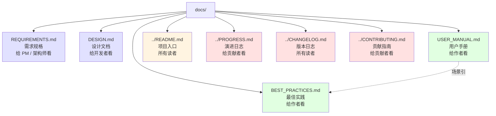
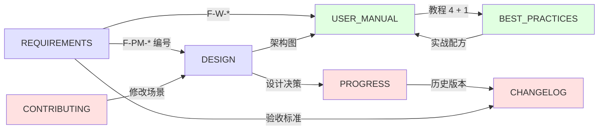

# 文档索引

novel-writer v0.11 的完整文档集，按读者角色分类。

---

## 📚 文档地图

---

## 🚀 按角色阅读

### 我是作者（想写小说）

| 顺序 | 文档 | 用途 |
|------|------|------|
| 1 | [USER_MANUAL.md](USER_MANUAL.md) | 安装 + 快速开始 + 教程 |
| 2 | [BEST_PRACTICES.md](BEST_PRACTICES.md) | 题材搭配、降 AI 味技巧 |
| 3 | [../README.md](../README.md) | 命令速查 |

### 我是开发者（想参与）

| 顺序 | 文档 | 用途 |
|------|------|------|
| 1 | [DESIGN.md](DESIGN.md) | 架构 + 数据流 + 关键模块 |
| 2 | [../CONTRIBUTING.md](../CONTRIBUTING.md) | 开发流程 + PR 规范 |
| 3 | [REQUIREMENTS.md](REQUIREMENTS.md) | 需求规格 |
| 4 | [../PROGRESS.md](../PROGRESS.md) | 演进日志（设计决策） |

### 我是 PM / 架构师

| 顺序 | 文档 | 用途 |
|------|------|------|
| 1 | [REQUIREMENTS.md](REQUIREMENTS.md) | 功能/非功能需求 |
| 2 | [DESIGN.md](DESIGN.md) | 架构与决策 |
| 3 | [../PROGRESS.md](../PROGRESS.md) | 设计哲学与演进 |

---

## 📖 各文档摘要

### [REQUIREMENTS.md](REQUIREMENTS.md)

- 项目目标与 8 项 P0/P1 优先级
- 3 类用户画像（长篇 / 网文 / 改编作者）
- 46 个功能需求编号（F-PM-1 到 F-C-6）
- 6 类非功能需求（兼容 / 性能 / 可靠性 / 可观测 / 可移植 / 可维护 / 可扩展）
- 4 类约束（LLM / 文件 / 用户）
- 验收标准 + 未来路线图

### [DESIGN.md](DESIGN.md)

- 分层架构图（用户 / CLI / 业务 / 基础）
- 模块依赖矩阵（无环设计）
- 项目结构图（.novel/ 子目录树）
- 元数据流时序图（写一章自动更新所有元数据）
- 长篇一致性机制（5 种长期记忆）
- LLM 适配层（think 剥离 4 层兜底 + chat_with_continuation）
- 提示词系统（3 层：de_ai_flavour / 任务模板 / 用户上下文）
- 题材 / 文风匹配流程
- 状态管理（自动维护触发条件）
- 异常处理（重试 / 残片兜底）
- 11 项关键设计决策

### [USER_MANUAL.md](USER_MANUAL.md)

- 5 分钟跑通第一个项目（短）
- 安装与配置 3 种方式（向导 / 手动 / 环境变量）
- 4 个新手教程（短篇 / 长篇 / 网文 / 改编）
- 46 个命令分类详解
- 5 个常见工作流（短篇一天 / 长篇一周 / 协作 / 多本并行 / 改编）
- 6 类故障排查
- 10 个 FAQ（兼容性 / 字数 / 风格 / 提示词扩展 / 数据 git / 英文 / 成本 / 协作 / 剧本）
- 完整命令速查表

### [BEST_PRACTICES.md](BEST_PRACTICES.md)

- 16 个严肃向题材 × 文风推荐组合（含作家参考）
- 8 个网文题材 × 文风组合
- samples 风格样本管理（选样 / 结构 / 避坑）
- 降 AI 味 5 大来源 + 5 个具体改写技巧
- 长篇节奏控制（卷-章-节 + 黄金三章 + 检查表）
- 人设一致性（5+ 维度人物档案）
- 多轮审稿策略（默认 / 关闭 / 自定义）
- 成本与速度平衡（3 套配方）
- 5 个场景实战配方（双雪涛风 / 汪曾祺风 / 修仙网文 / 改编）
- 9 类避坑清单（提示词 / 工作流 / 数据 / 工具 / 性能）
- 4 个进阶技巧（多书串联 / 接力续写 / 风格 A/B / 写作日历）

---

## 🔗 文档交叉引用

---

## 📊 文档统计

| 文档 | 行数 | 章节数 | 图表 |
|------|------|--------|------|
| REQUIREMENTS.md | ~500 | 7 | 0 |
| DESIGN.md | ~700 | 12 | **20+ mermaid** |
| USER_MANUAL.md | ~600 | 7 | **6 mermaid** |
| BEST_PRACTICES.md | ~700 | 10 | **5 mermaid** |
| README.md（主） | ~500 | 8 | 表格 |
| PROGRESS.md | ~250 | 7 | 0 |
| CHANGELOG.md | ~250 | 13 | 0 |
| CONTRIBUTING.md | ~250 | 8 | 0 |
| **合计** | **~3700** | **70+** | **30+ mermaid** |

---

## 🆘 我有问题

| 问题类型 | 看哪里 |
|------|------|
| 怎么装 / 怎么用 | [USER_MANUAL.md](USER_MANUAL.md) § 2-3 |
| 命令怎么用 | [USER_MANUAL.md](USER_MANUAL.md) § 4 或主 README |
| 怎么写得更好 | [BEST_PRACTICES.md](BEST_PRACTICES.md) |
| 怎么改架构 | [DESIGN.md](DESIGN.md) |
| 项目为什么这样设计 | [../PROGRESS.md](../PROGRESS.md) |
| 哪一版有什么 | [CHANGELOG.md](../CHANGELOG.md) |
| 怎么贡献 | [CONTRIBUTING.md](../CONTRIBUTING.md) |

---

## 📝 文档维护

- 更新本文档时同步更新底部交叉引用
- 任何架构变更需要更新 [DESIGN.md](DESIGN.md)
- 任何新命令需要更新 [USER_MANUAL.md](USER_MANUAL.md)
- 任何实战经验需要更新 [BEST_PRACTICES.md](BEST_PRACTICES.md)
- 任何版本变更需要更新 [CHANGELOG.md](../CHANGELOG.md) + [PROGRESS.md](../PROGRESS.md)

---

最后更新：v0.11.0