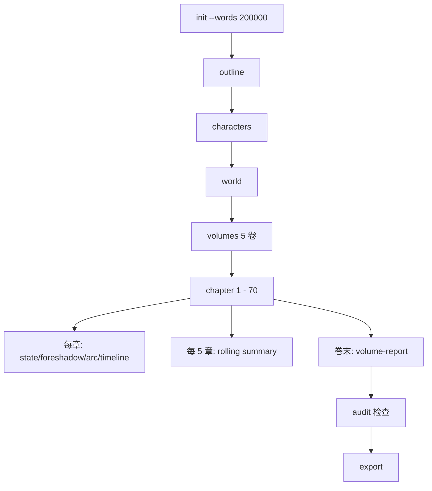

# novel-writer · 用户手册

> v0.11 · 完整使用指南

## 目录

1. [快速开始](#1-快速开始)（5 分钟上手）
2. [安装与配置](#2-安装与配置)
3. [教程：5 种典型用法](#3-教程5种典型用法)
4. [命令详解](#4-命令详解)
5. [常见工作流](#5-常见工作流)
6. [故障排查](#6-故障排查)
7. [FAQ](#7-faq)
8. [附录：命令速查](#附录命令速查-47-个)

---

## 1. 快速开始

```bash
# 1. 装包
pip install -e .

# 2. 配置（交互式，密码隐藏输入）
novel setup

# 3. 一行写完整本书（v0.12 起推荐用 novel write）

# 入口 A：需求驱动（题目 + 风格 + 字数 → 自动写完整本）
novel write my_novel \
  --title "冬夜的灰" \
  --theme "1995 年东北小镇的命案与四个孩子" \
  --genre 悬疑 --style 冷峻 --words 60000 \
  --quality premium --serve

# 入口 B：模仿驱动（TXT 源小说 → 提骨架 → 自动写完整本）
novel write fanfic \
  --from-source 白夜行.txt \
  --direction 换壳 --genre 校园 --style 冷峻 \
  --words 60000 --title "夜行"

# 入口 C：网文专项（一键网文包 + 端到端）
novel webnovel-pack my_xuanhuan \
  --title "凡人仙途" --theme "凡人逆袭" \
  --idea "残破玉佩" --auto --words 500000
```

跑完之后：

```bash
cd my_novel
novel status                       # 看章节进度
novel doctor                       # 诊断（加 --fix 自动修复）
novel chat 3 "把结尾放慢一些"      # 自然语言协作修改
```

> **旧工作流（v0.11 及以前）**：仍是合法的 — 用 `novel init + novel chapter N` 手动逐步写，
> 或 `novel auto` 走 6 阶段流水线。`novel write` 是新的统一入口。

# 6. 看进度
# 浏览器：http://127.0.0.1:8765 （novel auto --serve 启动后）
# 或终端：novel status --watch --auto
```

---

## 2. 安装与配置

### 2.1 系统要求

- Python 3.10+
- pip
- 任意 OpenAI Chat Completions 协议 API（默认 minimax）

### 2.2 安装

```bash
git clone <repo> ai-novel && cd ai-novel
pip install -e .             # 标准
pip install -e ".[dev]"      # 含 pytest + ruff（开发用）
```

### 2.3 配置 API（三选一）

| 方式 | 命令 / 文件 | 适合 |
|------|------------|------|
| **A. 向导**（交互） | `novel setup` | 首次（推荐） |
| **B. 复制 .env** | `cp .env.example .env` 后编辑 | 离线 / 已有 key |
| **C. 环境变量** | `export OPENAI_API_KEY=...` | CI / 脚本 |

**向导示例**：

```bash
$ novel setup
╭───────── novel setup ─────────╮
│ novel-writer 首次配置向导        │
│                                │
│ 下面会询问：API 地址、API key、  │
│ 模型、温度、DRY_RUN。           │
╰────────────────────────────────╯
API base URL: https://api.minimaxi.com/v1
API key: ************          ← 密码不回显
模型: minimax-Text-01
temperature（0.7 稳 / 0.95 放飞）: 0.9
目标章节字数: 3000
开启 DRY_RUN 模式? [否]y  # false 是 True
✓ 已写入: /path/to/.env
```

**.env** 关键字段：

```env
OPENAI_BASE_URL=https://api.minimaxi.com/v1
OPENAI_API_KEY=your-key
OPENAI_MODEL=minimax-Text-01    # 或 minimax-M3 / gpt-4o / deepseek-chat
TEMPERATURE=0.9
TARGET_CHAPTER_WORDS=3000
DRY_RUN=false
```

### 2.4 切换模型

```bash
# 临时：命令行
novel config --base-url https://api.openai.com/v1 --model gpt-4o

# 永久：写到 .env
novel config --api-key xxx --model gpt-4o

# 重置
novel setup --force
```

### 2.5 验证环境

```bash
novel doctor
```

应报告"未找到 .novel 项目目录"是预期行为——还没建项目。其他应该全绿。

---

## 3. 教程：5 种典型用法

### 教程 1：5 分钟跑通短篇

```bash
novel setup
novel init short \
  --title "窗台上的橘子" --theme "孤独老人与橘子" \
  --genre 现实 --style 诗意 --words 30000  # 10 章

cd short
novel outline
novel chapter 1    # ~3000 字
novel chapter 2
novel export       # → book.md
```

### 教程 2：长篇 1 周出 70%



```bash
novel init long --title "百年孤影" --theme "东北四代人" \
  --genre 现实 --style 冷峻 --words 200000

cd long
novel outline; novel characters; novel world; novel volumes

# 写（手动单章）
novel chapter 1

# 推荐用 novel write 一行写完整本（v0.12 统一入口）
novel write demo --title X --theme Y --genre Z --style W --words N

# 自动维护：state / foreshadow / arc / timeline / title 每章都更新
# 滚动摘要每 5 章
# 卷末报告每卷

# 检查
novel check
novel audit
novel export
```

### 教程 3：100 万字玄幻仙侠（两阶段工作流）


```bash
# 阶段 A：生成大纲 + 所有章纲（30-60 分钟 API 调用）
novel webnovel-pack xiuxian \
  --title "凡人仙途" --theme "凡人逆袭" \
  --genre 修仙 --style 经典爽文 \
  --words 1000000 --idea "残破玉佩金手指"

cd xiuxian
# v0.12 推荐用法：用 novel write --plans-only 只生成章纲不写章节
novel write . --title "凡人仙途" --theme "凡人逆袭修仙" \
  --genre 修仙 --style 经典爽文 --words 1000000 \
  --idea "残破玉佩金手指" --plans-only

# 生成完章纲后人工审核（manual 命令保留）
ls .novel/chapter_plans | wc -l   # 应该看到大量章纲
nano .novel/chapter_plans/0005.md  # 手工调
# 重生成某章：删除文件后重跑 plans-only

# 阶段 C：自动写正文（8-15 小时）
novel auto . -t "凡人仙途" --theme "..." \
  --genre 修仙 --style 经典爽文 \
  --words 1000000 --quality premium --budget 120 \
  --skip-plans --serve --serve-port 8765
# --skip-plans：跳过规划（已生成）
# --serve：后台启动 Web 仪表盘
# --budget 120：¥120 上限
```

打开 http://127.0.0.1:8765 看实时进度。

### 教程 4：网文冲量

```bash
# 一键建项目（黄金三章骨架）
novel webnovel-pack cultivation \
  --title "凡人修仙之xxx" --theme "凡人觉醒" \
  --genre 修仙 --style 经典爽文 \
  --idea "金手指：残破玉佩"

cd cultivation

# 黄金三章
novel chapter 1    # 困境
novel chapter 2    # 觉醒
novel chapter 3    # 打脸

# 升级流（v0.12 推荐用 novel write 一次写一段）
novel write demo --title "..." --genre 修仙 --words 50000

# 看半年成本
cat .novel/auto_state.json | python3 -m json.tool | grep -E "cumulative|budget"
```

### 教程 5：改编高热度小说

```bash
# 准备源小说信息
cat > source.txt << 'EOF'
《白夜行》东野圭吾
核心冲突：桐原亮司与雪穗共生 22 年。
EOF

# 一步改编
novel adapt -i source.txt \
  --direction 换名+换壳 --genre 校园 --style 冷峻 \
  --title "夜行"

# 改编方案存到 .novel/adapt.md
cat .novel/adapt.md

# 基于改编方案继续
novel outline
novel chapter 1
```

---

## 4. 命令详解

> 47 个命令，按 7 类组织。每条标注：用途 / 参数 / 示例。

### 4.1 基础（10 个）

| 命令 | 用途 | 关键参数 |
|---|---|---|
| `novel init <name>` | 建项目 | `--title --theme --genre --style --words` |
| `novel setup` | 配置向导 | `--force --no-input` |
| `novel config` | 改 config | `--base-url --model --api-key --dry-run/--no-dry-run` |
| `novel status` | 看项目 | `--watch --auto --interval` |
| `novel version` | 看版本 | `--no-output` 只输出版本号 |
| `novel doctor` | 诊断 | `--fix --json` |
| `novel list` | 列目录项目 | `--path --depth` |
| `novel info <name>` | 看单项目 | 无 |
| `novel whereami` | 当前项目 | 无 |
| `novel templates` | 推荐模板 | 无 |
| `novel serve` | Web 仪表盘 | `--port --host --open/--no-open` |

**`novel status --watch`**：终端版仪表盘
```bash
novel status --watch             # 完整项目状态
novel status --watch --auto      # 只看 auto 进度 / token / 成本
novel status --watch --interval 5  # 自定义刷新间隔
```

**`novel serve`**：浏览器版仪表盘
```bash
cd my_novel && novel serve         # 默认 http://127.0.0.1:8765
novel auto ... --serve --serve-port 9000  # auto 跑时同步启动
```

### 4.2 规划（6 个）

| 命令 | 用途 | 备注 |
|---|---|---|
| `novel outline` | 生成 / 重写全书大纲 | `--genre --words --extra --save/--print` |
| `novel characters` | 生成 / 扩展人物志 | `--extra` |
| `novel world` | 世界观 | 无 |
| `novel volumes` | 长篇分卷 | 无 |

> **v0.12 变更**：`plan` / `plan-all` / `plans` 已移除，被 `novel write` 的规划阶段覆盖。如需「只生成章纲不写章节」用 `novel write --plans-only`。

### 4.3 写作（10 个）

| 命令 | 用途 | 关键参数 |
|---|---|---|
| `novel chapter N` | 写第 N 章 | `--words --iters --no-polish --extra` |
| `novel continue N --with T` | 末尾接写 | `--words` |
| `novel chat N '指令'` | 自然语言改 | 无 |
| `novel expand-scene N` | 指定位置接场景 | `--after --words` |
| `novel auto ...` | **一键全自动** | 见 §4.10 |
| `novel webnovel-pack NAME` | 一键网文项目 | `--title --theme --idea` |
| `novel adapt ...` | 改编源小说 | `--source --direction --genre --style` |
| `novel fanfic ...` | 同人 / 后传 | `--source --char --era --as-chapter` |

### 4.4 润色（4 个）

| 命令 | 用途 |
|---|---|
| `novel polish N` | 润色第 N 章（基于 detect+review 反馈） |
| `novel detect N [--save]` | 检测 AI 味 |
| `novel radar N` | 6 维度风格雷达 |

> **v0.12 变更**：`batch` 已移除，被 `novel write` 的 POLISHING + CONSISTENCY 阶段自动覆盖。

### 4.5 一致性（10 个）

| 命令 | 自动 / 手动 | 触发时机 |
|---|---|---|
| `novel state` | 自动 + 手动 | 每章 |
| `novel rolling` | 自动 + 手动 | 每 5 章 |
| `novel foreshadow` | 自动 + 手动 | 每章 |
| `novel arc` | 自动 + 手动 | 每章 |
| `novel timeline` | 自动 + 手动 | 每章 |
| `novel title N` | 自动 + 手动 | 每章 |
| `novel check` | 手动 | 看漂移 |
| `novel volume-report` | 手动 | 卷末 |
| `novel gaps` | 手动 | 看伏笔状态 |
| `novel index` | 手动 | 全书索引 |

### 4.6 版本与导出（7 个）

| 命令 | 用途 | 关键参数 |
|---|---|---|
| `novel history` | 查看历史版本 | 无 |
| `novel diff N` | 对比两版 | `--from --to --stats` |
| `novel rollback N --to vN` | 回滚到历史版本 | `--yes` 跳过确认 |
| `novel fix N` | 检测 / 修复异常章节 | `--no-dry --yes` |
| `novel retry-stuck` | 自动重写残片 | `--threshold --iters` |
| `novel audit` | 综合审计表 | `--start --end` |
| `novel export` | 合并为书稿 | `--format md/txt --output` |

### 4.7 题材 / 文风查询（4 个）

| 命令 | 列出 |
|---|---|
| `novel genres` | 严肃向 10 个题材 |
| `novel styles` | 11 个文风 |
| `novel webnovel-genres` | 网文 8 个题材 |
| `novel webnovel-styles` | 9 个爽感文风 |

### 4.8 提示词管理

| 命令 | 用途 |
|---|---|
| `novel prompt <name> --show` | 查看项目级提示词覆盖 |
| `novel prompt <name> --edit` | 用 `$EDITOR` 编辑 |
| `novel prompt <name> --reset` | 恢复默认（删项目副本）|

### 4.9 novel auto（最常用）

```bash
novel auto [NAME] [OPTIONS]

一键全自动写小说：给定最小信息，跑完规划→写作→润色→一致性→导出。

必填：
  -t, --title TEXT       小说标题
  --theme TEXT           一句话主题

常用：
  -g, --genre TEXT       题材（默认 "现实 / 严肃文学"）
  -s, --style TEXT       文风（预设名或自由描述）
  -w, --words INTEGER    目标总字数（默认 30000）
  --chapters INTEGER     显式章节数（与 --words 二选一）
  --quality [draft|standard|premium]   质量档（默认 standard）
  --budget FLOAT         成本上限 CNY（0=不限）；超额自动降级
  --serve                启动后台 Web 仪表盘
  --serve-port INTEGER   仪表盘端口（默认 8765）

控制：
  --resume               强制续跑（默认自动检测 .novel/auto_state.json）
  --fresh                强制从头跑（覆盖旧进度）
  --dry-run              DRY_RUN 模式：不调 API

布局：
  --here                 就地初始化（跳过 NAME）
  --force                目标目录非空时仍执行

特殊：
  --plans-only           只跑规划阶段（生成 outline + 章纲），不进入写作
  --skip-plans           跳过规划阶段，直接进入写作（用现有 outline / chapter_plans）

示例：
  # 6 万字悬疑严肃向
  novel auto my_novel --title "冬夜的灰" --theme "..." \
    --genre 悬疑 --style 冷峻 --words 60000 --quality premium

  # 100 万字仙侠，预算 120
  novel auto xiuxian -t "凡人仙途" --theme "..." \
    --genre 修仙 -s 经典爽文 -w 1000000 \
    --quality premium --budget 120 --serve

  # 调试：只跑规划
  novel auto --title "..." --theme "..." --plans-only --dry-run

  # 续跑
  cd my_novel
  novel auto . -t "..." --theme "..." --words 60000
```

**质量档对比**：

| 档 | 章节迭代 | 字数容差 | AI 味阈值 | 雷达阈值 | 适合 |
|---|---|---|---|---|---|
| draft | 1 | ±30% | 跳过 | 跳过 | 网文冲量 |
| standard | 2 | ±20% | < 50 | ≥ 60 | 一般场景 |
| premium | 3 | ±10% | < 30 | ≥ 70 | 严肃向 |

**自动续跑**：每章写完即保存到 `.novel/auto_state.json`，Ctrl-C 后下次 `novel auto` 自动从中断处继续。

**失败兜底**：未达标的章节保留最后一次输出（占位草稿），可后续 `novel chapter N` 手动重写。

---

## 5. 常见工作流

### 5.1 短篇：1 天写完

```bash
# 早上 30 分钟
novel init short --title "..." --words 30k
novel outline; novel characters

# 下午 2 小时（速度优先）
for i in 1 2 3 4 5 6 7 8 9 10; do
  novel chapter $i --no-polish
done

# 晚上 1 小时（手动润色已写完的章节）
novel polish 5 --extra "强化结尾余韵"
# 上面那条不再是必需的，因为 novel write 的 POLISHING 阶段已经自动跑过了。
# 只有在 auto 跑完后还想手润某章时才用 novel polish N。
```

### 5.2 长篇 1 周出 70%

| 天 | 工作 | 命令 |
|---|------|------|
| 周一 | 规划 | `outline / characters / world / volumes` |
| 周二-周四 | 写 1-25 章 | `novel chapter N` 或 `sprint --count 5` |
| 周五 | 检查 | `novel check / gaps / audit` |
| 周末 | 润色关键章 | `novel polish 1 --5 35 70` |

### 5.3 章节精修：与 LLM 来回协作

```bash
# 不满意第 5 章
novel chapter 5
novel chat 5 '对话太干瘪，加强心理戏'
novel chat 5 '加一段她在厨房洗碗的回忆'

# 末尾接场景
novel continue 5 --with '小红回到房间，发现一封信'

# 指定位置接场景
novel expand-scene 5 --after '她推开那扇门' --with '门后是陌生男人'
```

### 5.4 多本并行管理

```bash
# 同时管 3 本
novel list --path ~/novels
# ┏━━━━━━┳━━━━━━┳━━━━━━━━━━┓
# ┃ 标题 ┃ 题材 ┃ 字数目标 ┃
# ┡━━━━━━╇━━━━━━╇━━━━━━━━━━┡
# │ 灵瓶  │ 修仙 │ 200K     │
# │ 夜行  │ 悬疑 │ 100K     │
# │ 灰烬  │ 现实 │ 80K      │
# └──────┴──────┴──────────┘

# 快速进入某一本
cd $(novel info ~/novels/灵瓶 | grep 路径)
```

### 5.5 改编工作流

```bash
# 1. 提取骨架（dry-run 看效果）
novel adapt -i source.txt --direction 换名 --genre 校园 --style 冷峻 \
  --title 新名 --no-save --print > skeleton.md

# 2. 完整改编
novel adapt -i source.txt --direction 换名 --genre 校园 --style 冷峻 \
  --title 新名

# 3. 用方案生成大纲
novel outline

# 4. 开始写
novel chapter 1
```

---

## 6. 故障排查

### 6.1 找不到项目目录

```
Error: 未找到 .novel 项目目录。
```

| 状况 | 解决 |
|------|------|
| 还没建项目 | `novel init <name>` |
| 已建项目 | `cd` 进入项目根目录（含 `.novel/` 的那层）|
| 想就地建 | `novel init . --here` |

### 6.2 API 调用失败

```
LLMError: api 401: ... invalid api key
```

```bash
novel config --api-key "your-real-key"
# 或
novel setup --force
```

### 6.3 章节空白 / think 截断

```
第 5 章字数 0 异常
```

```bash
# 自动检测 + 重写
novel retry-stuck --iters 2

# 手动重写
rm .novel/chapters/0005.md && novel chapter 5
```

### 6.4 think 残片污染

```
第 3 章包含未剥 think 标签
```

```bash
novel fix 3                # dry-run 检测
novel fix 3 --no-dry -y    # 一键删除并建议重写
```

### 6.5 跨章人物名漂移

```
novel check 发现：陈小军 vs 霍小军（0003 章用错名）
```

```bash
# 自动改
novel chat 3 '把"陈小军"全部改成"霍小军"'

# 或手工编辑冲突章节，统一用名
nano .novel/chapters/0003.md
```

### 6.6 长 prompt 超时

```
LLMError: chat failed after retries: timeout
```

```bash
REQUEST_TIMEOUT=300 novel chapter N   # 延长超时
TARGET_CHAPTER_WORDS=2000 novel chapter N  # 减小单章
```

### 6.7 novel auto 中途崩了

```bash
# 续跑：自动检测进度
cd my_novel
novel auto . -t "..." --theme "..."  # 自动从中断处继续
# 或显式：
novel auto . -t "..." --theme "..." --resume
```

### 6.8 仪表盘 / watch 看不到最新数据

仪表盘每 2 秒轮询，`status --watch` 同。手动：

```bash
cat .novel/auto_state.json | python3 -m json.tool
```

---

## 7. FAQ

### Q1：必须用 minimax 吗？

不是。任意 OpenAI Chat Completions 协议都行。改 `OPENAI_BASE_URL` + `OPENAI_MODEL`：

```bash
OPENAI_BASE_URL=https://api.openai.com/v1 OPENAI_MODEL=gpt-4o
OPENAI_BASE_URL=https://api.deepseek.com/v1 OPENAI_MODEL=deepseek-chat
OPENAI_BASE_URL=https://dashscope.aliyuncs.com/compatible-mode/v1 OPENAI_MODEL=qwen-long
```

### Q2：一章默认多少字？

3000 字（在 `.env` 中用 `TARGET_CHAPTER_WORDS` 配置）。模型会按目标字数的 75-95% 输出。

### Q3：怎么让小说更像某个作家？

```bash
# 方式 1：--style 致敬
novel init . --style "致敬汪曾祺《受戒》，短句、留白、淡墨"

# 方式 2：samples 目录放手写片段（推荐）
mkdir .novel/samples/
cat > .novel/samples/01.md << 'EOF'
（贴一段 200-1500 字的代表作品）
EOF
```

模型每章自动随机取 1-2 段作风格参考。

### Q4：怎么扩展 / 修改提示词？

1. **修改全局**：编辑 `prompts/<name>.md`，影响所有项目
2. **项目级覆盖**：`novel prompt <name> --edit`，写到 `.novel/prompts/<name>.md`，仅影响当前项目
3. **新增**：`prompts/<new>.md` + `novel/prompts.py` 加 `lru_cache` 加载函数

### Q5：项目数据能 git 追踪吗？

可以！但要加 `.gitignore`：

```gitignore
.env
.novel/chapters/   # 可选，体积大
.novel/history/    # 可选
.novel/auto_state.json  # 可选，含进度可重建
```

推荐追踪：`.novel/outline.md` / `.novel/characters.md` / `.novel/style.md` / `.novel/project.yaml` / `.novel/chapter_plans/`

### Q6：能写英文小说吗？

可以，但 `prompts/de_ai_flavour.md` 默认针对中文。改提示词 + 用英文模型（gpt-4o、claude-3-5-sonnet）。

### Q7：怎么减少 API 费用？

| 方法 | 节省 |
|---|---|
| `DRY_RUN=true` 调试 | 100%（不调 API） |
| 减小 `TARGET_CHAPTER_WORDS` 到 2000 | 33% |
| 用便宜模型（deepseek-chat） | 80%+ |
| `--quality draft` | 50%（单轮） |
| 跳过审稿 `--no-polish` | 33% |
| `--budget N` 限成本 | 超额自动降级 |

### Q8：能多人协作吗？

可以，git 协作：

- 把项目根目录推到 GitHub
- 每人本地一个 `.env`
- 章节是纯文本，可 diff / merge
- `save_chapter` 自动备份到 `history/` 防误覆盖

### Q9：能写剧本 / 漫画脚本吗？

可以，需改提示词：

1. 复制 `prompts/chapter.md` 为 `prompts/script.md`
2. 修改输出格式要求
3. 加 `novel script` 命令调用新的 `build_script_messages`

### Q10：auto 命令如何做到几小时两轮？

| 选项 | 答案 |
|---|---|
| 100 万字 | 8-15 小时 |
| 50 万字 | 4-7 小时 |
| 20 万字 | 1-3 小时 |
| 5 万字 | 10-30 分钟 |

成本：

| 档 | 100 万字 |
|---|---|
| draft | ¥5-15 |
| standard | ¥30-50 |
| premium | ¥80-150 |

---

## 附录：命令速查（47 个）

### 基础（11）
```
init          # 建项目
setup         # 首次配置向导
config        # 改 config
status        # 看项目状态（含 --watch / --auto）
version       # 看版本
doctor        # 诊断（含 --fix --json）
list          # 列目录下项目
info <name>   # 看单项目
whereami      # 当前所在项目
templates     # 推荐模板
serve         # Web 仪表盘
```

### 规划（7）
```
outline       # 全书大纲
characters    # 人物志
world         # 世界观
volumes       # 长篇分卷
plan N        # 细化第 N 章
plan-all      # 批量生成所有章纲
plans [N]     # 查看 / 列出章纲（--refresh 重生成）
```

### 写作（10）
```
chapter N     # 写第 N 章
write -s S -e E   # 连续写 S-E 章
sprint        # 从末尾自动写多章
continue N    # 末尾接写
chat N '...'  # 自然语言改
expand-scene N  # 指定位置接场景
auto ...      # 一键全自动（见 §4.9）
webnovel-pack NAME  # 一键网文项目
adapt         # 改编
fanfic        # 同人 / 后传
```

### 润色（4）
```
polish N      # 润色
detect N      # AI 味检测
radar N       # 风格雷达
batch <act>   # 批量处理
```

### 一致性（10）
```
state         # 故事状态（最近 3 章）
rolling       # 滚动摘要（每 5 章）
foreshadow    # 伏笔簿
arc           # 人物弧线
timeline      # 时间线
check         # 一致性检查
volume-report # 卷末报告
title N       # 章节标题
gaps          # 伏笔状态
index         # 全书索引
```

### 版本与导出（7）
```
history       # 历史版本
diff N        # 对比两版
rollback N    # 回滚
retry-stuck   # 重写残片
audit         # 综合审计
export        # 导出书稿
prompt        # 提示词管理（--show --edit --reset）
```

### 题材 / 文风（4）
```
genres            # 10 个严肃向题材
styles            # 11 个文风
webnovel-genres   # 8 个网文题材
webnovel-styles   # 9 个爽感文风
```

---

## 相关文档

- [REQUIREMENTS.md](REQUIREMENTS.md) · 需求规格
- [DESIGN.md](DESIGN.md) · 设计文档（含 30+ mermaid）
- [BEST_PRACTICES.md](BEST_PRACTICES.md) · 最佳实践（题材搭配、降 AI 味、成本配方）
- [PROGRESS.md](../PROGRESS.md) · 演进日志
- [CHANGELOG.md](../CHANGELOG.md) · 版本变更日志
- [CONTRIBUTING.md](../CONTRIBUTING.md) · 贡献指南