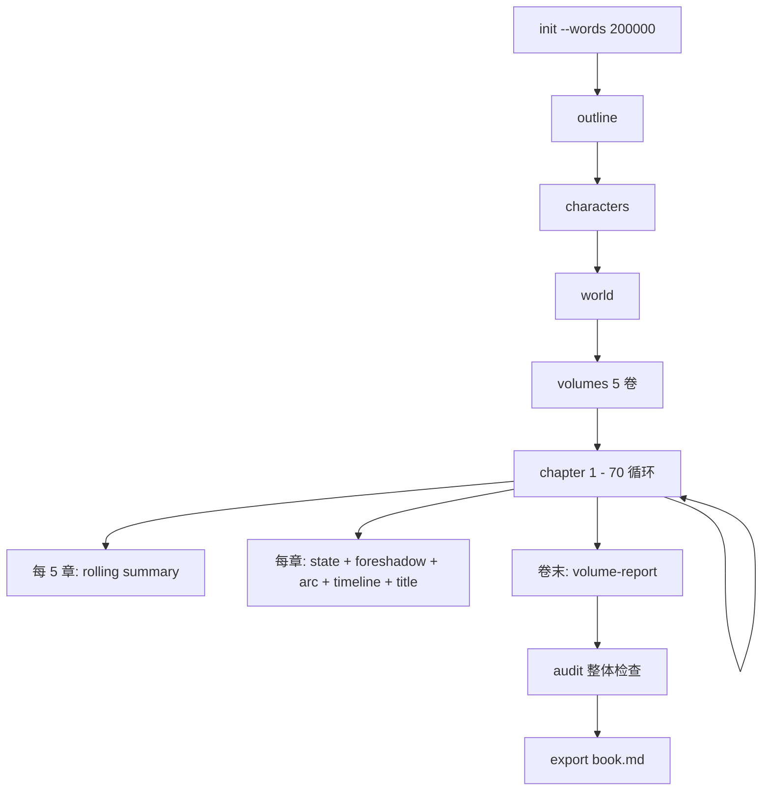
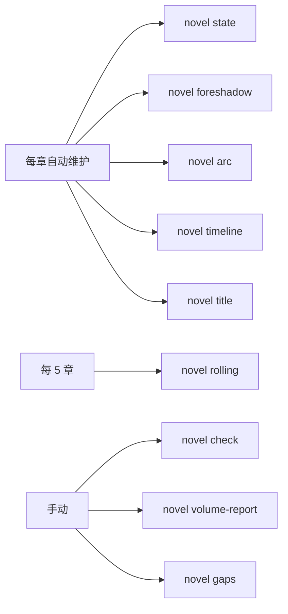

# 用户手册（User Manual）

novel-writer v0.11 的完整使用指南。

---

## 目录

1. [快速开始](#1-快速开始)
2. [安装与配置](#2-安装与配置)
3. [新手教程](#3-新手教程)
4. [命令详解](#4-命令详解)
5. [常见工作流](#5-常见工作流)
6. [故障排查](#6-故障排查)
7. [FAQ](#7-faq)

---

## 1. 快速开始

5 分钟跑通第一个长篇：

```bash
# 1. 安装
pip install -e .

# 2. 配置（首次会问 API key）
novel setup

# 3. 创建项目
novel init my_novel \
  --title "冬夜的灰" \
  --theme "1995 年东北小镇的命案与四个孩子" \
  --genre 悬疑 \
  --style 冷峻 \
  --words 60000

# 4. 写小说
cd my_novel
novel outline
novel chapter 1
novel chapter 2
novel chapter 3
```

---

## 2. 安装与配置

### 2.1 系统要求

- Python 3.10+
- pip
- 任意 OpenAI Chat Completions 协议 API（minimax 默认）

### 2.2 安装步骤

```bash
git clone <repo> ai-novel
cd ai-novel
pip install -e .

# 开发版（含测试 / lint）
pip install -e ".[dev]"
```

### 2.3 配置 API

#### 方式 A：交互式向导（推荐）

```bash
novel setup
```

依次输入：
- API base URL（默认 `https://api.minimaxi.com/v1`）
- API key（密码隐藏输入）
- 模型名（默认 `minimax-Text-01`，可选 `minimax-M3` 推理模型）
- temperature（默认 0.9）
- 目标章节字数（默认 3000）
- 是否开启 DRY_RUN

#### 方式 B：手动复制 .env

```bash
cp .env.example .env
# 编辑 .env 填入真实 key
```

#### 方式 C：环境变量

```bash
export OPENAI_BASE_URL="https://api.minimaxi.com/v1"
export OPENAI_API_KEY="your-key"
export OPENAI_MODEL="minimax-Text-01"
```

### 2.4 切换模型

```bash
# 临时切换
novel config --base-url https://api.openai.com/v1 --model gpt-4o

# 写入 .env
novel config --api-key xxx --model gpt-4o

# 完全重写配置
novel setup --force
```

---

## 3. 新手教程

### 教程 1：写一个 3 万字的短篇


```bash
# 第 1 步：创建项目（3 万字 ≈ 10 章）
novel init short_story \
  --title "窗台上的橘子" \
  --theme "一个孤独的老人和窗台上的橘子" \
  --genre 现实 --style 诗意 --words 30000

cd short_story

# 第 2 步：生成大纲
novel outline

# 第 3 步：生成人物
novel characters

# 第 4 步：逐章写
novel chapter 1    # ~3000 字
novel chapter 2
novel chapter 3
novel chapter 4

# 第 5 步：润色
novel polish 1 --extra "加强老人独白"

# 第 6 步：导出
novel export
# 生成 book.md
```

### 教程 2：写一个 20 万字的长篇



```bash
# 第 1 步：创建项目
novel init my_book --title "百年孤影" \
  --theme "东北百年家族四代人" --genre 现实 --style 冷峻

# 第 2 步：完整规划
novel outline         # 60-70 章大纲
novel characters      # 主要人物 + 关系
novel world           # 世界观
novel volumes         # 5 卷分卷

# 第 3 步：连续写
novel chapter 1
novel chapters 5 6 7  # 跳号写
novel write -s 8 -e 15  # 连续写

# 第 4 步：长篇机制自动维护
# 每章写完会自动：
#   - state.md：最近 3 章压缩
#   - rolling_summary.md：每 5 章
#   - foreshadowing.md：伏笔簿
#   - arcs/_overview.md：人物弧线
#   - timeline.md：故事内时间
#   - titles.json：章节标题

# 第 5 步：跨章一致性
novel check           # 自动检测人物名 / 时间 / 地点漂移
novel gaps            # 伏笔状态表
novel volume-report --volume 1  # 第 1 卷卷末报告

# 第 6 步：导出
novel export          # → book.md
```

### 教程 3：写网文

```bash
# 一键创建网文项目
novel webnovel-pack cultivation \
  --title "凡人修仙传之xxx" \
  --theme "凡人韩立逆袭成仙" \
  --genre 修仙 --style 经典爽文 \
  --idea "金手指：残破玉佩"

cd cultivation

# 网文项目黄金三章流程
novel chapter 1    # 困境：主角被压迫
novel chapter 2    # 觉醒：金手指出现
novel chapter 3    # 打脸：第一次装逼

# 后续：升级小高潮
novel write -s 4 -e 15   # 4-15 章升级流
```

### 教程 4：改编高热度小说

```bash
# 准备：把源小说信息保存到 source.txt
cat > source.txt << 'EOF'
《白夜行》
作者：东野圭吾
题材：推理 / 悬疑
核心冲突：桐原亮司与西本文代的孩子在废弃大楼发生命案，
          两个家庭的孩子走上共生关系。
EOF

# 改编
novel adapt \
  --source source.txt \
  --direction 换名+换壳 \
  --genre 校园 --style 冷峻 \
  --title "夜行"

# 结果保存到 .novel/adapt.md
cat .novel/adapt.md
```

### 教程 5：一键全自动（novel auto）


```bash
# 最短的一篇基本流程
cd ~/novels
novel auto my_novel \
  --title "冬夜的灰" \
  --theme "1995 年东北小镇的命案与四个孩子" \
  --genre 悬疑 \
  --style 冷峻 \
  --words 60000 \
  --quality premium

# Ctrl-C 之后续跑：
cd ~/novels
novel auto my_novel --title "冬夜的灰" ...   # 自动从上次中断处继续
```

参数速查：

| 参数 | 含义 |
|------|------|
| `-t, --title` | 小说标题（必填）|
| `--theme` | 一句话主题 |
| `-g, --genre` | 题材（默认 "现实 / 严肃文学"）|
| `-s, --style` | 文风（预设名或自由描述）|
| `-w, --words` | 目标总字数 |
| `--chapters` | 显式指定章节数（与 --words 二选一）|
| `--quality` | draft / standard / premium（默认 standard）|
| `--budget` | 成本上限 CNY（0=不限）；超额自动降级 |
| `--resume` | 强制续跑（默认自动检测）|
| `--fresh` | 强制从头跑（覆盖旧进度）|
| `--dry-run` | DRY_RUN 模式：不调 API |
| `--here` | 就地初始化（跳过 NAME）|

实时显示（终端）：

```text
⠼ 第 5 章：质量门控    ━━━━━━━━━━ 5/20  token 142,318 | ¥0.142  00:03:21
```

跑完后看汇总表：

```text
novel auto 汇总
  指标               值
  总章节             20
  已完成             20
  未达标             2
  累计字数           58,234
  累计 token         2,846,360
    输入/输出 token   2,130,200 / 716,160
  估算成本           ¥2.846
  用时               0:42:18
  输出               /home/.../book.md
```

质量档差异：

| 档 | 章节迭代 | 字数容差 | AI 味阈值 | 雷达阈值 | 适合 |
|---|---|---|---|---|---|
| draft | 1 | ±30% | 跳过 | 跳过 | 网文冲量 |
| standard | 2 | ±20% | < 50 | ≥ 60 | 一般场景 |
| **premium** | **3** | **±10%** | **< 30** | **≥ 70** | **严肃向** |

**可恢复 + 自动续跑**：
- 每章写完即保存到 `.novel/auto_state.json`
- Ctrl-C 后下次跑 `novel auto` 自动从中断处继续
- 失败的章节保留最后一次输出（占位草稿），可后续 `novel chapter N` 手动重写

---

## 4. 命令详解

### 4.1 基础命令

#### `novel init`

```bash
novel init <name> [options]

选项：
  --title, -t        小说标题
  --theme            一句话主题
  --style, -s        文风（预设名 / 自由描述）
  --words, -w        目标总字数（默认 30000）
  --genre, -g        题材（默认"现实 / 严肃文学"）
  --here             就地初始化（当前目录）
```

#### `novel setup`

```bash
novel setup [--force] [--no-input]

交互式生成 .env。
--force 覆盖已有 .env。
--no-input 用现有 env 变量生成（适合脚本）。
```

#### `novel doctor`

```bash
novel doctor [--fix] [--json]

诊断项目完整性。
--fix 自动修复占位文件。
--json 机器可读输出。
```

#### `novel status`

```bash
novel status

显示项目元数据、章节列表、字数。
```

#### `novel config`

```bash
novel config [--base-url URL] [--model MODEL] [--api-key KEY] [--dry-run/--no-dry-run]
```

### 4.2 规划命令

| 命令 | 作用 |
|---|---|
| `novel outline [--genre/-style/-words/-extra] [--save/--print]` | 生成 / 重写大纲 |
| `novel characters [-e] [--save/--print]` | 生成 / 扩展人物志 |
| `novel world` | 生成世界观 |
| `novel volumes` | 长篇分卷 |
| `novel plan N` | 细化第 N 章大纲 |

### 4.2.5 Web 仪表盘（novel serve）

跑 `novel auto` 跑半天，开浏览器看实时进度：

```bash
# 另开一个终端
cd ~/novels/my_novel
novel serve         # 默认 http://127.0.0.1:8765
# 或在 auto 跑时一并启动
novel auto my_novel --title "..." --serve  # auto 启动后台仪表盘
```

仪表盘（4 张卡片 + 1 张章节表 + 4 个按钮）：进度 / 字数 / Token / 成本。控制按钮：暂停 / 继续 / 降级 / 停止。控制信号写到 `.novel/auto_control.json`，每章写完后检查。

### 4.2.6 终端 watch（不开浏览器）

不想开浏览器？直接：

```bash
novel status --watch              # 完整项目状态
novel status --watch --auto       # 只看 auto 进度 + 成本
novel status --watch --interval 5  # 自定义刷新间隔（秒）
```

表格每 2 秒重画（rich.live），Ctrl-C 退出。

不需要浏览器 + 不需要单独终端——直接在跑 `novel auto` 的终端按 Ctrl-Z 挂起、`fg` 恢复，或者开第二个终端。

### 4.3 写作命令

```bash
novel chapter N [--words W] [--iters I] [--extra E]

写第 N 章。
- 默认 2 轮迭代（生成→检测→审稿→润色）
- --no-polish 跳过润色
- 自动维护 state/foreshadow/arc/timeline/title

novel write --start S --end E [--words W] [--no-polish]

连续写 S-E 章。

novel sprint [--count N] [--until N] [--words W]

从最后一章后自动写 N 章。

novel continue N [--with '意图'] [--words W]

在第 N 章末尾接写一段。
```

### 4.4 润色命令

| 命令 | 作用 |
|---|---|
| `novel polish N [--extra]` | 对第 N 章润色 |
| `novel detect N [--save]` | 检测 AI 味 |
| `novel radar N` | 风格雷达 |
| `novel batch <action>` | 批量处理 |

### 4.5 一致性命令



### 4.6 多项目管理

```bash
# 列出所有项目
novel list [--path /] [--depth N]

# 查看项目信息（不 cd）
novel info <name>

# 当前所在项目
novel whereami
```

### 4.7 改编 / 网文

```bash
# 改编
novel adapt --source FILE --direction D --genre 悬疑 --style 冷峻 --title 新名

# 同人 / 后传
novel fanfic --source FILE --char 主角 --era 后传 --as-chapter 1

# 网文包
novel webnovel-pack NAME --title T --theme S --genre 修仙 --style 经典爽文
```

### 4.8 版本与导出

```bash
# 查看历史
novel history

# 对比两版
novel diff <N> [--from current] [--to v1]

# 回滚
novel rollback <N> --to vN [--yes]

# 修复异常章节
novel fix <N> [--no-dry --yes]

# 自动重写残片
novel retry-stuck [--threshold 100] [--iters I]

# 导出书稿
novel export [--format md/txt] [--output FILE]
```

---

## 5. 常见工作流

### 5.1 短篇：1 天写完

```bash
# 早上（30 分钟）
novel init short --title "..." --words 30k
novel outline
novel characters

# 下午（2 小时）
for i in 1 2 3 4 5 6 7 8 9 10; do
  novel chapter $i --no-polish   # 先不润色，速度优先
done

# 晚上（1 小时）
novel batch polish --start 1 --end 10   # 批量润色
novel polish 5 --extra "强化结尾的余韵"
```

### 5.2 长篇：1 周出 70%

| 天 | 工作 | 命令 |
|---|------|------|
| 周一 | 规划 | `outline / characters / world / volumes` |
| 周二-周四 | 写 1-25 章 | `novel chapter N` 或 `sprint --count 5` |
| 周五 | 检查 | `novel check / gaps / audit` |
| 周末 | 润色关键章 | `novel polish 1 --5 35 70` |

### 5.3 长篇：与 LLM 来回协作

```bash
# 写第 5 章不满意？
novel chapter 5         # 生成
novel chat 5 '对话太干瘪，加强小红的心理戏'   # 自然语言改
novel chat 5 '加一段她在厨房洗碗的回忆'

# 章节末尾接场景
novel continue 5 --with '小红回到房间，发现一封信'

# 在指定位置接场景
novel expand-scene 5 --after '她推开那扇门' --with '门后是一个陌生男人'
```

### 5.4 多本并行

```bash
# 同时管 3 本
novel list --path ~/novels
# ┏━━━━━━┳━━━━━━┳━━━━━━━━━━━━━━━━┓
# ┃ 标题 ┃ 题材 ┃ 字数目标      ┃
# ┡━━━━━━╇━━━━━━╇━━━━━━━━━━━━━━━━┩
# │ 灵瓶   │ 修仙 │ 200K          │
# │ 夜行   │ 悬疑 │ 100K          │
# │ 灰烬   │ 现实 │ 80K           │
# └──────┴──────┴────────────────┘

# 快速进入某一本
cd $(novel info ~/novels/灵瓶 | grep 路径)  # 或手动 cd
```

### 5.5 改编工作流

```bash
# 第 1 步：提取骨架
novel adapt -i source.txt --direction 换名 --genre 校园 --style 冷峻 \
  --title 新名 --no-save --print > skeleton.md

# 第 2 步：检查骨架
cat skeleton.md

# 第 3 步：基于骨架生成完整改编方案
novel adapt -i source.txt --direction 换名 --genre 校园 --style 冷峻 \
  --title 新名

# 第 4 步：用方案生成完整大纲
novel outline

# 第 5 步：开始写
novel chapter 1
```

---

## 6. 故障排查

### 6.1 找不到项目目录

```
Error: 未找到 .novel 项目目录。
```

**解决**：
- 如果还没建项目：`novel init <name>`
- 如果已建项目：`cd` 进入项目根目录
- 想就地建：`novel init . --here`

### 6.2 API 调用失败

```
LLMError: api 401: ... invalid api key
```

**解决**：
```bash
novel config --api-key "your-real-key"
# 或
novel setup --force
```

### 6.3 章节空白

```
第 5 章字数 0 异常
```

**解决**：
```bash
novel retry-stuck --iters 2  # 自动重写
# 或手动
rm .novel/chapters/0005.md && novel chapter 5
```

### 6.4 think 残片污染

```
第 3 章包含未剥 think 标签
```

**解决**：
```bash
novel fix 3  # 检测 + 建议
rm .novel/chapters/0003.md && novel chapter 3
```

### 6.5 跨章人物名漂移

```
novel check 发现：陈小军 vs 霍小军（0003 章用错名）
```

**解决**：编辑冲突章节，统一用名。或者用：
```bash
novel chat 3 '把"陈小军"全部改成"霍小军"'
```

### 6.6 长 prompt 超时

```
LLMError: chat failed after retries: timeout
```

**解决**：
- 切换网络环境
- 用 `REQUEST_TIMEOUT=300 novel chapter N` 延长超时
- 减小 `TARGET_CHAPTER_WORDS=2000`

---

## 7. FAQ

### Q1：必须用 minimax 吗？

**A**：不是。任意 OpenAI Chat Completions 协议都行。

```bash
# OpenAI
OPENAI_BASE_URL=https://api.openai.com/v1
OPENAI_MODEL=gpt-4o

# DeepSeek
OPENAI_BASE_URL=https://api.deepseek.com/v1
OPENAI_MODEL=deepseek-chat

# 通义千问
OPENAI_BASE_URL=https://dashscope.aliyuncs.com/compatible-mode/v1
OPENAI_MODEL=qwen-long
```

### Q2：一章默认多少字？

**A**：3000 字（在 `.env` 中用 `TARGET_CHAPTER_WORDS` 配置）。
模型会按目标字数的 75% 到 95% 输出，宁可少写不灌水。

### Q3：怎么让小说更像某个作家？

**A**：
```bash
# 方式 1：--style 致敬
novel init . --style "致敬汪曾祺《受戒》，短句、留白、淡墨"

# 方式 2：samples 目录放手写片段
mkdir .novel/samples/
cat > .novel/samples/01.md << 'EOF'
（贴一段你喜欢的作家作品，200-1500 字）
EOF
```

模型写每章时会自动随机抽 1-2 段作为风格参考。

### Q4：怎么扩展提示词？

**A**：
1. 编辑 `prompts/<name>.md`（项目级或全局）
2. 新增提示词：在 `prompts/<new>.md` 添加 + `novel/prompts.py` 加 `lru_cache` 加载

### Q5：项目数据能 git 追踪吗？

**A**：可以！但要加 `.gitignore`：
```
.env
.novel/chapters/   # 可选，体积大
.novel/history/    # 可选
```

推荐追踪：`.novel/outline.md` / `.novel/characters.md` / `.novel/style.md` / `.novel/project.yaml`

### Q6：能写英文小说吗？

**A**：可以，但 `de_ai_flavour.md` 默认针对中文。改提示词 + 用英文模型。

### Q7：怎么减少 API 费用？

| 方法 | 节省 |
|---|---|
| 用 DRY_RUN 调试 | 100%（不调 API） |
| 减小 `TARGET_CHAPTER_WORDS` | 50% |
| 用更便宜的模型（DeepSeek） | 80% |
| 调高 `TEMPERATURE` 让模型一次到位 | 减少迭代 |
| 跳过审稿 (post-check / no-polish) | 33% |

### Q9：能多人协作吗？

**A**：通过 git 协作。建议：
- 把项目根目录推到 GitHub
- 每人本地一个 `.env`
- 章节是文本文件，可 diff / merge
- 自动备份到 `history/` 防误覆盖

### Q10：能写剧本 / 漫画脚本吗？

**A**：可以，但需要自己改 `chapter.md` 的输出模板。建议：
1. 复制 `prompts/chapter.md` 为 `prompts/script.md`
2. 修改输出格式要求
3. 加一个 `novel script` 命令调用 `build_script_messages`

---

## 附录 A：完整命令速查（46 个）

| 类别 | 命令 |
|------|------|
| 基础 | `init / status / config / setup / version / doctor / list / info / whereami / templates / prompt` |
| 规划 | `outline / characters / world / volumes / plan` |
| 写作 | `chapter / write / sprint / continue / chat / expand-scene / webnovel-pack / adapt / fanfic` |
| 润色 | `polish / detect / radar / batch` |
| 一致性 | `state / rolling / foreshadow / arc / timeline / check / volume-report / title / gaps / index` |
| 版本 | `history / diff / rollback / fix / retry-stuck / audit / export` |
| 查询 | `genres / styles / webnovel-genres / webnovel-styles` |

## 附录 B：相关文档

- [REQUIREMENTS.md](REQUIREMENTS.md) - 需求规格
- [DESIGN.md](DESIGN.md) - 设计文档
- [BEST_PRACTICES.md](BEST_PRACTICES.md) - 最佳实践
- [PROGRESS.md](../PROGRESS.md) - 演进日志
- [CHANGELOG.md](../CHANGELOG.md) - 版本日志
- [CONTRIBUTING.md](../CONTRIBUTING.md) - 贡献指南